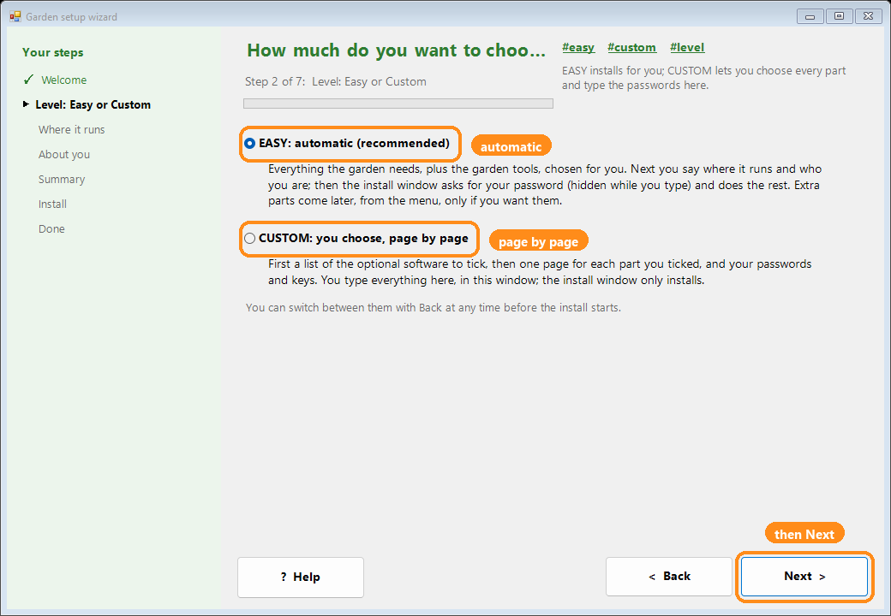
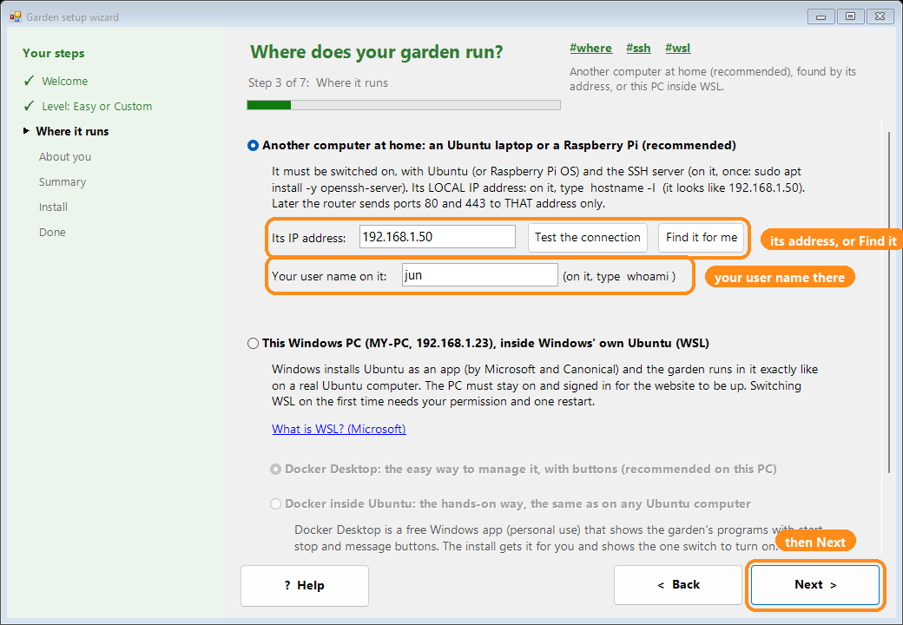
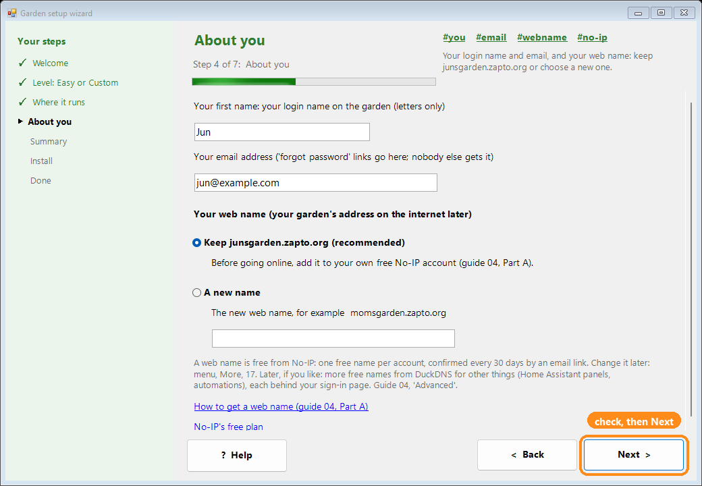
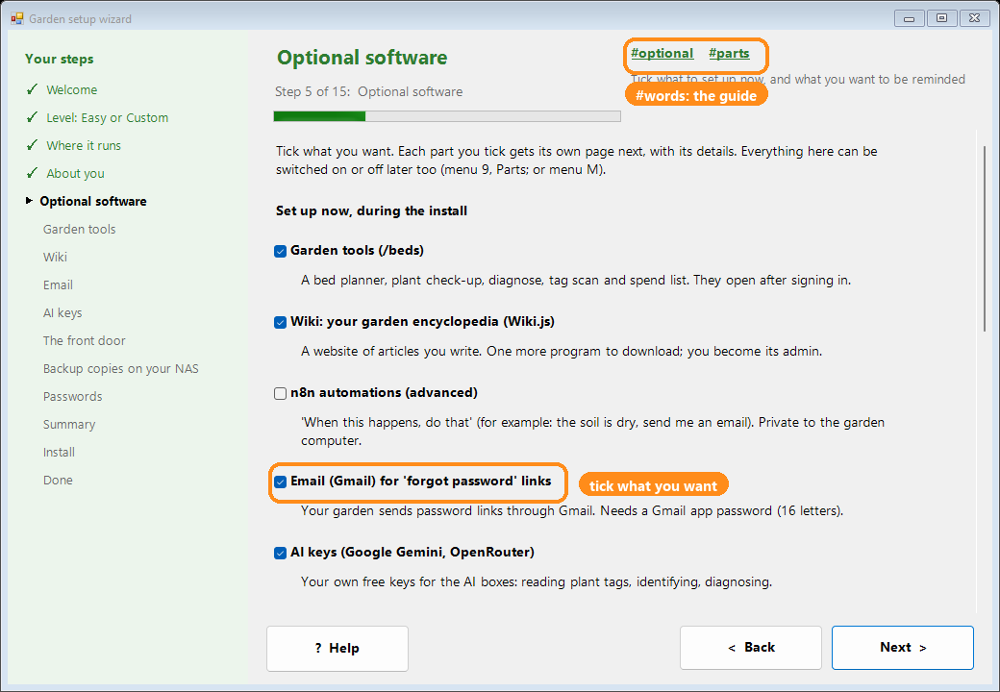
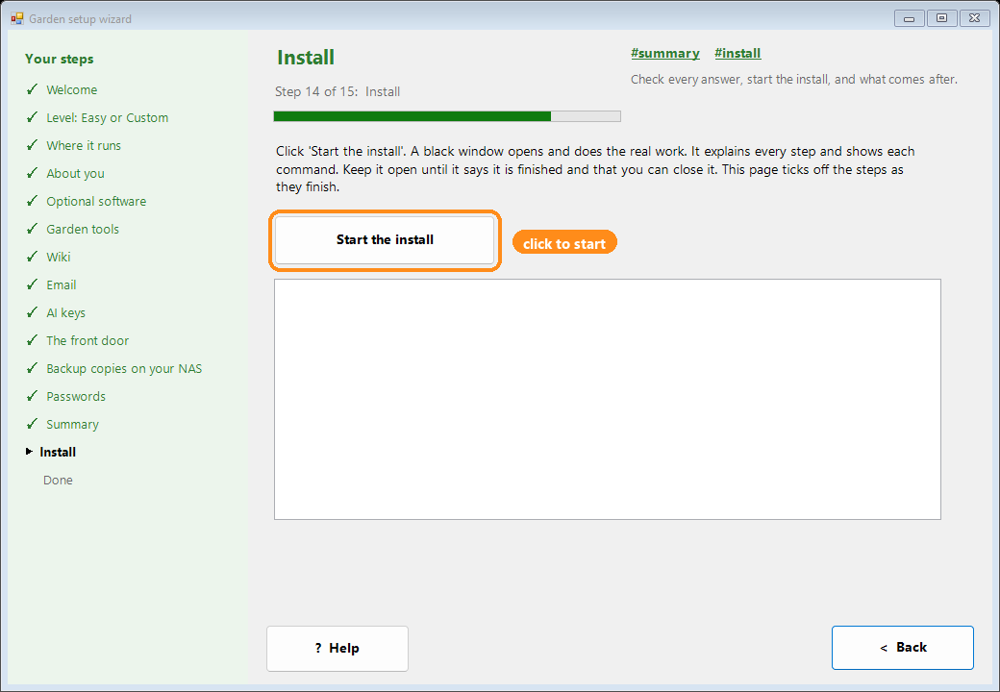
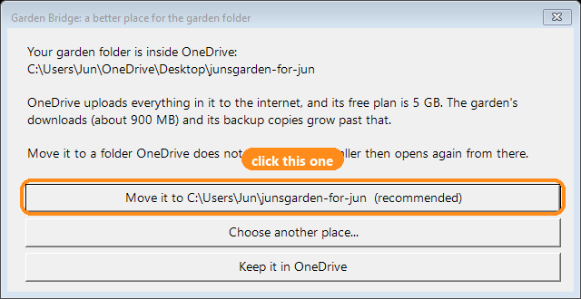
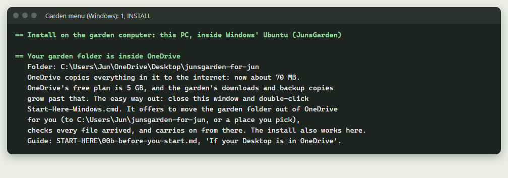

# 00b. Before you start: what you need, what to sign up for, and how long it takes

No surprises: everything you will need is on this page, sorted into
**necessary** and **optional**, with how long each part usually takes.
Nothing has to be done in one go. Every step can be stopped and carried on
later, and the menu remembers where you were.

## Why it is built this way (a note from Jason)

I chose the automatic route so you can have your own Linux web server without
the steep learning curve. The setup does the work and explains every step as it
goes, so it stays easy, and Custom lets you choose every part yourself. It is
designed to be done in parts: stop, come back, carry on. Later you can move the
main folders (menu 8, then 8; guide 26) and choose your own web name (the Website name swap).

It is built to protect your home network and your computer. Only the front door
(Caddy) is reachable from the internet, and only on the two web ports. Everything
else listens on the garden computer alone. The firewall is on, nobody has a
built-in account, and every password and key is made new on your computer. I
followed every best practice I could within a home budget, to keep what is
exposed to the internet as small as possible.

This is now your project.

## Easy or Custom?

The install asks this once. Both use the same 14 numbered steps.

| | **1) EASY** (recommended) | **2) CUSTOM** |
|---|---|---|
| Questions | Your name, email, database password (Enter = made for you), keep the web name or choose a new one. At the end: your password, email (Gmail, optional) and your AI keys | The same, plus each optional part, one by one, and which step to start at |
| Installs | Everything necessary, plus the garden tools | What you choose: garden tools (default Yes), wiki (default No), n8n (default No) |
| Photos | Loaded by itself, when the photos download is there | You choose: now, or later (menu 6, then 11) |
| Wiki | Off. Switch it on any time (menu 9) | Asked (default No) |

Either way you can add or remove parts later (guide 19 lists every option).

## What you need: necessary

| What | Why | Time |
|---|---|---|
| **A garden computer** that can stay on: an Ubuntu laptop (tested), this Windows PC with Windows' own Ubuntu (tested; for using the garden on this PC only, see below), or a Raspberry Pi 5 (tested on 64-bit Raspberry Pi OS; it needs good cooling, a fan, because it gets hot while the website is built) | The garden runs on it | Laptop: 2 to 3 hours to put Ubuntu on it the first time (guide 01). A Pi 5 with its starter kit: about 1 hour. Windows: set up by the installer (one restart) |
| **Free disk space**: about 60 GB on an Ubuntu laptop; on Windows, about 60 GB free on C: | Docker, the website, the photos, and the automatic backups (about a week of them; about 6 GB together) | Nothing to do; just check before you start |
| **A USB stick, 16 GB or larger** (only to put Ubuntu on a laptop) | To install Ubuntu (it is erased) | Included in the 2 to 3 hours |
| **The three downloads** from the Google Drive folder | The garden (about 5 MB; the first start then gets the program from GitHub, about 75 MB), the photos (about 800 MB), the wiki pages (under 1 MB; only if you want the wiki) | Garden: 1 to 2 minutes. Photos: about 2 minutes on fast internet, 15 to 20 minutes on slow internet |
| **The install** (menu 1) | Puts everything together | 30 to 90 minutes, mostly waiting. Each step shows its own time. The longest step, building the website, takes 15 to 45 minutes (up to an hour on a very old laptop or a Pi) |
| **Your password** for the garden | Your login, and your sign-in page | 1 minute |

**No sign-ups are needed to install.** Your garden works at home without any
account anywhere.

### Good to know before the install starts
- **Right after a fresh Ubuntu install**, Ubuntu updates itself in the
  background for 10 to 30 minutes. If step 3 of the install (Ubuntu updates
  and tools) says it cannot
  install, wait 15 minutes and choose `1` again: it carries on.
- **After the long build** (building the website) it may ask for your Ubuntu
  password again. Nothing happens until you type it, so check the window now
  and then.

### On a Windows PC (the garden inside Windows' own Ubuntu, WSL)

Every page, and what to answer: [guide 23, The setup wizard on Windows](23-full-setup.md#help-wizard).

- **What it is for:** using the garden on this PC itself. Putting the garden on
  the internet, and showing it to phones and other computers at home, does not
  work from Windows' own Ubuntu as the guides describe: it has its own internal
  address inside the PC that the router and your phones cannot reach. For those,
  use a separate garden computer (an Ubuntu laptop or a Raspberry Pi). To learn
  more, Microsoft explains WSL's networking here (reading only; the garden does
  not set it up): <https://learn.microsoft.com/windows/wsl/networking>
- **Which Docker (the "Where it runs" page):** **Docker Desktop**, the easy way: a Windows app with
  buttons that shows the garden's programs, starts with Windows, and is free for
  personal use. The installer gets it for you and waits for one switch (Settings >
  Resources > WSL integration: `JunsGarden` on). Or **Docker inside Ubuntu**, the
  hands-on way: the same as on any Ubuntu computer. Guide 26 compares them.
- **One restart:** the first time, Windows asks permission to switch WSL on and
  needs one restart. After the restart, double-click `Start-Here-Windows.cmd`
  again and click through the same pages: it carries on where it stopped.
- **Your Ubuntu user name and password:** it asks you to choose an Ubuntu user
  name (for example `jun`) and a password, typed twice (nothing shows while you
  type). Write them down. It asks for that password again right after.
- **Download:** Ubuntu for WSL downloads several hundred MB.
- **If WSL does not start after the restart:** virtualization may need to be
  switched on in the PC's BIOS. Microsoft's help:
  <https://learn.microsoft.com/windows/wsl/troubleshooting>
- **The PC must not sleep**, or the garden stops: Settings, System, Power,
  Sleep = **Never**.
- **About 60 GB free on C:** (see the table above).

### If your Desktop is in OneDrive

On many Windows 11 PCs the Desktop, Documents and Pictures folders live inside
**OneDrive**. OneDrive is Microsoft's online storage: it uploads (copies to the
internet) everything in its folders. You can tell by the folder's path in File
Explorer: it has `OneDrive` in it, for example
`C:\Users\Jun\OneDrive\Desktop\junsgarden-for-jun`.

That is a problem for the garden. OneDrive's free plan holds **5 GB**. The
garden's downloads are about 900 MB, and its backup copies grow past 5 GB, so
OneDrive soon fills up and keeps uploading large files for nothing.

So when you double-click `Start-Here-Windows.cmd` and the garden folder is
inside OneDrive, a small window opens first, before the installer's pages:

- **Move it to `C:\Users\<you>\junsgarden-for-jun` (recommended):** the garden
  folder goes into your own user folder (`<you>` is your Windows user name),
  which OneDrive does not upload. Choose this one.
- **Choose another place...:** a folder window opens. A `junsgarden-for-jun`
  folder is made inside the place you pick. A place inside OneDrive is refused.
- **Keep it in OneDrive:** nothing moves, and the installer opens as usual.
  Closing the small window does the same.

What **Move** does, step by step:
1. It copies every file into the new folder. If that folder already has
   something in it, it stops and moves nothing.
2. It counts the files in both places to check every one arrived. If any are
   missing, it says so and the old folder stays as it was.
3. If the photos and wiki zips (`junsgarden-photos-addon.zip`,
   `junsgarden-wiki-addon.zip`) are on a OneDrive Desktop, it moves them into the
   new folder too.
4. If you had already set up the garden's automatic jobs on this PC (the
   weekly backup copy, "keep running"), it points them at the new folder, so
   they keep working after you delete the old one.
5. It puts a **Garden folder** shortcut on your Desktop, so the new folder is
   easy to find.
6. It says "Done" and opens the installer again from the new place. Carry on
   there.

**The old folder is never deleted for you.** It stays in OneDrive until you
delete it yourself. After the install has finished, right-click the old
`junsgarden-for-jun` folder in OneDrive and choose **Delete** to free the space.
(The **Garden folder** shortcut leads to the new one, which you keep.)

> **Why let the installer move it, not File Explorer?**
> Dragging a folder by hand moves the files one by one, with no check at the end.
> If it stops halfway, some files are in each place and nothing tells you. The
> installer copies instead: it checks that every file arrived before it opens
> from the new place, and it leaves the old folder untouched. If anything goes
> wrong, the old folder is still complete, so you can simply carry on with it.

The Windows menu (`Garden-Menu-Windows.cmd`) reminds you too. If the garden
folder is inside OneDrive, **INSTALL** (menu `1`) shows how much is there and
points back to this section. The install also works from OneDrive; the note is
only a warning:

The photos and wiki zips are found in the garden folder, on the Desktop (also a
OneDrive Desktop) or in Downloads. The install sends them straight to the
garden computer from there; no extra copy is made on the PC.

## To put the garden on the internet: necessary for that step only

This needs a separate garden computer (an Ubuntu laptop or a Raspberry Pi), not
Windows' own Ubuntu on a Windows PC (see "On a Windows PC" above).

| What | Why | Time |
|---|---|---|
| **A free No-IP account** with your web name, and its **DDNS key** (guide 04, Part A) | Keeps your web name pointing at your home | About 10 minutes, plus confirming the email No-IP sends. A free name is confirmed every 30 days (No-IP emails a link) |
| **Your router's admin page** and its password (on a sticker on the router, or from your internet company) | To reserve the garden computer's address and forward ports 80 and 443 to it (guide 14) | 15 to 30 minutes |
| **The front door step** (menu M, then 1) | Caddy, your sign-in page, the No-IP updater | 15 to 30 minutes |

## Strongly recommended

| What | Why | Time |
|---|---|---|
| **A Gmail just for your website** (recommended, free): <https://accounts.google.com/signup> | One account for everything the website needs: it sends the password emails, keeps the Google Drive backups and the AI key, and signs in to Tailscale, DuckDNS and No-IP (they offer "Sign in with Google"). Your personal inbox stays apart, and handing the website on later means handing on one account | About 10 minutes |
| **A Gmail app password** (needs 2-Step Verification on your Google account) | So "forgot password" emails reach you. You only need to remember one password; if you forget it, a reset email comes straight to you (the website and the sign-in page each send their own; menu U then 5 sets both to the same new one again) | 5 minutes (10 if 2-Step Verification is not on yet) |
| **A password manager**, or a notebook kept somewhere safe | For the keys and passwords below | 5 minutes |

## Plan your website's name and email (10 minutes, on paper)

**1. A name.** Short, easy to say on the phone, lowercase letters, numbers and `-`
only, for example `momsgarden`. It becomes your web name (`momsgarden.zapto.org`,
guide 04) and, if it is free, your website's Gmail (`momsgarden.site@gmail.com`).
Check both are free before you decide.

**2. An email.** Three choices; each works:

| Choice | Good | Less good |
|---|---|---|
| Your own email | Nothing new to make | The website's mail mixes with yours; handing the website on later is harder |
| One you already use for sign-ups (or spam) | Keeps your main inbox quiet | Easy to miss the important mails (password links, No-IP's 30-day email) |
| **A new Gmail just for the website** (recommended): <https://accounts.google.com/signup> | Everything in one place, apart from your own mail; easy to hand on | One more password (keep it in your password manager) |

**3. One Gmail, many addresses ("plus addresses").** Gmail delivers
`momsgarden.site+noip@gmail.com` to `momsgarden.site@gmail.com`: add `+` and any word
before the `@`. Give each service its own word when you sign up:

| Service | Sign up with |
|---|---|
| No-IP (web name) | `momsgarden.site+noip@gmail.com` |
| DuckDNS, Tailscale | `momsgarden.site+duckdns@gmail.com`, `momsgarden.site+tailscale@gmail.com` |
| Google AI Studio, OpenRouter | `momsgarden.site+ai@gmail.com` |

The "To" line of each email then shows which service it came through, and spam to
`+noip` tells you who passed your address on. To sort them for you: in Gmail, the
search box, **Show search options**, type the address under **To**, **Create filter**,
then choose a label (for example "No-IP"). Google's steps:
<https://support.google.com/a/users/answer/9308648> and <https://support.google.com/mail/answer/6579>.

Good to know:
- A few websites refuse a `+` in an address; then use the plain one.
- Someone can remove the `+word`, so it tells you where an address leaked, but does not hide it.
- Dots do not matter in Gmail (`momsgarden.site` = `momsgardensite`):
  <https://support.google.com/mail/answer/7436150>.
- The Gmail app password (menu `M`, `3`) belongs to the plain address: type that one there.
- The garden's own sign-in is always your garden password, never this email account.

## Optional (only if you want them)

| What | What it gives you | Time |
|---|---|---|
| A **Gemini key** (Google AI Studio, free) | The AI boxes: reading plant tags, plant facts (guide 16) | 2 minutes |
| An **OpenRouter key** (free) | A backup for when Gemini is busy | 5 minutes |
| A **Perenual key** (free) | Plant facts in the plant admin | 5 minutes |
| The **wiki** (menu 9) | Your garden encyclopedia | 5 minutes, plus about 30 minutes while the pages go in |
| **DuckDNS** (free) | More addresses for other things, such as Home Assistant (guide 04, Advanced) | 5 minutes |
| A **NAS** (network drive) | A second copy of every backup (guide 13) | 10 to 20 minutes |
| **Google Drive backups** with your own Google client ID | A copy away from home (guide 13) | 15 minutes |
| **SSH keys and Remote Desktop** | Work on the garden computer from another room (guide 20) | 10 to 20 minutes |
| **Local AI** on a desktop with a graphics card | AI without the internet (guide 15) | 30 to 60 minutes |

## Write these down (keep them in a password manager)

| What | Where you find it |
|---|---|
| The garden computer's **user name** and its **password** | You choose them when installing Ubuntu (or, on Windows, when the installer sets up Windows' own Ubuntu). Explained in [START-HERE/00-READ-ME-FIRST.md, section "Three names for one computer"](00-READ-ME-FIRST.md#three-names-for-one-computer-people-mix-these-up-all-the-time) |
| Its **computer name** (host name) | Ubuntu: Settings, System, About ("Device Name"). Also shown by menu M, then 2 (Network) |
| Its **local IP address** (looks like 192.168.1.50) | Ubuntu: Settings, Wi-Fi (or Network), the gear next to your connection, "IPv4 Address". Or menu M, then 2. Or on a Windows PC: the installer's **Find it for me** button |
| Your **router's address and password** | The sticker on the router |
| Your **garden password** | You choose it at the end of the install |
| The **wiki admin password** (only with the wiki) | You choose it when the wiki is set up |
| Your **No-IP DDNS key** (username and password) | No-IP, Dynamic DNS, DDNS Keys |
| Your **Gmail app password** | myaccount.google.com, Security, App passwords |
| Your **AI keys** | Their own pages (guide 16) |

Ubuntu has no separate "root password": when the computer asks for a password to
make a change (`sudo`), it means **your own** Ubuntu password.

## Ports: what is opened, and where

| Port | What | Open to |
|---|---|---|
| 80 and 443 | The front door (web) | The internet, only after the front door step, and only these two in the router |
| 22 | SSH (working from another computer) | Your home network only |
| 3389 | Remote Desktop, if you switch it on (guide 20) | Your home network only; never forwarded in the router |
| Everything else (8030 website, 3000 wiki, 9091 sign-in page, the database, ...) | The garden's programs | This computer only |

## A realistic plan

| Sitting | What | Time |
|---|---|---|
| 1 | Put Ubuntu on the laptop (guide 01), or set up the Pi | 1 to 3 hours |
| 2 | Download, then install (Easy) | 1 to 2 hours, mostly waiting (the website build alone: 15 to 45 minutes, up to an hour on a very old laptop or a Pi) |
| 3 | Gmail app password, AI keys (menu K) | 15 minutes |
| 4 | No-IP, router, front door: the garden goes online | About 1 hour |
| Later | Anything optional, one at a time | See the table above |

If you stop in the middle of a sitting, start the menu again and choose `1`:
it shows which steps are done and carries on.
