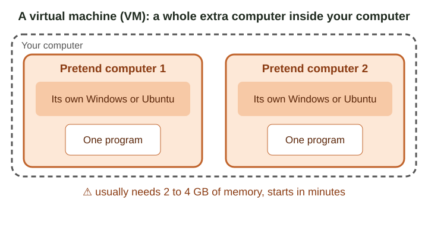
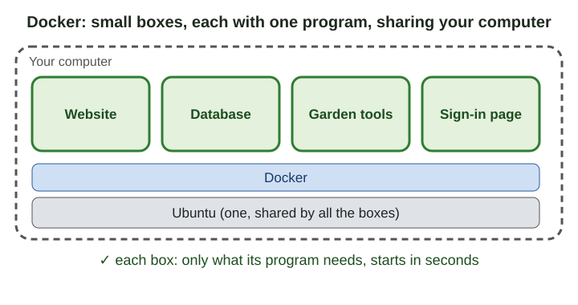

# What is Docker? (just for your information)

## Quick version
*No time to read it all? This is the short version. The full guide is below.*

- Just for your information. You do not need to learn this: the menu does all of it.
- A program needs other files to work. Docker puts each program in a small box with only the files it needs.
- All the boxes share the one Ubuntu that is already on the computer.
- A virtual machine (a whole pretend computer) usually needs 2 to 4 GB of memory and takes minutes to start. A box uses only the memory its program uses and starts in seconds.
- That is why the garden fits on an old laptop or a Raspberry Pi.
- Each box is closed. In your garden, only the front door (Caddy) talks to the internet.
- Your photos and your database are kept in your own folders, outside the boxes.

---

You do not need to learn this. The menu does all of it for you.
This page only explains, in plain words, what Docker is and why the garden uses it.

## A program needs things

A program needs some other files to work.
For example, the garden's website needs a web server and a database.
Those must be on the computer, in the right versions.

There are two common ways to give a program what it needs.

## Way 1: a virtual machine (a "VM")

A virtual machine is a pretend computer inside your computer.
It has its own whole Windows or Ubuntu.
Your program runs inside that pretend computer.

This works. But a pretend computer is big:

- It usually needs 2 to 4 GB of memory, each one.
- It takes minutes to start.
- It needs its own updates, like a real computer.

## Way 2: Docker (small boxes)

Docker puts each program in a small box.
The box has only that program and the files it needs.
All the boxes share the one Ubuntu that is already on the computer.

A box is small:

- It uses only the memory its program uses.
- It starts in seconds.
- To update a program, Docker swaps its box for a new one.

## Why this matters for an old laptop or a Raspberry Pi

An old laptop (for example one that came with Windows 7) has little memory.
A Raspberry Pi has little memory too.

- Several pretend computers would not fit in that memory.
- Several small boxes do fit.

A Raspberry Pi also has a different kind of processor chip (called ARM).
A pretend computer made for an ordinary PC does not run well on that chip.
The main programs the garden uses are made in versions for both kinds of chips.
Docker picks the right version by itself.
So the same garden is made to run on the laptop and on the Pi. (It was tested on ordinary PCs and laptops, and on a Raspberry Pi 5: guide 01.)

An old Windows 7 laptop cannot run Docker itself.
It can get Ubuntu instead (guide 01). Then it can run the garden in boxes.

## Two more good things about the boxes

1. **Each box is closed.** A box can only use what it is given.
   In your garden, only the front door (Caddy) talks to the internet.
   The boxes answer only on this computer.
2. **Nothing is mixed.** Removing a box removes that program completely.
   Your photos and your database are kept in your own folders, outside the boxes.

## Where the boxes come from

Each box starts from an official "image" made by the program's own makers
(for example the database's makers). The list is in `WHAT-GETS-INSTALLED.md`.
The website's box is built on your computer, from the code in this folder.

## If you want to read more (optional)

- Docker's own short explanation: <https://docs.docker.com/get-started/docker-overview/>
- Raspberry Pi and Docker: <https://docs.docker.com/engine/install/debian/>
