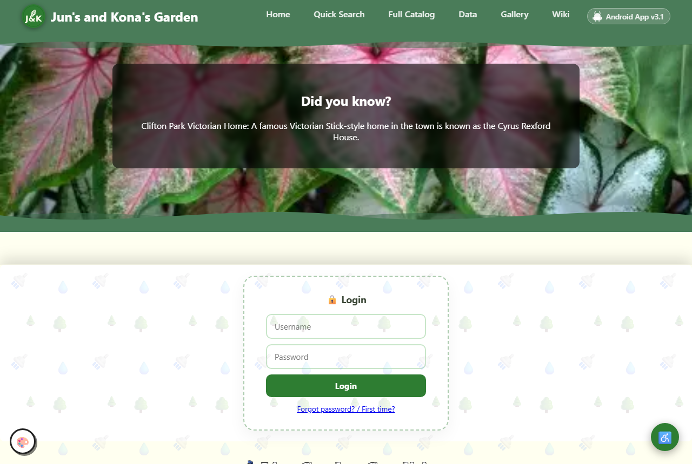
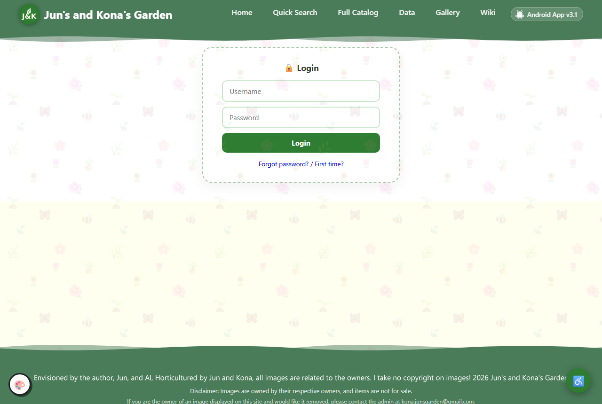
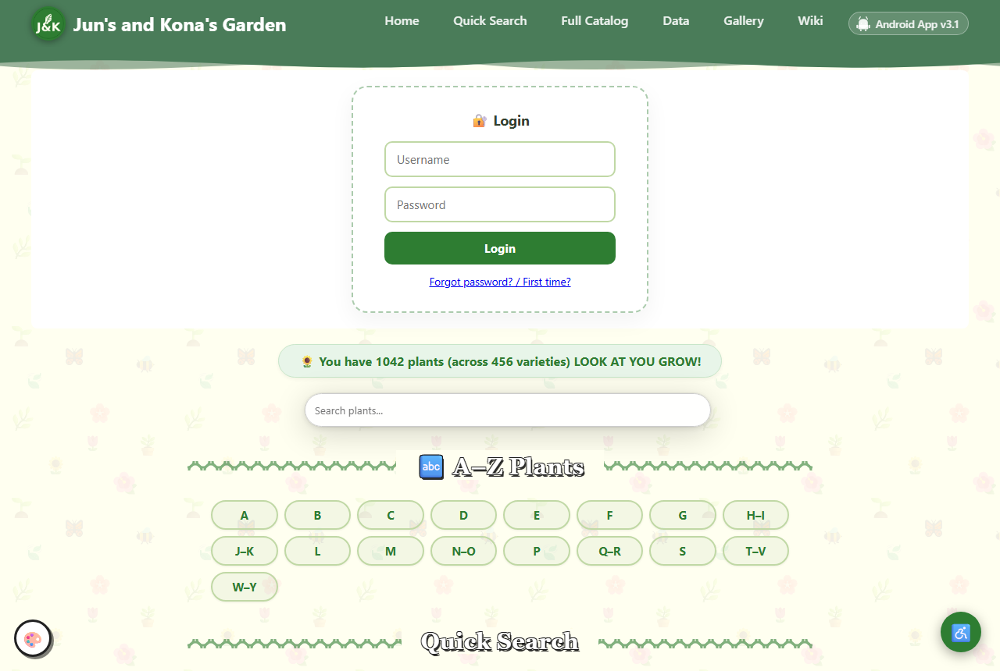

# 03. Your garden at home: password, email, AI, first edits

## Quick version
*No time to read it all? This is the short version. The full guide is below.*

- This guide gets your garden working at home at `http://localhost:8030`: your password, email, the AI boxes and a first edit.
- It takes 30 minutes after the install. Free.
- Open the garden: menu `4`.
- Set your password: menu `U`, then `5` (at least 10 characters).
- Email for "forgot password" links (optional): make a Gmail app password, then menu `8`, then `3`.
- AI boxes (optional): make a free key at <https://aistudio.google.com/apikey>, then menu `8`, `4`, `1` (Gemini), then `1` again (Paste a new key).
- Log in at `http://localhost:8030/login.php` and change a plant in the plant admin (`/streamlit/`). (From Windows with a separate garden computer: Windows menu `4`, then add `/login.php` to the end of the address it opened.)
- Time zone: the install uses the computer's own. To change it: menu `8`, then `2`.
- It worked when the checklist (menu `5`) ends with 0 fail.

---

## What you will build
Your garden running on the garden computer at `http://localhost:8030`, with all
your plants and photos (the photos come from their own download, menu `6`,
then `11`), your own password, email for "forgot password" links,
and the AI boxes working.

## Time and cost
30 minutes after the install. Free.

## What you need first
The install is done (menu `1` said **ALL DONE**). If not, see
`00-READ-ME-FIRST.html` in the garden folder. The longest part of the install is
building the website: 15 to 45 minutes (up to an hour on a very old laptop or a
Pi).

## Steps

### Part A. Open your garden

On the garden computer, menu `4` (or open `http://localhost:8030`).
*You should see:* your home page, and the catalogue full of plants.
From Windows, the Windows menu `4` opens it through a secure tunnel.

### Part B. Your password
The install offered this at the end. If you skipped it: menu `U`, then `5`.
It sets ONE password for the website login and your sign-in page. At least 10
characters. Nothing shows while you type.

### Part C. Email for "forgot password" links (optional)
The site sends mail through your Gmail with an **app password**: a separate
password just for this, not your normal Gmail password.
1. Open your Google account, **Security**, and turn on **2-Step Verification**.
2. In Security, find **App passwords**
   (<https://myaccount.google.com/apppasswords>). Make one named `garden`.
   Google shows it once.
3. Menu `8` Settings, then `3` (Email). Type your Gmail address, then paste the
   app password (`Ctrl+Shift+V`; it is hidden). Say **y** to the test email.
*You should see:* "Sent", and the email arrives (check spam the first time).

Google's own help: <https://support.google.com/accounts/answer/185833>

### Part D. The AI boxes (optional)
Some pages have AI helpers (plant health, identify, tag reading). They use
Google's free Gemini service when you give the garden a key.
1. Make a free key at <https://aistudio.google.com/apikey> (guide 16 explains).
2. Menu `8` Settings, then `4` (API keys), then `1` (Gemini), then `1` again
   (**Paste a new key (or replace the old one)**). Paste the key: it is hidden,
   saved in `.env`, and tested for you.

Without a key, those boxes say AI is not set up. Everything else works.
A free key is enough for a home garden. Paying for more is your choice, on your
own Google account, with a spending limit (guide 16, "More than the free limits").

### Part E. Log in and change a plant

1. Open `http://localhost:8030/login.php` and log in with your name and password.
2. Open the plant admin at `http://localhost:8030/streamlit/`. Its tabs let you
   add and edit plants.
3. Open `http://localhost:8030/catalog.php` and find the plant you changed.

**Using Windows with a separate garden computer?** Then addresses like
`http://localhost:8030/login.php` do not open on the PC (the garden is on the
other computer). Use the Windows menu `4` (Open the website); then add
`/login.php` to the end of the address it opened (the same for `/streamlit/`
and `/catalog.php`). Keep the extra window it opened while you work: that
window is the secure tunnel.

## Everyday jobs (the menu)

| I want to | Menu |
|---|---|
| Start / stop the garden | `2` / `3` |
| Open the website | `4` |
| Check everything is OK | `5` |
| Make a backup now / put one back | `6`, then `1` / `7` |
| Change name, email, keys, folders | `8` |
| Change the time zone (it starts as the computer's own) | `8`, then `2` |
| Switch the garden tools, wiki or n8n on or off | `9` |
| Add or remove people, guests, lock down | `U` |
| See what the programs have been saying | `M`, then `6` |

## How you know it worked
- The catalogue shows your plants with photos.
- You can log in and save a change.
- The checklist (menu `5`) ends with 0 fail.

## If something goes differently
| What you see | What to do |
|---|---|
| The page does not open | Menu `2` (start), then menu `5`. It says which part is down. |
| Login says wrong password | Menu `U`, `5` to set it again. After 5 wrong tries it waits 15 minutes. |
| No password email | Settings, `3`, and send the test email. It says what Gmail did not like. |
| Plants but no photos | The photos zip is not loaded yet: put `junsgarden-photos-addon.zip` (still zipped) in Home or Downloads, then menu `6`, then `11` (or `bash garden.sh photos`). Guide 13. |
| Anything else | Menu `H` makes a help file; guide 09 has more fixes. |

## Make it yours
- Change a colour in `site/style.css` (guide 11, example 1).
- Write a blog post from the website.
- Add a plant you bought this year, with a photo.

**Next:** [Project 1: Uptime Kuma](projects/P01-uptime-kuma.md), or [11 How your website works](11-maintain-your-site.md).
