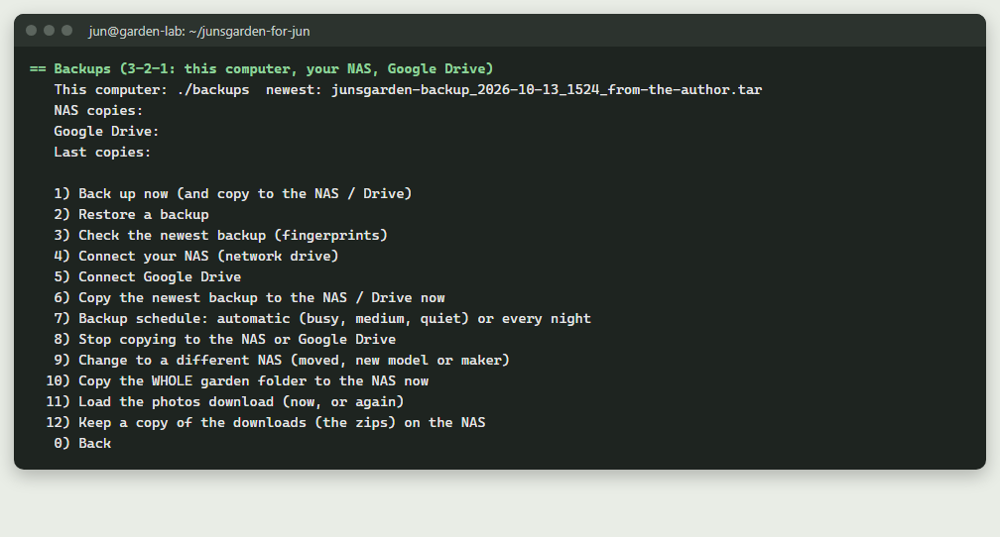
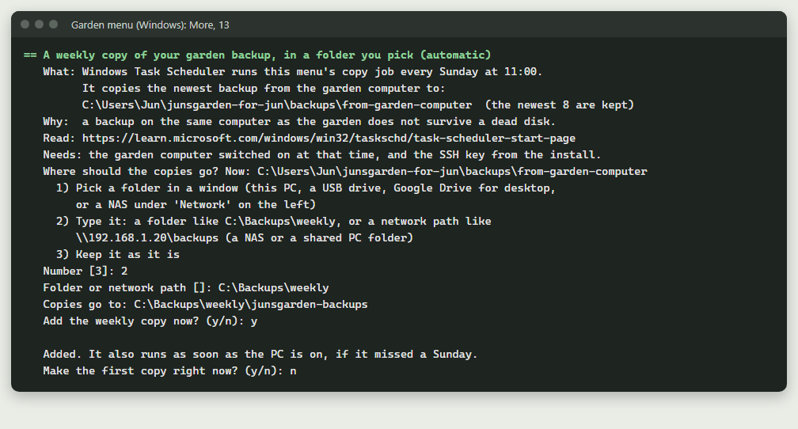
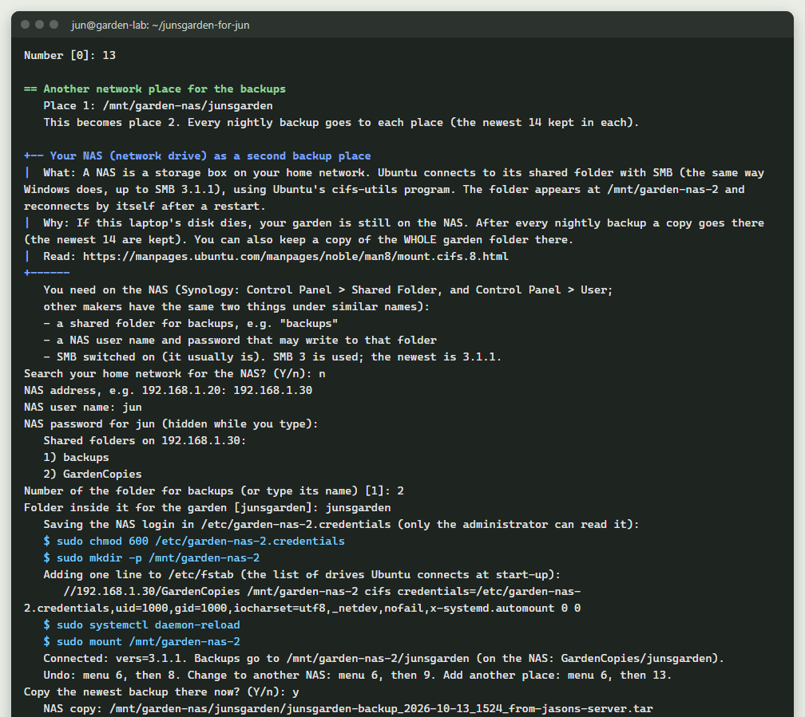
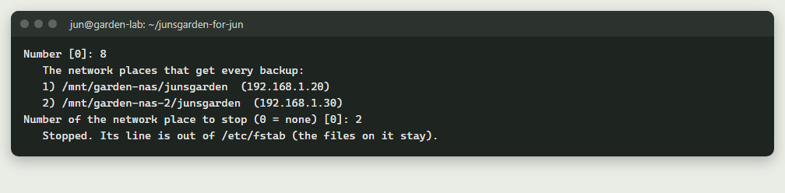

# 13. Backups, restoring, and folder names

## Quick version
*No time to read it all? This is the short version. The full guide is below.*

- Every backup is one `.tar` file in the `backups/` folder. Its name tells you the date, the time and the label.
- Backups run by themselves: every hour the garden looks at what changed, and backs up more often when it is busy, less when it is quiet, at least once a week. Backups you make yourself are never deleted for you.
- Each backup includes all your photos (about 800 MB). Automatic ones are thinned (today's newest 3, then one a day for a week), so they need about 8 GB at most.
- Make one: menu `6`, then `1`. Check one: `bash garden.sh verify`. Restore one: menu `7` (it first saves a `before-restore` backup).
- Keep 3 copies: on the garden computer, on your NAS (menu `6`, then `4`) and on Google Drive (menu `6`, then `5`). A second NAS or a PC's shared folder can get every backup too (menu `6`, then `13`; up to 3 network places).
- A Windows PC can collect a copy every week, into a folder you pick: Windows menu, `M`, then `13`.
- A backup on the same laptop does not protect you from a broken laptop. Copy one to a USB stick now and then.
- To rename or move a file or folder (photos, pages, backups and so on), use menu `M`, then `18` (or menu `8`, then `8`). Every place that uses it changes with it: guide 26.
- Do not rename the folders inside your photos folder, or photo files, by hand: use that menu, so the website and the database follow.

---

## The backup file: its name tells you everything

Every backup is ONE file in the `backups/` folder:

```
junsgarden-backup_2026-10-13_0230_nightly.tar
                  |          |    |
                  date       time label (optional)
```

| Label | Made by |
|---|---|
| `auto` | the automatic schedule. Thinned for you: today's newest 3, then one a day for a week. |
| `nightly` | the 2:30 am backup, if you chose "every night" (menu `6`, then `7`). Kept 7 days. |
| (none) | you, with menu `6`, then `1`. Never deleted for you. |
| `before-restore` | a restore, just before it puts an older backup back. Your safety net. |
| `from-the-author` | the one that came in the zip: your whole garden as it was |

Inside each backup:

| Piece | What it holds |
|---|---|
| `database.sql.gz` | the garden database: plants, comments, logins |
| `wiki.sql.gz` | the wiki's pages (when the wiki is installed) |
| `images.tar` | every photo, in its own folders (`Database/`, `Gallery/`, `post/`, `blog/`, `plan/`, `HeroBanner/`) |
| `data.tar` | comments, guestbook, the home page facts |
| `cashe.tar` | the AI's saved answers (the spelling "cashe" is on purpose: the website expects it) |
| `n8n.tar`, `auth.tar` | n8n workflows, and the sign-in page's settings and accounts (when installed) |
| `MANIFEST.txt` | what is inside, with file counts |
| `SHA256SUMS` | a fingerprint of every piece. A restore checks them before it changes anything. |

**How big?** Each backup includes all your photos (about 800 MB). The automatic
backups kept (at most 3 from today and one a day for 6 days) need about 8 GB, plus any backups you make
yourself (delete old ones of your own from the `backups/` folder when you no
longer need them).

## Make one, check one, restore one



- **Make:** menu `6`, then `1` (Back up now). It takes a minute or two.
- **Check:** `bash garden.sh verify` checks the newest backup's fingerprints and shows its manifest.
- **Restore:** menu `7`. Pick the backup from the list. The program first makes a
  `before-restore` backup of what is there now, stops the website, puts
  everything back, and starts it again.

## The automatic backup schedule (Ubuntu, set up by the install)
The install adds one line to your **cron** (Ubuntu's alarm clock). Every hour it
runs `bash garden.sh backup auto`, which counts what changed since the last
backup and decides:

| Level | What changed since the last backup | What happens |
|---|---|---|
| busy | 4 or more edits | a backup now; while edits keep coming, about once an hour |
| medium | 1 to 3 edits | a backup when the last one is 6 hours old, or from 9 pm |
| quiet | nothing | no backup, but never more than 7 days without one |

An **edit** is one row of the garden's database that was added, changed or
removed (a plant, a photo's record, a note, a blog post), or one photo file
added or changed. Rows that change by themselves (the weather, sign-in
attempts) are not counted. Switched off (menu `M`, then `14`)? Then nothing
changes and no backup is made.

Automatic backups have the label `auto`. They are thinned so they do not fill
the disk: today's newest 3, then the newest one of each of the 6 days before;
older automatic ones are deleted. Backups you make yourself, and the
`before-...` safety backups, are never deleted for you. If the disk is too full
for a backup, it is skipped and the log says so.

You don't need to do anything, but here is how to see and change it:

1. See it: menu `6`, then `7` shows the level right now, when the next backup
   comes, and the last 5 looks. Or `crontab -l`: one line ending in
   `garden.sh backup auto >> backups/backup.log 2>&1`.
   `7 * * * *` at the start means "at 7 minutes past every hour".
2. See what it did: `tail -20 backups/backup.log` (one line per look).
3. Prefer one backup every night at 2:30 am, whatever happens (the old way)?
   Menu `6`, then `7`, then `2`. Back to automatic: `1`. (`BACKUP_SCHEDULE` in
   `.env` remembers the choice.)
4. It disappeared? Menu `1` (install) puts it back.

If a rename goes wrong after its backup, the program offers to put that
`before-rename` backup back (nothing is restored without your yes).

Cron's official guide: <https://manpages.ubuntu.com/manpages/noble/man5/crontab.5.html>

## A copy on your Windows PC (automatic, if you want it)
If you have a Windows PC at home, it can collect a copy of the newest backup
every week by itself, and put it in a folder you choose.

**The easy way:** Windows menu (`Garden-Menu-Windows.cmd`), `M`, then `13`.



1. It explains what it does, then asks **where the copies should go**:
   - `1` **Pick a folder in a window.** Any folder the PC can see: a folder on
     this PC, a USB drive, **Google Drive for desktop** (Google's own program
     that shows your Drive as a drive letter, often `G:`), or a NAS: click
     **Network** on the left of the window and open the NAS.
   - `2` **Type it.** A folder like `C:\Backups\weekly`, or a network path like
     `\\192.168.1.20\backups` (a NAS, or a folder another PC shares). A
     network path is two backslashes, the address, one backslash, the shared
     folder's name.
   - `3` **Keep it as it is.** The first time, that is
     `backups\from-garden-computer\` inside the garden folder on this PC.
2. It makes a folder named `junsgarden-backups` inside the place you chose, and
   checks it can write there. In the picture, the copies go to
   `C:\Backups\weekly\junsgarden-backups`. It remembers the place for next time.
3. If that folder is inside OneDrive, it warns you: 8 copies are several GB, more
   than OneDrive's free 5 GB.
4. **Add the weekly copy now?** Type `y`. It adds a Windows Task Scheduler task
   called **Jun's Garden - copy backup to this PC**. It runs every Sunday at
   11:00 (or as soon as the PC is on, if it missed a Sunday), copies the newest
   backup there, and keeps the newest 8. It writes each result in
   `logs\backup-copy.log`.
5. **Make the first copy right now?** `y` copies one now, so you can see it work.

**A NAS needs one thing first.** Open the NAS once in File Explorer (type
`\\192.168.1.20` in the address bar, with your NAS's address), sign in with the
NAS user name and password, and tick **Remember my credentials**. Windows then
keeps the login, and the weekly copy can get in while nobody is watching. If you
skip this, the menu says it "cannot write" there and tells you the same thing.

**To change it later:** choose `13` again. It says the copy is already scheduled
and asks **Change where the copies go?** `y` asks the three choices above
again. `n` moves on to **Remove the weekly copy?**: `y` removes the task (the
copies already made stay where they are), `n` leaves everything as it is.

- **By hand, once:** Windows menu, `M`, `10` (makes a backup and copies it to
  the `backups` folder in the garden folder on the PC).
- **Scheduling it yourself instead** (if you'd rather click through it):
  1. Press the Windows key, type **Task Scheduler**, open it.
  2. **Create Basic Task**. Name: `Jun's Garden backup copy`. Trigger: **Weekly**, Sunday, 11:00.
  3. Action: **Start a program**. Program: `powershell.exe`. Arguments (one line;
     change the folder to where your garden folder is):
     `-NoProfile -WindowStyle Hidden -ExecutionPolicy Bypass -File "C:\Users\YOU\Desktop\junsgarden-for-jun\windows\Garden-Menu.ps1" -Action copy-newest-quiet`
  4. Finish. Right-click the task, **Run**, and check `logs\backup-copy.log`.

  Microsoft's guide: <https://learn.microsoft.com/windows/win32/taskschd/task-scheduler-start-page>

The copy needs the garden computer switched on at that time, and the SSH key
the Windows install made (no password is stored anywhere).

## 3-2-1: your NAS and Google Drive
The safe rule is **3 copies, on 2 kinds of storage, 1 away from home**:

| Copy | Where | How often | Kept |
|---|---|---|---|
| 1 | `backups/` on the garden computer | automatic: hourly when busy, at least weekly | today's newest 3, then one a day for a week (about 8 GB) |
| 2 | your **NAS** (a network drive at home), and up to 2 more network places if you add them | after every backup | newest 14 in each place |
| 3 | **Google Drive** (away from home) | once a week | newest 4 (about 3.2 GB; free Drive has 15 GB) |

Menu `6` (Backups) sets up 2 and 3. After that they happen by themselves after
each backup. `logs/offsite.log` shows every copy, with the date (`NAS` for the
first network place, `NAS2` and `NAS3` for the others, `CLOUD` for Google Drive).

### Connect your NAS (menu `6`, then `4`)
What you need from the NAS first (on a Synology: **Control Panel > Shared
Folder** and **Control Panel > User**):
- the NAS's address on your network (reserve it in the router too, guide 14)
- a shared folder for backups, for example `backups`
- a NAS user that may write to it, and its password

You don't need to know the NAS's address: the menu offers to **search your
home network** for file-sharing devices (it only knocks on port 445; it logs
in nowhere) and lists them with their names. After you type the NAS user and
password, it **lists the shared folders** on it, so you pick one by number.
It works with SMB 3, up to the newest SMB 3.1.1 that current NAS boxes use.

The menu then:
1. installs `cifs-utils` and `smbclient` (Ubuntu's programs for Windows-style network folders, SMB),
2. saves the NAS login in `/etc/garden-nas.credentials` (only the administrator can read it),
3. adds one line to `/etc/fstab` (Ubuntu's list of drives to connect at start-up), with
   `nofail` so the laptop still starts if the NAS is off, and keeps a copy of the
   old file as `/etc/fstab.bak-garden`,
4. connects the share at `/mnt/garden-nas`, checks it can write there, and
5. copies the newest backup.

This NAS is **network place 1**. You can add two more (see "More than one
network place" below).

**Doing it by hand** (to learn what the menu does):
```
sudo apt install -y cifs-utils
sudo mkdir -p /mnt/garden-nas
sudo nano /etc/garden-nas.credentials        # two lines: username=...  password=...
sudo chmod 600 /etc/garden-nas.credentials
sudo nano /etc/fstab                          # add the line below, then save
//192.168.1.20/backups /mnt/garden-nas cifs credentials=/etc/garden-nas.credentials,uid=1000,gid=1000,iocharset=utf8,_netdev,nofail,x-systemd.automount 0 0
sudo systemctl daemon-reload && sudo mount /mnt/garden-nas
ls /mnt/garden-nas
```
(Use your NAS address and folder. `uid=1000` is your user number: `id -u` shows it.)
Official reference: <https://manpages.ubuntu.com/manpages/noble/man8/mount.cifs.8.html>
and Ubuntu's guide: <https://manpages.ubuntu.com/manpages/noble/man8/mount.cifs.8.html>

### More than one network place (menu `6`, then `13`)
One NAS is good. Two places are better: if one box breaks, the other still has
your garden. Choice `13`, **Add another network place (a second NAS, or a PC's
shared folder)**, adds another place that gets every backup. A **network place**
is any shared folder on your home network: a second NAS, or a folder that a
Windows PC shares.

- You can have **up to 3 places** in all. Place 1 is the NAS from choice `4`
  (it does not change). Choice `13` adds place 2, then place 3.
- After every nightly backup, a copy goes to **each** place, and the newest 14
  are kept in each.
- The questions are the same as for the first NAS (search the network or type
  the address, user name, password, pick the shared folder). The new place
  appears at `/mnt/garden-nas-2` (or `-3`), with its own login file
  `/etc/garden-nas-2.credentials`.
- When all 3 places are in use, `13` says so: stop one first (choice `8`, below).

In this example, place 1 is a NAS at `192.168.1.20`, and place 2 is a Windows
PC at `192.168.1.30` that shares a folder named `GardenCopies`:



**A Windows PC as a network place.** On that PC, make a folder (for example
`GardenCopies`), right-click it, choose **Give access to** (on Windows 11 it
is under **Show more options**), then **Specific people**, pick the user, and
give it **Read/Write**. In the garden menu, type
that PC's address, and the user name and password of that Windows account. The
PC must be switched on at 2:30 am, or that night's copy to it is missed (the
menu then writes `NAS2 FAILED (not reachable)` in `logs/offsite.log`, and the
other places still get theirs). Microsoft's guide:
<https://support.microsoft.com/windows/file-sharing-over-a-network-in-windows-b58704b2-f53a-4b82-7bc1-80f9994725bf>

### Stop copying to one place (menu `6`, then `8`)
Choice `8`, **Stop copying to the NAS or Google Drive**, lists the network
places with their numbers and addresses, and asks which one to stop. Type its
number, or `0` to stop none. Then, if Google Drive is connected, it asks
whether to stop that too.



Stopping a place takes its line out of `/etc/fstab` and removes its login file.
**The files already on it stay.** To use it again later, add it again with `13`
(or `4` for place 1).

The uninstall (More, `12`) disconnects every network place the same way.

### The WHOLE garden folder on the NAS (menu `6`, then `10`)
Besides the nightly backups, the menu can keep a copy of the **entire garden
folder** on the NAS (network place 1) (code, settings, photos, backups) in `whole-garden-folder/`,
weekly, newest 2 kept. The database's own working files are left out (they
change while the garden runs); the newest backup inside the copy holds the
database safely. The copy includes your settings file `.env` (with its
passwords), so keep the NAS private. To bring a garden back from it onto a new
computer: copy the `.tar` there, unpack it (`tar -xf FILE`), and run menu `1`.

### Change to a different NAS (menu `6`, then `9`)
Moved the NAS, or bought a new one (any maker)? Choose `9`: it disconnects the
old one cleanly (its files stay on it), connects the new one the same way as
above, and if the old one is still on, offers to copy the newest 3 garden
backups across. From then on everything lands on the new NAS. (Choice `9`
changes network place 1. To change place 2 or 3, stop it with `8` and add the
new one with `13`.)

If a very old NAS only speaks SMB 2 or 1, it will not connect: SMB 1 is unsafe
and switched off in Ubuntu on purpose. Use a newer NAS or update its software.

### Connect Google Drive (menu `6`, then `5`)
**First, your own Google "client ID" (once, about 10 minutes, free).** rclone's
shared one "is being retired and will stop working during 2026" (rclone's own
words), and then the weekly copy would stop. The menu shows the steps; they come
from <https://rclone.org/drive/#making-your-own-client-id>. In short: make a
project at <https://console.developers.google.com/>, enable the **Google Drive
API**, set up the consent screen (app name `rclone`, audience **External**,
scope `https://www.googleapis.com/auth/drive.file`, yourself as a test user),
create an **OAuth client** of type **Desktop app**, then **Publish app** (without
publishing, Google asks you to sign in again every week). Paste the client ID
and the client secret when the menu asks (the secret is hidden while you type).
Press Enter with nothing to use rclone's shared one for now.

The menu installs **rclone** from Ubuntu's own app store, then opens Google's
sign-in page in your browser: choose your account and click **Allow**. rclone
asks only for permission to files **it creates** (`drive.file`), so it cannot
see the rest of your Drive. A folder named `JunsGarden-backups` appears in your
Drive. rclone's settings are in `~/.config/rclone/rclone.conf` (only you can read it).

No browser on the garden computer (working over SSH)? rclone tells you to run
`rclone authorize "drive"` on a computer that has a browser and paste back what
it prints. Official guide: <https://rclone.org/drive/> and <https://rclone.org/remote_setup/>

### Or let the NAS send it to Google Drive
Many NAS boxes can copy a folder to Google Drive themselves. On a Synology the
app is **Cloud Sync** (Package Center): add Google Drive, choose the NAS folder
`backups/junsgarden`, direction "Upload local changes only". Then the garden
computer only needs the NAS copy. Synology's help: <https://kb.synology.com>
(search "Cloud Sync").

### Check your copies once a month
- `tail logs/offsite.log` shows recent copies (OK or FAILED).
- Open each NAS folder and the Drive folder and look for this week's file.
- Practise a restore from a NAS copy: copy the file into `backups/` and use menu `7`.

## Keep a copy somewhere else
A backup on the same laptop protects you from mistakes, not from a broken laptop.
Copy the newest backup to a USB stick now and then: open Files, go to the
`backups` folder, and drag the newest `.tar` file onto the USB stick. From
Windows, the Windows menu `M` (More), then `10`, makes a backup and copies it
to the PC for you.

## Moving to a new computer
1. Install the garden on the new computer (it loads the backup that came in the zip).
2. Copy your newest backup into the new computer's `backups/` folder.
3. Menu `7`, choose that backup.
4. Your settings file (`.env`) is not in the backup, on purpose: it holds your keys and
   passwords. So on the new computer, paste your keys again (menu `K`), set up email
   again (menu `8`, then `3`), and add again the people who may edit (menu `U`, then `2`).
   Guests of the sign-in page come along with the backup.

The backup stores each piece by its job (images, data, ...), not by folder
name, so it restores fine even if the folders are named differently there.

## Renaming or moving folders
Every folder the garden uses is set in ONE place, and **Settings** changes it for
you: menu `8`, then `8` (Rename or move a file or folder), then `2`. It stops the
garden, moves the folder (to another disk too), saves the new place, and starts
again. The checklist then confirms every folder is found. Guide 26 shows every step.

| Setting | Default | Holds |
|---|---|---|
| `SITE_DIR` | `./site` | the website's style, scripts, app download |
| `IMAGES_DIR` | `./local/images` | your photos |
| `DATA_DIR` | `./local/data` | comments and guestbook |
| `CACHE_DIR` | `./local/cashe` | the AI cache |
| `DB_DIR` | `./local/db` | the database's own files |
| `N8N_DIR` | `./local/n8n` | n8n |
| `AUTH_DIR` | `./local/authelia` | the sign-in page |
| `BACKUP_DIR` | `./backups` | backups |

**Do not rename these by hand** (the website would lose them):
- **The folders INSIDE your photos folder** (`Database`, `Gallery`, `post`, `blog`,
  `plan`, `HeroBanner`). The website looks for exactly those names.
- **Photo file names.** The database remembers each photo by its name.

To give them your own names, use menu `M`, then `18`, then `1`: it renames the folder
or file AND changes every place that uses the name (code, pages, photo lists,
database), with a backup first. The guides keep showing the first names;
`logs/renames.tsv` lists what is called what now. Guide 26.

**Moving the whole garden folder** (for example to a bigger disk): menu `M`, then
`18`, then `3`. It stops the garden, moves it, counts the files, and fixes the
desktop icon, the nightly backup line and Docker's programs, which remember the
folder's full path. Guide 26.

## Read more
- tar (the archive format): <https://www.gnu.org/software/tar/manual/>
- SHA-256 fingerprints: <https://www.gnu.org/software/coreutils/manual/html_node/sha2-utilities.html>
- The 3-2-1 backup rule: <https://www.backblaze.com/blog/the-3-2-1-backup-strategy/>
