# 19. Every menu option, explained

## Quick version
*No time to read it all? This is the short version. The full guide is below.*

- A look-up list of every choice in every menu: what it does, when to use it, what it changes, and how to undo it.
- Open the menu: the "Jun's Garden" desktop icon, or `bash garden.sh` in the garden folder. On Windows: `Garden-Menu-Windows.cmd`. The very first time: `Start-Here-Ubuntu.sh` (on Windows, `Start-Here-Windows.cmd`, the setup wizard), which also gets the program.
- Every option explains itself on screen before anything changes, and shows each command before it runs.
- Everyday choices: `1` install (or carry on, or repair), `2` start, `3` stop, `4` open the website, `5` checklist, `6` backups, `7` restore.
- More choices: `8` Settings, `9` Parts, `U` users, `K` API keys, `A` my addresses, `H` help file, `P` PDF guides, `M` More (advanced), `L` language.
- Most options are also a command: `bash garden.sh WORD`, for example `bash garden.sh backup`.
- Uninstall is More, `12`. Its choice `2` removes everything, but makes a final backup first and asks you to type `DELETE`.

---

This guide lists every choice in the garden menu, one by one: what it does,
when to use it, what it puts on the computer, and how to take it back.
Use it to look something up, or later, to decide whether to add something new.

**How to open the menu**

- **The very first time:** right after unzipping there is no icon and no
  `garden.sh` yet. On Ubuntu, right-click `Start-Here-Ubuntu.sh` and choose
  **Run as a Program** (or type `bash Start-Here-Ubuntu.sh`): it gets the
  program from GitHub, checks every file, and opens this menu. On Windows,
  double-click `Start-Here-Windows.cmd` (the setup wizard).
- **Ubuntu:** double-click the "Jun's Garden" icon on the desktop, or open a
  terminal in the garden folder and type `bash garden.sh`
- **Windows:** double-click `Garden-Menu-Windows.cmd` in the garden folder.
  The garden itself always runs on Ubuntu (another computer, or Windows' own
  Ubuntu). The Windows menu sends each job to that computer and shows it on your screen.

**Before anything changes, each option explains itself on screen.** A blue box
says *What* it is, *Why* you would want it, and where to *Read* more. Each
command is shown before it runs. Everything shown is also saved in the `logs/` folder.

**Most options are also a command.** Instead of the menu you can type
`bash garden.sh WORD` (for example `bash garden.sh backup`). The words are
listed under each option and in the table near the end.

A few words used below:

- **.env** is your private settings file in the garden folder. Only you can read it.
- **A container** is one program running in its own sealed box (Docker).
- **127.0.0.1 / localhost** means "this computer only". Nobody else can reach it.
- **cron** is Ubuntu's alarm clock: it runs a job at a set time.

---

## Main menu

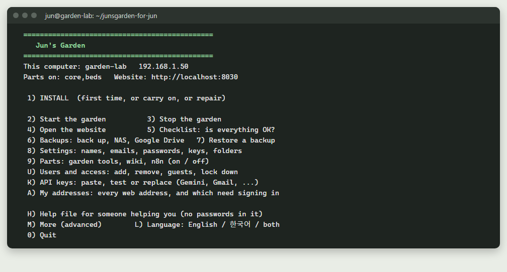

`0) Quit` closes the menu.

### 1) INSTALL  (first time, or carry on, or repair)

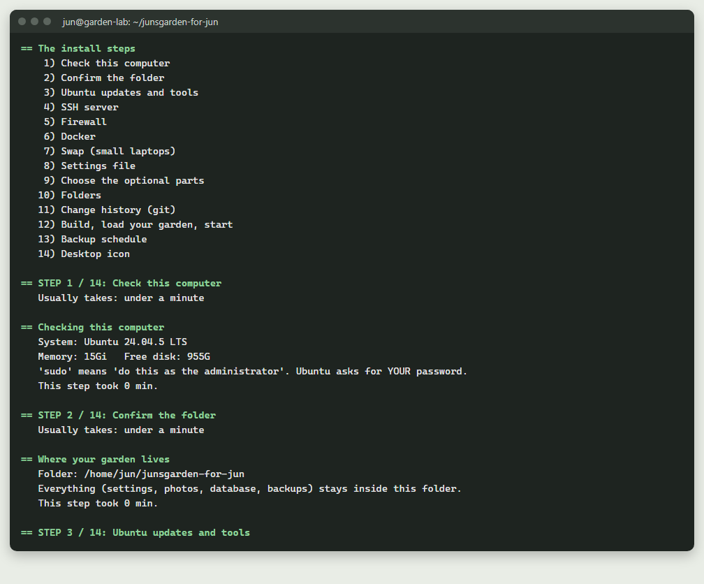

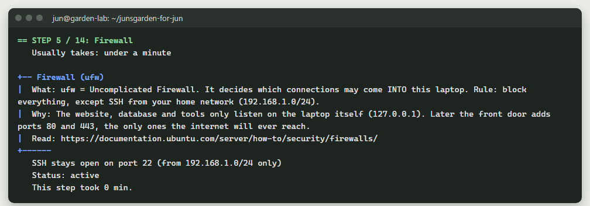

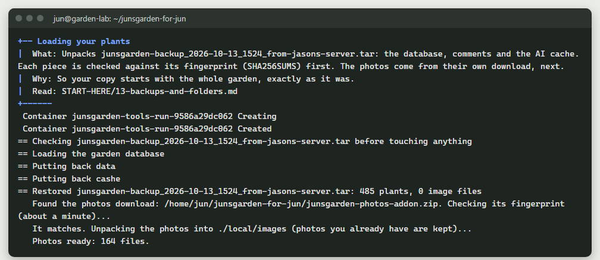

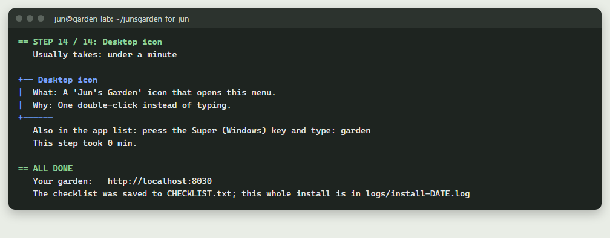

- **What it does:** Sets up the whole garden in 14 steps. If it stopped before, it carries on from that step. Steps that are already done and working are skipped. The first time it asks: this computer or another one, EASY or CUSTOM, and keep the web name or choose a new one.
- **When to use it:** The first time. After the install stopped. Or to repair something the checklist says is broken.
- **What it installs or changes:** Ubuntu updates and git, curl, openssl, rsync, unzip. The SSH server. The firewall (ufw): blocks everything coming in except SSH from your home network. Docker. A 4 GB swap file on small computers. The `.env` settings file, the folders in `local/`, a git history. It builds and starts the garden (website on 127.0.0.1:8030 only), loads your plants from `backups/` and your photos from the photos download (`junsgarden-photos-addon.zip`, if it is there), adds the automatic backup schedule (cron looks every hour; Backups 7 changes it to every night at 2:30 am) and the desktop icon. EASY also turns on the garden tools, then asks for your password, offers email (Gmail) and asks for your AI keys.
- **To undo it:** More, 12 (Uninstall).
- **Command:** `bash garden.sh install`. Guides: `01-ubuntu-laptop.md`, `03-run-your-garden.md`, and `WHAT-GETS-INSTALLED.md` (one folder up).

### 2) Start the garden
- **What it does:** Starts every garden program that is switched on, then waits (up to 5 minutes) until the website answers.
- **When to use it:** After menu 3, or after the computer was off and the garden did not come back.
- **What it installs or changes:** Nothing. It only starts the containers.
- **To undo it:** Menu 3.
- **Command:** `bash garden.sh start`

### 3) Stop the garden
- **What it does:** Stops the garden's programs. Nothing is deleted.
- **When to use it:** Before moving the computer, or when you want the website off for a while.
- **What it installs or changes:** Nothing. The website is off until you start it again.
- **To undo it:** Menu 2.
- **Command:** `bash garden.sh stop`

### 4) Open the website
- **What it does:** Opens your garden in the web browser at `http://localhost:8030` (on Windows, see the Windows section).
- **When to use it:** Any time you want to look at your garden on this computer.
- **What it installs or changes:** Nothing.
- **To undo it:** Nothing to undo.
- **Command:** `bash garden.sh open`

### 5) Checklist: is everything OK?

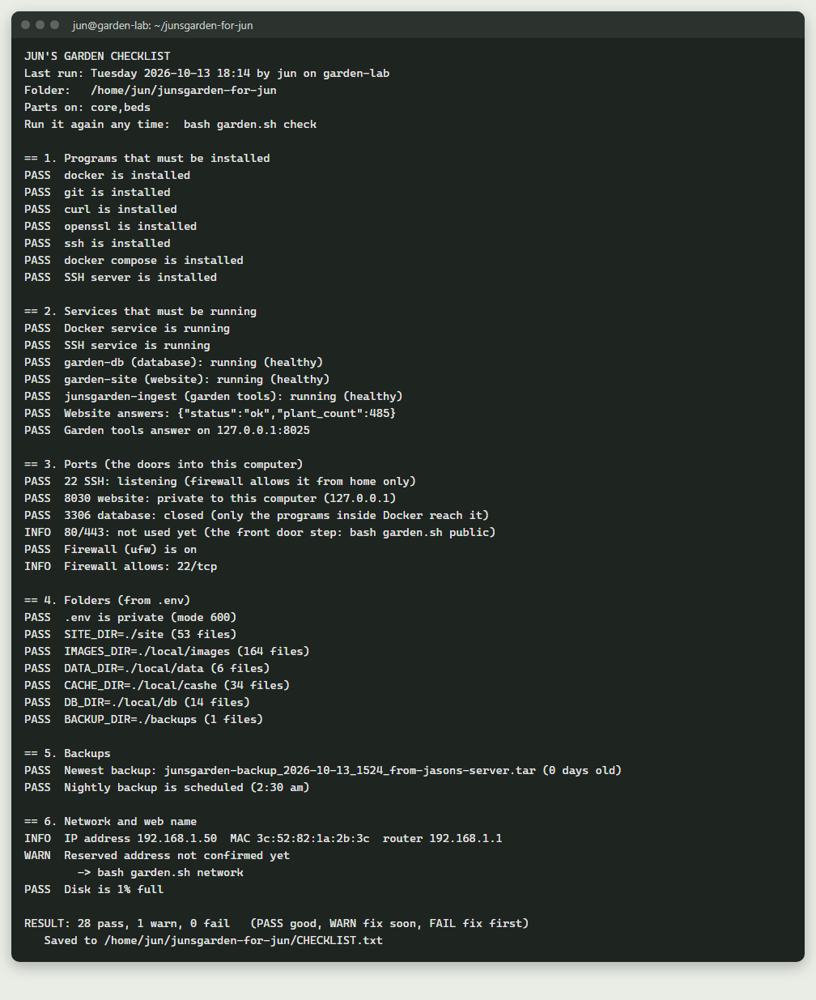

- **What it does:** Checks the programs, the services, the ports (doors), the firewall, the folders, the backups, the network and web name, and the free disk space. Each line says PASS, WARN or FAIL, with the fix under it.
- **When to use it:** When something seems wrong, after a change, or once in a while.
- **What it installs or changes:** Writes `CHECKLIST.txt` and adds one line to `checklist-history.log`. Nothing else.
- **To undo it:** Nothing to undo.
- **Command:** `bash garden.sh check`. Guide: `09-troubleshooting.md`.

### 6) Backups: back up, NAS, Google Drive
- **What it does:** Opens the Backups menu (its own section below).
- **Command:** `bash garden.sh backups`. Guide: `13-backups-and-folders.md`.

### 7) Restore a backup
- **What it does:** Shows your backups, newest first. You pick one. If the database has plants, it first makes a safety backup of what is there now (label `before-restore`). Then it stops the website, garden tools and wiki, puts the backup back, and starts everything again.
- **When to use it:** After a mistake, or to go back to an older day.
- **What it installs or changes:** Replaces the database, photos, comments and the other saved pieces with the ones in the backup.
- **To undo it:** Restore again and pick the `before-restore` backup.
- **Good to know:** If the backup is from before a rename, it offers to do the renames again (guide 26).
- **Command:** `bash garden.sh restore` (or `bash garden.sh restore FILE-NAME`). Guide: `13-backups-and-folders.md`.

### 8) Settings: names, emails, passwords, keys, folders
- **What it does:** Opens the Settings menu (its own section below).
- **Command:** `bash garden.sh settings`

### 9) Parts: garden tools, wiki, n8n (on / off)
- **What it does:** Opens the Parts screen (its own section below).
- **Command:** `bash garden.sh parts`

### U) Users and access: add, remove, guests, lock down
- **What it does:** Opens the Users menu (its own section below).
- **Command:** `bash garden.sh users`. Guide: `07-sso-gate.md`.

### K) API keys: paste, test or replace (Gemini, Gmail, ...)
- **What it does:** Opens the Keys menu (its own section below).
- **Command:** `bash garden.sh keys`. Guide: `16-ai-studio.md`.

### A) My addresses: every web address, and which need signing in

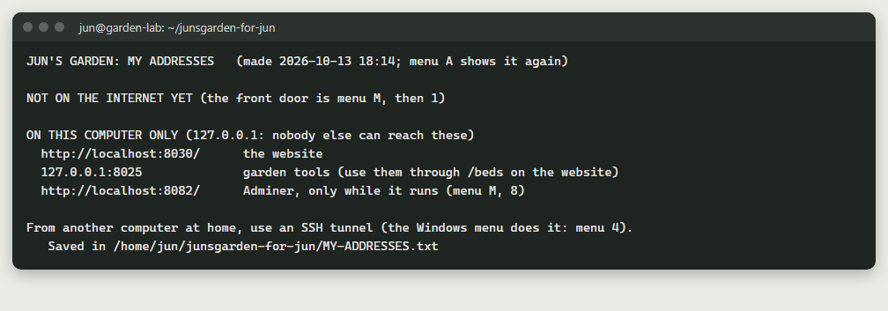

- **What it does:** Lists every address of your garden: on the internet, at home, and on this computer only. It says which ones need the sign-in page.
- **When to use it:** When you forget an address, or after putting the garden online.
- **What it installs or changes:** Writes the list to `MY-ADDRESSES.txt`. Nothing else.
- **To undo it:** Nothing to undo.
- **Command:** `bash garden.sh addresses`

### H) Help file for someone helping you (no passwords in it)
- **What it does:** Makes one text file with what a helper needs: how far the install got, the computer, Docker, your settings with every password and key hidden, the checklist, and the last lines of the logs.
- **When to use it:** When you are stuck and want to show someone (or Gemini) what happened. Read it first.
- **What it installs or changes:** Writes `help/junsgarden-help-DATE.txt`. It also runs the checklist, which rewrites `CHECKLIST.txt`.
- **To undo it:** Delete the file if you do not need it.
- **Command:** `bash garden.sh helpme`. Guide: `09-troubleshooting.md`.

### P) PDF guides: get or refresh them
- **What it does:** Shows `PDF guides/STATUS.txt`, asks English, Korean, both or not now, and downloads that set from GitHub (other hosts listed in `DOWNLOAD-HOSTS.txt` are tried if one does not answer). Each download is checked against its fingerprint in `PDF-GUIDES-SHA256.txt`; if it does not match, nothing is written. A set that is already in (the same version) is **not** fetched again: the menu says "Already up to date" and asks "Get them again anyway?" (default No). A cut-off download carries on where it stopped.
- **When to use it:** If the PDF guides did not arrive during the install, or you want the other language, or a fresh copy.
- **What it installs or changes:** Writes the PDFs into `PDF guides/English` and/or `PDF guides/Korean` and updates `PDF guides/STATUS.txt`. On Windows they land on the PC. Nothing else.
- **To undo it:** Delete the folder `PDF guides/Korean` (or English) if you do not want it.
- **Command:** `bash garden.sh pdfs` (Windows: `Garden-Menu.ps1 -Action pdfs`).

### M) More (advanced)
- **What it does:** Opens the More menu (its own section below).

### L) Language: English / 한국어 / both
- **What it does:** Asks 1) English, 2) Korean, or 3) Both. Only the words change; what you type (numbers, letters, y/n) stays the same. A sentence with no Korean version shows in English.
- **When to use it:** Any time.
- **What it installs or changes:** Saves your choice in `.garden-lang`.
- **To undo it:** Choose L again and pick another language.
- **Command:** `bash garden.sh language`

---

## More (M)

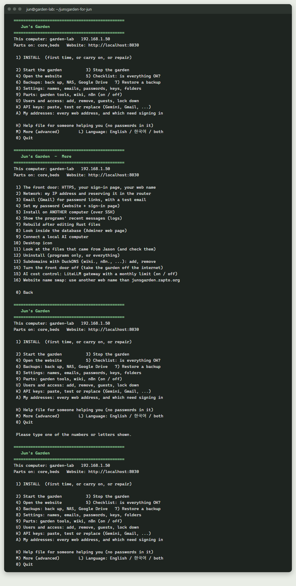

These are the Ubuntu numbers. The Windows More menu has a different order
after 4; see "Windows-only items" at the end. `0) Back` returns to the main menu.

### 1) The front door: HTTPS, your sign-in page, your web name
- **What it does:** Offers three ways to open the garden to other devices (see "The front door's three choices" below).
- **When to use it:** When you want the garden on your home Wi-Fi, to practise, or to put it on the internet.
- **What it installs or changes:** Depends on the choice: Caddy, the sign-in page, firewall doors 80 and 443, the No-IP updater.
- **To undo it:** More, 14, then 3 (Off the internet only).
- **Command:** `bash garden.sh public`. Guides: `04-go-public-no-ip-caddy.md`, `04b-take-over-junsgarden-zapto.md`, `07-sso-gate.md`.

### 2) Network: my IP address and reserving it in the router
- **What it does:** Shows this computer's network card, IP address, MAC address (the card's fixed ID) and the router's address, with the steps to reserve the IP in the router. If you say you reserved it, it remembers the IP, and the checklist warns you if it ever changes.
- **When to use it:** Before going online. Port forwarding needs an address that never changes.
- **What it installs or changes:** Only saves `LAPTOP_IP` in `.env` when you say yes. The reservation itself you make in the router.
- **On Windows' own Ubuntu (WSL):** it says the numbers are WSL's private inside address: do not reserve or forward it. To show the garden to other devices or put it online, use a separate garden computer (guide 00b).
- **To undo it:** Nothing to undo.
- **Command:** `bash garden.sh network`. Guide: `14-reserve-your-ip.md`.

### 3) Email (Gmail) for password links, with a test email
- **What it does:** Asks for your Gmail address and a Gmail APP password (16 letters, hidden while you type), then offers to send a test email.
- **When to use it:** So the website and the sign-in page can send "forgot password" emails.
- **What it installs or changes:** Saves the Gmail settings in `.env`. If the front door is on, it rewrites the sign-in page's settings. Restarts the programs.
- **To undo it:** Keys (K), Gmail app password, then 4 (Remove).
- **Command:** `bash garden.sh email`. Guide: `03-run-your-garden.md` (Part C).

### 4) Set my password (website + sign-in page)
- **What it does:** Asks the login name, then the new password (hidden). One password for the website login and the sign-in page. It is stored only as a scrambled hash.
- **When to use it:** First time, or whenever you want a new password.
- **What it installs or changes:** The stored password. The sign-in page is restarted so it counts straight away.
- **To undo it:** Set it again.
- **Command:** `bash garden.sh password` (or `bash garden.sh password NAME`).

### 5) Install on ANOTHER computer (over SSH)
- **What it does:** Asks the other computer's IP address and your user name on it. Checks it answers on the SSH port (22). Makes an SSH key on this computer if there is none and adds it there (you type that computer's password once). Copies the garden folder (not `.env`, `local/`, `backups/`, `logs/`, `.git`) and your newest backup, then runs the install there.
- **When to use it:** When the garden should live on another Ubuntu laptop or a Raspberry Pi.
- **What it installs or changes:** Here: `~/.ssh/id_ed25519` (if new) and `.garden-remote` (last IP and user, no password). There: everything menu 1 installs.
- **To undo it:** On that computer, More 12 (Uninstall). Remove this computer's key there with Users (U), 7.
- **Command:** `bash garden.sh remote`

### 6) Show the programs' recent messages (logs)
- **What it does:** Shows the last 50 lines each garden program printed.
- **When to use it:** When something does not start or behaves oddly.
- **What it installs or changes:** Nothing.
- **To undo it:** Nothing to undo.
- **Command:** `bash garden.sh logs`

### 7) Rebuild after editing Rust files
- **What it does:** Builds the website again from the code in `rust/` and restarts it. Only changed files are compiled again.
- **When to use it:** After you (or Gemini) edited the website's code or templates.
- **What it installs or changes:** A new website container from your code.
- **To undo it:** Put the file back with `git checkout -- FILE`, then rebuild again.
- **Command:** `bash garden.sh rebuild`. Guide: `11-maintain-your-site.md`.

### 8) Look inside the database (Adminer web page)
- **What it does:** Starts Adminer, a one-page database viewer, at `http://localhost:8082` (this computer only). It shows what to type: System MySQL, Server `db`, Username `dbadmin`, Database `juns_garden_db`, Password = the `DB_PASSWORD` line in `.env`.
- **When to use it:** To look at tables and rows without typing SQL.
- **What it installs or changes:** Downloads the Adminer image the first time and starts the container `garden-adminer`.
- **To undo it:** `bash garden.sh dbweb-stop` (there is no menu number for this).
- **Command:** `bash garden.sh dbweb`. Guide: `12-your-database.md`.

### 9) Connect a local AI computer
- **What it does:** Asks the IP address of a computer running Ollama (local AI). Checks it answers, lists its models, and lets you choose one. Leave the address empty to turn local AI off.
- **When to use it:** Only if you have a separate computer with a strong graphics card running Ollama.
- **What it installs or changes:** Saves `OLLAMA_URL` and `OLLAMA_MODEL` in `.env` and restarts the website. Nothing is installed on this computer.
- **To undo it:** Choose it again and leave the address empty.
- **Command:** `bash garden.sh ai`. Guide: `15-local-ai.md`. (Same as Settings, 10.)

### 10) Desktop icon
- **What it does:** Puts a "Jun's Garden" icon on the desktop and in the app list. It opens this menu.
- **When to use it:** If the icon is missing (the install normally makes it).
- **What it installs or changes:** `junsgarden.desktop` in `~/.local/share/applications/` and on the Desktop.
- **To undo it:** Delete the icon. Uninstall (More 12, choice 1) also removes both.
- **Command:** `bash garden.sh icon`

### 11) Look at the files that came from the author (and check them)
- **What it does:** Shows what each folder that came from the author is (the zip plus the first-start download from GitHub), with file counts and sizes. Offers to check every file's fingerprint against `FILES-FROM-AUTHOR.txt` (what came in the zip) and `CODE-FINGERPRINTS.txt` (the program) and list the ones that changed. Offers to open the folder in the Files app.
- **When to use it:** To see exactly what came from the author, or to find what was changed since.
- **What it installs or changes:** Nothing.
- **To undo it:** Nothing to undo.
- **Command:** `bash garden.sh files`. Guide: `18-review-the-code.md`.

### 12) Uninstall (programs only, or everything)
- **What it does:** Offers two levels (see the "Uninstall" section below).
- **Command:** `bash garden.sh uninstall`

### 13) Subdomains with DuckDNS (wiki., n8n., ...): add, remove
- **What it does:** Opens the Subdomains menu (its own section below).
- **Command:** `bash garden.sh subdomains`. Guide: `04-go-public-no-ip-caddy.md` (Advanced).

### 14) On / off: the whole garden, or only off the internet; check-up, clean-up
- **What it does:** One screen with six choices. `1` switches everything off (`docker compose down`, without `-v`: nothing is deleted) and stops the front door. `2` switches it all on again, even months later, and checks the website. `4` starts again a program that is stuck. `5` removes Docker's leftovers (old versions of the garden's programs older than 7 days, old build notes), after asking; Enter means no. `6` runs the check-up every 6 hours.
- **`3`, off the internet only:** Stops Caddy, closes doors 80 and 443 in the firewall (and the home-only door), stops the No-IP updater and the DuckDNS updater, and switches the sign-in page off. The garden keeps running at home.
- **When to use it:** `1` when you do not want to host the site for a while, or the traffic is too much; `3` to take it off the internet but keep it at home, or before moving it; `5` when the disk fills up.
- **What it installs or changes:** `1` writes `.garden-off` (scheduled backups rest while it is there). `3`: Caddy and the No-IP updater are switched off (not removed), the DuckDNS cron line is removed, and in `.env` the web name is cleared and the address goes back to localhost. `6` is one cron line.
- **To undo it:** `1`: choose `2`. `3`: More, 1 again (it switches the No-IP updater back on); with subdomains, also Subdomains, 1; in the router, also remove the 80 and 443 forwarding yourself if you want it fully closed. `6`: choose it again.
- **Command:** `bash garden.sh power`, or straight away `bash garden.sh off`, `bash garden.sh on`, `bash garden.sh offline` (`3`), `bash garden.sh checkup`, `bash garden.sh cleanup`. Guide: `26-rename-move-and-switch.md`.

### 15) AI cost control: LiteLLM gateway with a monthly limit (on / off)
- **What it does:** Switches LiteLLM on, or manages it when it is on (see "AI cost control (LiteLLM)" below).
- **Command:** `bash garden.sh llm`. Guide: `16-ai-studio.md`.

### 16) Website name swap: use another web name than junsgarden.zapto.org

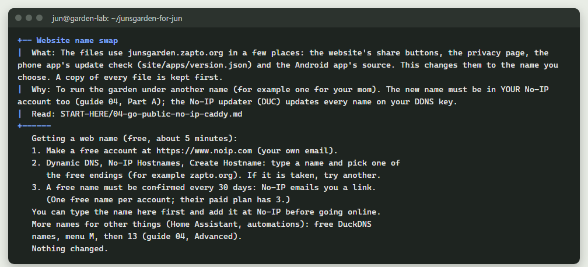

- **What it does:** Changes the web name written in 12 files (share buttons, privacy page, the phone app's update check, the Android app's code) to the name you type. It shows the files first and asks.
- **When to use it:** To run the garden under another name (the name must be in your own No-IP account too).
- **What it installs or changes:** Those files (copies of the old ones go to `logs/web-name-change_DATE/`). If installed and online with the old name: `.env` and Caddy follow. Offers to rebuild the website, and saves the change in your git history.
- **To undo it:** Run it again with the old name, or copy the old files back from `logs/web-name-change_DATE/`. Phones with the app keep checking the old name until you rebuild the app.
- **Command:** `bash garden.sh webname`. Guide: `04-go-public-no-ip-caddy.md`.

> **Why use the menu for this, not File Explorer?**
> The web name is written in 12 files (the list is `WEBNAME_FILES` in
> `garden.sh`: the website's code, the privacy page, the phone app's update file,
> the Android app, `docker-compose.yml` and more), and also in your settings
> (`.env`) and the front door's settings (Caddy and the sign-in page). Renaming by
> hand means finding every one; miss one and the share buttons, the phone app's
> updates or the front door quietly keep the old name. The menu changes all of
> them together: it checks the new name looks like a web name, lists the files
> before it changes anything, keeps a copy of each, updates `.env` and the front
> door when they use the old name, and offers to rebuild the website (it then waits
> until the website answers). It can be undone: run it
> again with the old name, or copy the files back from `logs/web-name-change_DATE/`.

---

### 17) Reach the garden from anywhere, privately (Tailscale): on / off
- **What it does:** installs Tailscale with Tailscale's own installer, shows a sign-in link
  (sign in with your Tailscale account), then lets SSH and Remote Desktop in through
  Tailscale only (one firewall line, `ufw allow in on tailscale0`). Tells you the name to use.
- **When to use it:** to reach the garden computer from anywhere, with only your own devices
  able to connect. Optional, highly recommended (guide 20, "Away from home").
- **What it installs or changes:** the `tailscale` program (from Tailscale's own package
  source) and one firewall line. No port is opened in the router.
- **To undo it:** the same item again (it disconnects and removes the firewall line);
  `sudo apt remove tailscale` removes the program.
- **Command:** `bash garden.sh tailscale`

### 18) Rename or move a file or folder (every place that uses it follows)
- **What it does:** Four choices. `1` renames a file or folder of the website (a photo folder, a page, a data file) and changes every place that uses the name: the code, the pages, the photo lists and the database rows. `2` moves one of the big folders to another place or disk (the same as Settings 8 used to). `3` moves the WHOLE garden folder. `4` lists what was renamed or moved so far. It shows every place first, offers a backup, and changes nothing until you type `y`.
- **When to use it:** To give the website your own names, or to move the garden to a bigger disk.
- **What it installs or changes:** The name, every place that uses it, `IMAGE_FOLDERS` in `.env` for a renamed photo folder, one git entry, and a line in `logs/renames.tsv`. Copies of everything it changes go to `logs/rename_DATE/` first.
- **To undo it:** Choose it again and rename it back.
- **Good to know:** The guides keep showing the names the garden came with.
- **Command:** `bash garden.sh rename`. Guide: `26-rename-move-and-switch.md`.

## Backups (6)

The top of this screen shows where your backups are, the newest one, the NAS
and Google Drive folders, and the last copies made. `0) Back` returns to the main menu.
Guide for all of these: `13-backups-and-folders.md`.

### 1) Back up now (and copy to the NAS / Drive)
- **What it does:** Saves the database, photos, data and AI cache (plus the wiki, n8n and sign-in page when they are on) into one `.tar` file in `backups/`. Then copies it to the NAS, and to Google Drive if the last Drive copy is 6 or more days old.
- **When to use it:** Before any big change. (Backups are also made by themselves: more often when the garden is busy, at least once a week; choice 7.)
- **What it installs or changes:** One new file in `backups/`. Your own backups are never deleted for you; automatic ones are thinned (today's newest 3, then one a day for a week). Each backup includes all the photos (about 800 MB), so the automatic ones need about 8 GB at most.
- **To undo it:** Nothing to undo. Delete the file if you do not want it.
- **Command:** `bash garden.sh backup` (or `bash garden.sh backup LABEL`).

### 2) Restore a backup
- **What it does:** The same as main menu 7.
- **Command:** `bash garden.sh restore`

### 3) Check the newest backup (fingerprints)
- **What it does:** Checks every piece inside the newest backup against its fingerprints, so you know it is not damaged.
- **When to use it:** Once in a while, or before you rely on a backup.
- **What it installs or changes:** Nothing.
- **To undo it:** Nothing to undo.
- **Command:** `bash garden.sh verify` (or `bash garden.sh verify FILE-NAME`).

### 4) Connect your NAS (network drive)
- **What it does:** Can search your home network for the NAS, asks its user name and password (hidden), lists its shared folders so you can pick one, and connects it as network place 1. After that, every backup is also copied there (the newest 14 are kept). Offers a copy now and a weekly copy of the WHOLE garden folder.
- **When to use it:** When you have a NAS and want a second copy at home.
- **What it installs or changes:** Installs `cifs-utils` and `smbclient`. Saves the NAS login in `/etc/garden-nas.credentials` (administrator only). Adds one line to `/etc/fstab` (old copy: `/etc/fstab.bak-garden`). The NAS appears at `/mnt/garden-nas`. Saves `BACKUP_NAS_DIR` (and maybe `NAS_FULL_COPY`) in `.env`.
- **To undo it:** Backups, 8.
- **Command:** `bash garden.sh nas`

### 5) Connect Google Drive
- **What it does:** Walks you through making your own free Google "client ID" (recommended: rclone's shared one is being retired during 2026), then a Google sign-in in your browser. Makes the Drive folder `JunsGarden-backups`. Once a week the newest backup goes there (the newest 4 are kept). Offers a copy now (about 800 MB).
- **When to use it:** For a copy away from home (fire, flood, theft).
- **What it installs or changes:** Installs `rclone`. Its settings and Google permission go in `~/.config/rclone/rclone.conf`. It can only see files it made itself. Saves `BACKUP_CLOUD` in `.env`.
- **To undo it:** Backups, 8. To remove the Google permission too: `rclone config delete garden-gdrive`.
- **Command:** `bash garden.sh cloud`

### 6) Copy the newest backup to the NAS / Drive now
- **What it does:** Copies the newest backup to the NAS and Google Drive right now (Drive too, even if it had one this week).
- **When to use it:** After connecting a NAS or Drive, or after a copy failed.
- **What it installs or changes:** Copies one file. Old copies over the limit (14 on the NAS, 4 on Drive) are deleted there.
- **To undo it:** Nothing to undo.

### 7) Backup schedule: automatic (busy, medium, quiet) or every night
- **What it does:** Shows the backup line in cron, and (automatic) the level right now: busy (4 or more edits since the last backup: a backup now), medium (1 to 3: within 6 hours or from 9 pm) or quiet (none: at least weekly), when the next backup comes, and the last 5 looks from `backups/backup.log`. Then `1` keeps or turns on the automatic schedule, `2` changes to one backup every night at 2:30 am.
- **When to use it:** To see that backups are scheduled and what the schedule decided, or to choose between the two ways. Guide 13 explains how edits are counted.
- **What it installs or changes:** With `1` or `2`: `BACKUP_SCHEDULE` in `.env` and the backup line in your cron (`crontab -l`). Otherwise nothing.
- **To undo it:** Nothing to undo.

### 8) Stop copying to the NAS or Google Drive

- **What it does:** Lists the network places that get every backup, each with its number and address, and asks "Number of the network place to stop (0 = none)". Type a number to stop that one, or `0` to keep them all. Then, if Google Drive is connected, asks "Stop copying to Google Drive?" (default No). The files already on the NAS, the PC or Drive stay.
- **When to use it:** When you no longer use one of those places, or to free a place before adding another with 13.
- **What it installs or changes:** A network place: disconnects it, removes its line from `/etc/fstab`, deletes its login file (`/etc/garden-nas.credentials`, or `-2` / `-3`), and clears its `BACKUP_NAS_DIR` and `BACKUP_NAS_HOST` lines in `.env` (`_2` / `_3` for places 2 and 3). Drive: clears `BACKUP_CLOUD`; rclone's Google permission stays until you run `rclone config delete garden-gdrive`.
- **To undo it:** Backups 4 (place 1), 13 (places 2 and 3) or 5 (Drive) again.

### 9) Change to a different NAS (moved, new model or maker)
- **What it does:** Disconnects the old NAS (network place 1; its files stay on it), runs "Connect your NAS" for the new one, then offers to copy the newest 3 garden backups from the old NAS to the new one. (Places 2 and 3: stop with 8, add again with 13.)
- **When to use it:** When the NAS moved or you bought a new one.
- **What it installs or changes:** The same as Backups 4, for the new NAS.
- **To undo it:** Choose 9 again and connect the old one.

### 10) Copy the WHOLE garden folder to the NAS now
- **What it does:** Puts one `.tar` of the whole garden folder (code, settings including `.env`, photos, backups; not the live database files or logs) in `whole-garden-folder/` on the NAS (network place 1). The newest 2 are kept.
- **When to use it:** For a complete copy in one place. Keep the NAS private: `.env` is inside.
- **What it installs or changes:** One file on the NAS.
- **To undo it:** Delete it on the NAS.

### 11) Load the photos download (now, or again)
- **What it does:** Finds `junsgarden-photos-addon.zip` (in the garden folder, Home, Downloads, Desktop, or the folder above; on a Korean Ubuntu also `~/다운로드` and `~/바탕화면`). If it is not there, it downloads it: about 32 small encrypted parts, from several hosts at once (`PHOTO-PARTS.json` lists the parts and their fingerprints, `DOWNLOAD-HOSTS.txt` the hosts). Every part is checked before it is used; a host that is down or answers wrong hands its parts to the others (the first part is fetched from Google Drive first; if Drive does not answer, it comes from a backup, which needs the access file `photos-access.token` from the same data package; the install says so plainly, and removes that access file once all the photos are in); a cut-off part carries on where it stopped. The parts are put together and unlocked with `photos.key` (it came in your private data package, `junsgarden-for-jun.zip`; it is never on a public host and never shown), and the finished zip is checked as a whole. Then it checks the zip's fingerprint and unpacks it into your photos folder. Photos you already have are kept. Plain files the author added to the zip (folder `extras/`) are copied to the top of the photos folder as they are. A version that is already downloaded is not fetched again. If `photos.key` is missing, it says so, writes nothing, and the garden carries on without photos.
- **When to use it:** If the install ran before the photos were downloaded, or to get them again.
- **What it installs or changes:** Photos in `local/images/`, and `junsgarden-photos-addon.zip` in the garden folder. Installs `unzip` if it is missing. While downloading, the parts wait in `.garden-downloads/` and are removed when the zip is complete.
- **To undo it:** Nothing simple to undo (the photos are plain files).
- **Command:** `bash garden.sh photos`

### 12) Keep a copy of the downloads (the zips) on the NAS
- **What it does:** Copies `junsgarden-for-jun.zip`, the photos add-on and the wiki add-on (those it finds) to a `downloads` folder on the NAS. Only new or changed ones are copied.
- **When to use it:** So you never need to download them from Google Drive again. Connect the NAS first (Backups 4).
- **What it installs or changes:** Files on the NAS.
- **To undo it:** Delete them on the NAS.

### 13) Add another network place (a second NAS, or a PC's shared folder)

- **What it does:** Lists the places you already have, says which number the new one becomes, then asks the same questions as choice 4 (search or address, user name, password, shared folder). Up to 3 network places in all; place 1 is the one from choice 4 and does not change. After that, every backup goes to each place, and the newest 14 are kept in each. If all 3 are in use, it says so and changes nothing.
- **When to use it:** For a second copy at home on another box: a second NAS, or a folder a Windows PC shares (that PC must be on when backups run; a missed copy shows in `logs/offsite.log`).
- **What it installs or changes:** The same as choice 4, with the place's number: login file `/etc/garden-nas-2.credentials` (or `-3`), one line in `/etc/fstab`, the folder at `/mnt/garden-nas-2` (or `-3`), and `BACKUP_NAS_DIR_2` / `BACKUP_NAS_HOST_2` (or `_3`) in `.env`. The weekly copy of the WHOLE garden folder stays on place 1 only.
- **To undo it:** Backups, 8, and type the place's number.

---

## Settings (8)

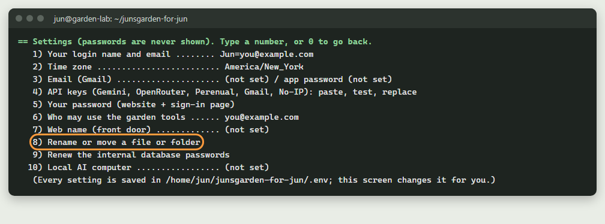

Every setting is saved in `.env`; this screen changes it for you. Passwords are
never shown. `0) Back` returns to the main menu.

### 1) Your login name and email
- **What it does:** Asks your first name (letters only) and your email.
- **When to use it:** If your name or email changes.
- **What it installs or changes:** `GARDEN_USERS` and `GARDEN_UPLOADER_NAMES` in `.env`, then restarts. Careful: it saves only YOU as the editor, so other editors added with Users 2 are taken out of that list. If you changed the name, set a password for it (Settings 5).
- **To undo it:** Choose 1 again with the old values (and add the other people again with Users 2).

### 2) Time zone
- **What it does:** Asks the time zone (examples: America/New_York, Asia/Seoul). The install starts with the computer's own time zone.
- **When to use it:** If the times on the site are wrong, or you move.
- **What it installs or changes:** `TZ` in `.env`, then restarts.
- **To undo it:** Choose 2 again.

### 3) Email (Gmail)
- **What it does:** The same as More, 3.

### 4) API keys (Gemini, OpenRouter, Perenual, Gmail, No-IP): paste, test, replace
- **What it does:** The same as main menu K.

### 5) Your password (website + sign-in page)
- **What it does:** The same as More, 4.

### 6) Who may use the garden tools
- **What it does:** Asks the emails allowed into the garden tools (/beds), with a comma between them.
- **When to use it:** To let someone else use the garden tools, or stop them.
- **What it installs or changes:** `BEDS_ALLOWED_EMAILS` in `.env`, then restarts.
- **To undo it:** Choose 6 again.

### 7) Web name (front door)
- **What it does:** Opens the whole front door step (the same as More, 1), not only a name.
- **To undo it:** More, 14. (To change the name written in the files, use More, 16.)

### 8) Rename or move a file or folder
- **What it does:** The same as More 18 (four choices). Choice `2` lists the 8 garden folders (website files, photos, data, cache, database, n8n, sign-in page, backups). You pick one and type its new place, inside the garden folder or on another Linux disk. It stops the garden, moves the folder, updates `.env` and starts again.
- **When to use it:** If you want a folder somewhere else, or a file or folder of the website under your own name (choice `1`).
- **What it installs or changes:** The folder's place and its line in `.env`. Moving the backups folder also rewrites the backup schedule's cron line.
- **To undo it:** Choose 8 again and move it back.
- Guides: `13-backups-and-folders.md`, `26-rename-move-and-switch.md`.

> **Why use the menu for this, not File Explorer?**
> The garden finds each folder through its line in `.env` (for example
> `IMAGES_DIR=./local/images`). Docker reads those lines to connect the folders
> to the programs; the backup program finds the backups folder the same way. If you
> rename or move a folder by hand, those lines still point at the old place: the
> website starts with no photos, or the backups go nowhere. The menu does every
> part together: it stops the garden, refuses a new name that is already in use,
> moves the folder (the database and sign-in folders with administrator rights,
> because the system owns them), writes the new place into `.env`, starts the
> garden again and waits until the website answers. If the move fails, nothing is
> changed. To undo it, choose 8 again and move the folder back.

### 9) Renew the internal database passwords
- **What it does:** Makes new long random passwords for the database's own accounts, changes them inside the database, saves them in `.env` and restarts. You never type them.
- **When to use it:** Once a year, or if `.env` was ever shown to anybody.
- **What it installs or changes:** `DB_PASSWORD` and `DB_ROOT_PASSWORD` in `.env`.
- **To undo it:** Nothing to undo (the old ones are gone; nothing needs them).

### 10) Local AI computer
- **What it does:** The same as More, 9.

---

## Parts (9)

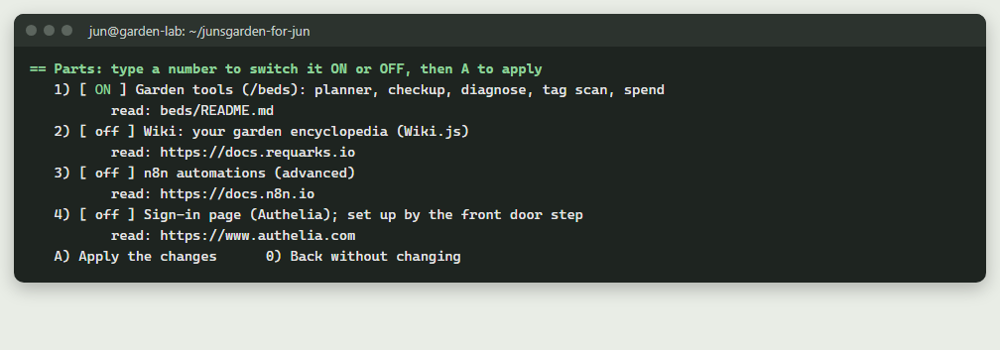

Type a part's number to switch it ON or OFF, then **A** to apply.
`0) Back without changing` leaves everything as it was.
Switching a part OFF stops it but keeps its data, so ON brings it back.

### 1) Garden tools (/beds): planner, checkup, diagnose, tag scan, spend
- **What it does:** A small Python program: bed planner, plant checkup, diagnose, tag scan, spend list, wiki queue. It also reads tag photos for the phone app.
- **When to use it:** EASY turns it on. Online, it opens only after signing in on your sign-in page.
- **What it installs or changes:** Builds and starts the container `junsgarden-ingest` on 127.0.0.1:8025.
- **To undo it:** Parts, 1 (OFF), then A.
- Read: `beds/README.md`.

### 2) Wiki: your garden encyclopedia (Wiki.js)
- **What it does:** Your own garden wiki at `http://localhost:3000`. The first time, a helper makes YOU its admin (it asks a wiki admin password) and adds the garden's pages if `junsgarden-wiki-addon.zip` is found (about 30 minutes). Without that zip the wiki starts empty.
- **When to use it:** If you want the encyclopedia. You can add the pages later with `bash garden.sh wiki`.
- **What it installs or changes:** Downloads Wiki.js and starts it (its pages are kept in the garden's database).
- **To undo it:** Parts, 2 (OFF), then A.

### 3) n8n automations (advanced)
- **What it does:** A drag-and-drop tool for "when this happens, do that" (for example: soil is dry, send me an email), at `http://localhost:5678`.
- **When to use it:** Later, for fun projects.
- **What it installs or changes:** Downloads n8n and starts its container.
- **To undo it:** Parts, 3 (OFF), then A.
- Guides: `START-HERE/n8n/`.

### 4) Sign-in page (Authelia); set up by the front door step
- **What it does:** Your sign-in page, in front of the garden tools. It cannot be switched on here before the front door step is done (More, 1).
- **When to use it:** Normally never here; the front door turns it on and off.
- **What it installs or changes:** The container `garden-auth` on 127.0.0.1:9091.
- **To undo it:** More, 14 turns it off together with the front door. (Switching it OFF here while the garden is online stops the garden tools from opening online.)

### A) Apply the changes
- **What it does:** Builds what is new, starts what is ON, stops and removes the containers of what is OFF (their data stays), and runs the wiki setup if the wiki is on.

---

## Users and access (U)

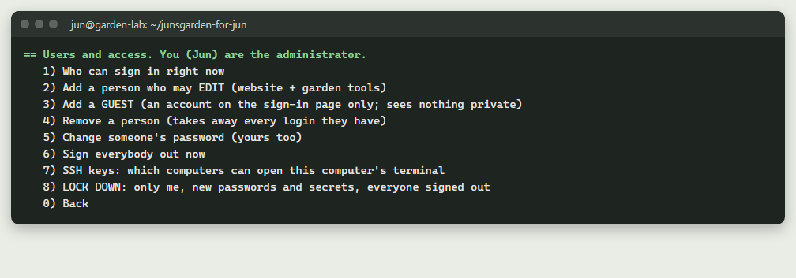

You are the administrator. `0) Back` returns to the main menu. Guide: `07-sso-gate.md`.

### 1) Who can sign in right now
- **What it does:** Lists everyone who can sign in, and the emails allowed into the garden tools.
- **When to use it:** To check who has access.
- **What it installs or changes:** Nothing.
- **To undo it:** Nothing to undo.

### 2) Add a person who may EDIT (website + garden tools)
- **What it does:** Asks their first name and email, adds them, then asks you to type a first password for them (tell them in person; they can change it).
- **When to use it:** When someone helps you edit the garden.
- **What it installs or changes:** Adds them to `GARDEN_USERS`, `GARDEN_UPLOADER_NAMES` and `BEDS_ALLOWED_EMAILS` in `.env`; restarts the website and garden tools.
- **To undo it:** Users, 4.

### 3) Add a GUEST (an account on the sign-in page only; sees nothing private)
- **What it does:** Asks a name and (optional) email and makes an account on the sign-in page only. Guests cannot edit or open the garden tools.
- **When to use it:** For a visitor who only needs to sign in.
- **What it installs or changes:** One account on the sign-in page.
- **To undo it:** Users, 4.

### 4) Remove a person (takes away every login they have)
- **What it does:** Takes the person out of every list and removes all their logins (website and sign-in page). It will not remove you.
- **When to use it:** When someone should no longer have access.
- **What it installs or changes:** `.env` lists and their accounts. Also check Users 7 for their SSH key.
- **To undo it:** Add them again (Users 2 or 3).

### 5) Change someone's password (yours too)
- **What it does:** Asks the name, then the new password (hidden). The same as More, 4.

### 6) Sign everybody out now
- **What it does:** Signs everyone out of the website and the sign-in page.
- **When to use it:** If a phone or computer was lost, or you are not sure who is signed in.
- **What it installs or changes:** A new random sign-in secret in `.env`; everyone must sign in again.
- **To undo it:** Nothing to undo; just sign in again.

### 7) SSH keys: which computers can open this computer's terminal
- **What it does:** Lists the keys in `~/.ssh/authorized_keys` (one per computer, labelled like user@computer). You can remove one by number.
- **When to use it:** To remove a computer you do not recognise or no longer use.
- **What it installs or changes:** Removes that line. A copy of the old list is kept in `~/.ssh/authorized_keys.bak`.
- **To undo it:** Copy the `.bak` file back over `authorized_keys`.

### 8) LOCK DOWN: only me, new passwords and secrets, everyone signed out
- **What it does:** Removes every login except yours (guests too), lets only your email into the garden tools, signs everyone out, makes new sign-in secrets and new database passwords (that step asks first), asks you for a NEW password, and shows the SSH keys. It asks "Lock down now?" first (default No).
- **When to use it:** If you think someone got in, or you want a fresh start on access.
- **What it installs or changes:** The user lists and secrets in `.env`, all accounts but yours. Afterwards do by hand: your Ubuntu password (`passwd`), the router's admin password, old Gmail app passwords, your No-IP password.
- **To undo it:** No undo; add people back with Users 2 or 3.
- **Command:** `bash garden.sh lockdown`

---

## API keys (K)

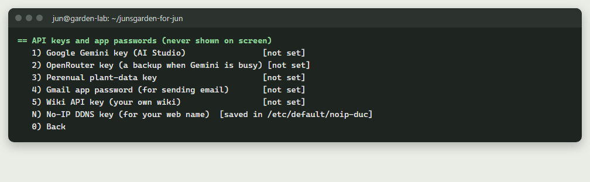

The screen lists each key with **set** or **not set** (and the date it last
changed). Keys are never shown on screen. They are saved in `.env`; the dates
(never a key) go in `logs/key-changes.log`. `0) Back` returns to the main menu.
Guides: `08-gemini-setup.md`, `16-ai-studio.md`.

### 1) Google Gemini key (AI Studio)
- **What it does:** Used by the website's AI boxes and the garden tools (tag reading, identify, diagnose). Free from aistudio.google.com.

### 2) OpenRouter key (a backup when Gemini is busy)
- **What it does:** Used by the AI boxes and garden tools when Gemini is busy. The garden only asks for models whose name ends in ":free".

### 3) Perenual plant-data key
- **What it does:** Plant facts in the plant admin and the garden tools' lookup. Free plan at perenual.com.

### 4) Gmail app password (for sending email)
- **What it does:** Password-reset emails and the sign-in page's emails. Choosing "Paste a new key" here opens the Email step (More, 3).

### 5) Wiki API key (your own wiki)
- **What it does:** Lets the garden tools' wiki queue publish drafts to your wiki. You make it inside your wiki (Administration > API Access).

### N) No-IP DDNS key (for your web name)
- **What it does:** Runs the No-IP updater setup: asks the DDNS key's username and password (hidden).
- **What it installs or changes:** If the No-IP updater is not installed yet, it downloads and installs it from noip.com. The key is saved in `/etc/default/noip-duc` (administrator only).
- **To undo it:** More, 14 stops the updater; Uninstall (More 12) removes it and its key.

### After you pick a key (1 to 5): its own small menu
- **1) Paste a new key (or replace the old one):** shows how to get one, then you paste it (nothing shows). It is saved, the programs that use it are restarted, and the key is tested. To undo: 4 (Remove), or paste the old one.
- **2) Test the key that is saved now:** asks the key's own service if it works. Changes nothing.
- **3) How to get a key, step by step:** shows the official steps. Changes nothing.
- **4) Remove this key:** empties it in `.env` and restarts the programs that use it. Also delete it at the service itself (the screen shows where). To undo: 1 (paste it again).
- **0) Back**

---

## The front door's three choices

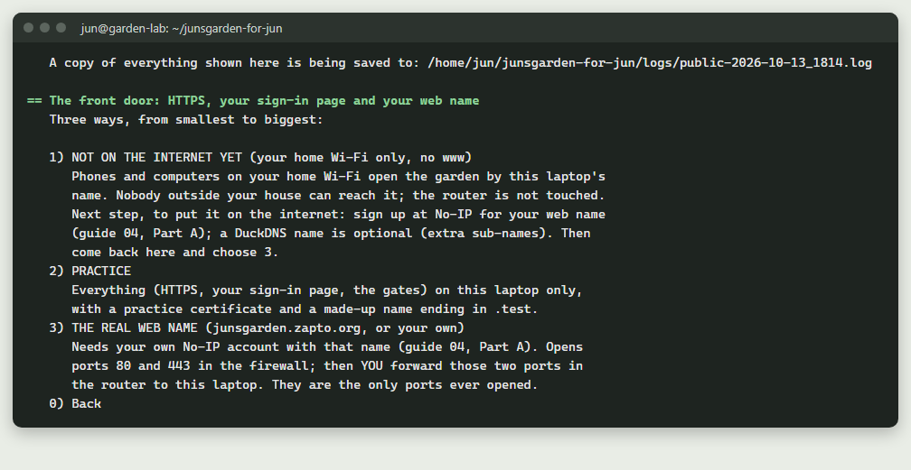

You get these from More, 1 (or Settings, 7, or `bash garden.sh public`).
`0) Back` changes nothing. Guide: `04-go-public-no-ip-caddy.md`.

### 1) NOT ON THE INTERNET YET (your home Wi-Fi only, no www)
- **What it does:** Phones and computers on your home Wi-Fi open the garden at `http://THIS-COMPUTER.local` or its IP address. Nobody outside your house can reach it. The garden tools (/beds) stay closed here.
- **When to use it:** To use the garden at home before your No-IP name is ready.
- **What it installs or changes:** Installs Caddy (from its official source) as a system service; writes `/etc/caddy/Caddyfile` (old one kept as `Caddyfile.bak`); firewall: port 80 from your home network only. The router is not touched.
- **On Windows' own Ubuntu (WSL):** other devices cannot reach it this way; it warns and asks "Carry on anyway?" (Enter = no). Only choice 2 works there; use a separate garden computer to go online (guide 00b).
- **To undo it:** More, 14.

### 2) PRACTICE
- **What it does:** Everything (HTTPS, your sign-in page, the gates) on this laptop only, with a made-up name ending in `.test` and a practice certificate. Firefox warns about the certificate: that is expected. At the end it asks for your sign-in password.
- **When to use it:** To try the real thing safely first.
- **What it installs or changes:** Installs Caddy and starts the sign-in page (Authelia); writes the Caddyfile; opens 80 and 443 in the firewall; adds the practice name to `/etc/hosts` (this laptop only).
- **To undo it:** More, 14. (Uninstall also removes the `garden.test` line from `/etc/hosts`.)

### 3) THE REAL WEB NAME (junsgarden.zapto.org, or your own)
- **What it does:** Asks your web name (it must be in YOUR No-IP account) and, if the wiki is on, an optional wiki web name. Sets up HTTPS, your sign-in page at `https://NAME/auth`, the gates, and the No-IP updater. Shows this computer's network details, then tells you to forward ONLY TCP 80 and 443 in the router to this computer. At the end it asks for your sign-in password.
- **When to use it:** When you are ready to be on the internet (guide 04, Part A first).
- **What it installs or changes:** Caddy, the sign-in page, `/etc/caddy/Caddyfile`, firewall doors 80 and 443, the No-IP updater with your DDNS key (`/etc/default/noip-duc`). `.env`: your web name and address. The router step you do yourself.
- **To undo it:** More, 14, then remove the 80 and 443 forwarding in the router.
- **On Windows' own Ubuntu (WSL):** the internet cannot reach it; as with choice 1, it warns first. Use a separate garden computer (guide 00b).
- Guides: `04b-take-over-junsgarden-zapto.md`, `07-sso-gate.md`.

---

## Subdomains (More 13; Windows: More 14)

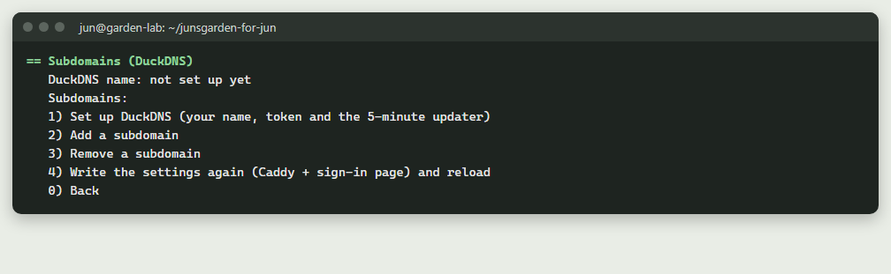

A free DuckDNS name can have sub-names (wiki.NAME.duckdns.org, ...). They all
come in through the same two doors (80 and 443) and Caddy gives each one its
padlock. Nothing new is opened in the router. `0) Back` returns to More.
Guide: `04-go-public-no-ip-caddy.md` (Advanced).

### 1) Set up DuckDNS (your name, token and the 5-minute updater)
- **What it does:** Shows the steps on duckdns.org, asks your DuckDNS name and token (hidden), and tests it.
- **When to use it:** Before adding any subdomain.
- **What it installs or changes:** The token in `~/.config/garden-duckdns/token` (only you can read it), `DUCKDNS_DOMAIN` in `.env`, a small updater script and a cron line that runs it every 5 minutes.
- **To undo it:** More, 14 removes the cron line; Uninstall removes the folder too.

### 2) Add a subdomain
- **What it does:** Asks the name (wiki = port 3000, n8n = 5678, status = 3001 for Uptime Kuma, home = 8123 for Home Assistant, or any name and its port) and whether it goes behind your sign-in page. Then rewrites Caddy's and the sign-in page's settings and reloads.
- **When to use it:** To put one more program online on its own address. Needs DuckDNS (1) and the front door (More 1, choice 2 or 3) first.
- **What it installs or changes:** `SUBDOMAINS` in `.env` (for wiki also `WIKI_SITE_URL`), `/etc/caddy/Caddyfile`, the sign-in page's rules. The wiki is left out until its setup is finished.
- **To undo it:** Subdomains, 3.
- Guides: `projects/P01-uptime-kuma.md`, `projects/P03-home-assistant.md`.

### 3) Remove a subdomain
- **What it does:** Asks the name, takes it out of the list, rewrites the settings and reloads.
- **To undo it:** Subdomains, 2.

### 4) Write the settings again (Caddy + sign-in page) and reload
- **What it does:** Rewrites Caddy's and the sign-in page's settings from `.env` and reloads Caddy. If Caddy's check fails, the old settings are put back.
- **When to use it:** After a change, or if something looks out of date.
- **What it installs or changes:** `/etc/caddy/Caddyfile` (old one kept as `Caddyfile.bak`).
- **To undo it:** Nothing to undo.

---

## AI cost control (LiteLLM) (More 15; Windows: More 16)

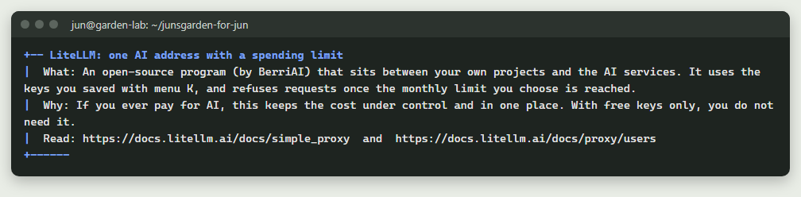

LiteLLM is one private AI address on this computer (`http://localhost:4000`)
for your OWN projects (n8n, coding tools, scripts). It holds your keys and stops at
a monthly limit. The garden website and garden tools keep using their own keys
directly. With free keys only, you do not need it. Guide: `16-ai-studio.md`.

### When it is off: "Switch LiteLLM on?"
- **What it does:** Asks the monthly limit in US dollars (0 = free models only), then starts LiteLLM with two models: `gemini-flash` and `free-openrouter`.
- **What it installs or changes:** Downloads the LiteLLM image; writes `local/litellm/config.yaml` (no keys in it); `LITELLM_BUDGET` and `LITELLM_PORT` in `.env` (4000, or the next free port); starts the container `garden-llm` (this computer only).
- **To undo it:** LiteLLM menu, 7.

### When it is on: its menu (`0) Back` returns to More)
Every change rewrites `local/litellm/config.yaml` and restarts LiteLLM.

### 1) Add a Gemini model (uses your Gemini key, menu K)
- **What it does:** Asks the Gemini model id and a short name your projects will use. **To undo it:** LiteLLM, 4.

### 2) Add an OpenRouter model (uses your OpenRouter key; ":free" models cost nothing)
- **What it does:** Asks the OpenRouter model id and a short name. **To undo it:** LiteLLM, 4.

### 3) Add a local model from Ollama (your own AI computer, guide 15)
- **What it does:** Asks the Ollama computer's address, the model name and a short name. **To undo it:** LiteLLM, 4.

### 4) Remove a model
- **What it does:** Asks the short name and removes that model. **To undo it:** add it again (1, 2 or 3).

### 5) Change the monthly spending limit
- **What it does:** Asks the new limit in US dollars; saved in `.env` and the settings file. **To undo it:** choose 5 again.

### 6) Show the gateway key (to paste into one of your projects)
- **What it does:** Shows `LITELLM_MASTER_KEY` on screen. Treat it like a password. Changes nothing.

### 7) Switch LiteLLM off
- **What it does:** Asks first (default No). Switches the part off and removes its container. Its settings are kept. **To undo it:** More 15 again.

---

## Uninstall (More 12)

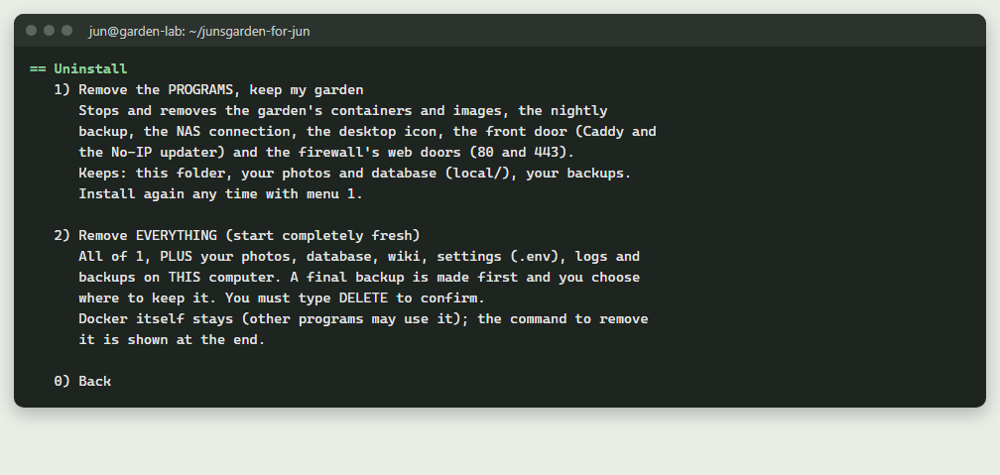

`0) Back` changes nothing.

### 1) Remove the PROGRAMS, keep my garden
- **What it does:** Asks first (default No). Removes what the setup added to Ubuntu, but not your garden.
- **What it installs or changes:** Stops and removes the garden's containers and the images built here; removes the backup schedule and the automatic check-up (cron), the desktop icon, every network place connection (the files on them stay), Caddy, the No-IP updater and its key, the DuckDNS updater; closes firewall doors 80 and 443; removes the `garden.test` line from `/etc/hosts`. Keeps: this folder, `local/` (photos and database), your backups. Not removed (you decide): Docker, the SSH server, git, the 4 GB swap file (the screen shows how).
- **To undo it:** Main menu 1 (INSTALL) again.

### 2) Remove EVERYTHING (start completely fresh)
- **What it does:** Makes a final backup first (also copied to the NAS if connected), asks which folder to move it to (empty = your Home folder), then you must type `DELETE`. Then it does all of choice 1, PLUS deletes your photos, database, wiki, settings (`.env`), logs and backups on this computer.
- **What it installs or changes:** Deletes `local/`, `backups/`, `logs/`, `help/`, `.env`, the remembered choices and checklist files; removes the Google Drive connection from rclone; removes the garden's own leftover Docker storage (volumes; other programs' are left alone). The program files stay in the folder.
- **To undo it:** Put the final backup into `backups/`, then main menu 1 (INSTALL): it loads your garden from it.

---

## Windows-only items

The Windows main menu has the **same numbers and letters** as Ubuntu, plus **T**.
Most items simply run `bash garden.sh WORD` on the garden computer (over SSH,
or inside Windows' own Ubuntu, WSL) and show it in this window. These ones
work differently on Windows:

### 1) INSTALL  (first time, or carry on, or repair)
- **The first time:** `Start-Here-Windows.cmd` opens the setup wizard (guides 00b and 23), which runs this same install with your answers, so the install does not ask them again. Menu 1 is then for carrying on or repairing.
- **Before it starts:** If the garden folder is inside OneDrive, `Start-Here-Windows.cmd` first offers to move it out (to `C:\Users\<you>\junsgarden-for-jun`, or a place you pick), checks every file arrived, and opens the installer from the new place. The old folder is never deleted for you. The Windows menu's INSTALL shows a note about it too. Guide: `00b-before-you-start.md`, "If your Desktop is in OneDrive".
- **What it does:** Asks where the garden runs if you have not chosen yet (see T). Another computer: checks the SSH port, makes this PC's SSH key and adds it there (you type its password once). This PC: switches on WSL (then restart Windows once), installs Ubuntu 24.04 named `JunsGarden`, and makes your Ubuntu user; with Docker Desktop, it installs Docker Desktop (winget) if needed and waits for its WSL integration switch (guide 26). Then asks: keep the web name or a new one. Copies the garden folder (the `PDF guides` folder stays on this PC) and newest backup, sends the photos and wiki zips straight there from the garden folder, the Desktop (also a OneDrive Desktop) or Downloads (no extra copy on the PC), and runs `garden.sh install` there.
- **What it installs or changes:** On this PC: `.ssh\id_ed25519` (if new), `.garden-target-windows.txt`; with WSL, Windows' Ubuntu, and (if you say yes) a Task Scheduler task "Jun's Garden keep running" so Ubuntu stays on while you are signed in. On the garden computer: everything menu 1 installs.
- **To undo it:** More 12 (Uninstall) on the garden computer. Windows' Ubuntu and the Task Scheduler task are not removed by the menu; remove them in Windows yourself.

### 4) Open the website
- **What it does:** With WSL: opens `http://localhost:8030`. With another computer: opens a new window that IS a secure tunnel (this PC's port 18030 to the garden computer's website), then opens `http://localhost:18030`. Close that window to stop the tunnel.
- **What it installs or changes:** Nothing.

### L) Language on the garden computer: English / Korean / both
- **What it does:** Runs the language choice on the garden computer (the same as Ubuntu's L).

### T) Choose the garden computer
- **What it does:** 1) another computer at home (asks its local IP, or type `F` to find the computers at home with SSH, and your user name on it), or 2) this Windows PC inside WSL, then asks: Docker Desktop (the easy way) or Docker inside Ubuntu.
- **What it installs or changes:** Saves the choice in `.garden-target-windows.txt` (IP and user name only, never a password).
- **To undo it:** Choose T again.

### The Windows More menu: numbers that differ from Ubuntu

| Windows More | What it is | Ubuntu More |
|---|---|---|
| 1 to 4 | the same as Ubuntu | 1 to 4 |
| 5 | Open a terminal on the garden computer | (Ubuntu 5 is "Install on ANOTHER computer") |
| 6 to 9 | the same as Ubuntu | 6 to 9 |
| 10 | Copy the newest backup to THIS PC | (Ubuntu 10 is "Desktop icon") |
| 11, 12 | the same as Ubuntu | 11, 12 |
| 13 | Weekly automatic copy of the backup to THIS PC (on / off) | (Windows only) |
| 14 | Subdomains with DuckDNS | 13 |
| 15 | On / off: the whole garden, or only off the internet; check-up, clean-up | 14 |
| 16 | AI cost control: LiteLLM | 15 |
| 17 | Website name swap | 16 |
| 18 | Desktop shortcuts: Garden terminal (SSH) and Garden screen (Remote Desktop) | (Windows only) |
| 19 | Reach the garden from anywhere, privately (Tailscale): on / off | 17 |
| 20 | Rename or move a file or folder | 18 |
| 21 | Find the garden computer again (if its address changed) | (Windows only) |

Messages printed by `garden.sh` use the Ubuntu numbers. On Windows, add one for
Ubuntu 13 to 16 (Ubuntu "menu M, then 13" is Windows More 14), and two for Ubuntu
17 and 18 (Tailscale is Windows More 19, rename is Windows More 20).

### More 5) Open a terminal on the garden computer
- **What it does:** Opens a new window with the garden computer's terminal (SSH, or WSL Ubuntu in the garden folder).
- **What it installs or changes:** Nothing.
- **To undo it:** Close the window.

### More 8) Look inside the database (Adminer, on the garden computer: http://localhost:8082 there)
- **What it does:** Runs `garden.sh dbweb` on the garden computer (the same as Ubuntu More 8). Adminer only answers on the garden computer itself (127.0.0.1:8082).
- **To undo it:** `bash garden.sh dbweb-stop` on the garden computer (More 5 opens its terminal).

### More 10) Copy the newest backup to THIS PC
- **What it does:** Makes a NEW backup on the garden computer, then copies the newest backup into the `backups` folder of this PC's garden folder.
- **What it installs or changes:** One new backup there, one file here.
- **To undo it:** Delete the file on this PC if you do not need it.

### More 13) Weekly automatic copy of the backup to THIS PC (on / off)

- **What it does:** First asks where the copies go: `1` pick a folder in a window (this PC, a USB drive, Google Drive for desktop, or a NAS under "Network" on the left), `2` type a folder like `C:\Backups\weekly` or a network path like `\\192.168.1.20\backups`, or `3` keep it as it is (at first, `backups\from-garden-computer\` in the garden folder). It makes a `junsgarden-backups` folder inside the place you chose, checks it can write there, remembers it, and warns if it is inside OneDrive. Then it adds a Task Scheduler task, "Jun's Garden - copy backup to this PC", every Sunday at 11:00 (or as soon as the PC is on, if it missed one). The task copies the newest backup (it makes no new one) into that folder and keeps the newest 8. Offers a first copy now.
- **When to use it:** For a second copy on another computer, without remembering. Needs the garden computer on at that time. A NAS: open it once in File Explorer first and sign in with "Remember my credentials" ticked, or the menu cannot write there.
- **What it installs or changes:** The task; the chosen place in `.garden-target-windows.txt`; copies in the chosen folder; a log in `logs\backup-copy.log`.
- **To undo it:** Choose More 13 again: it asks "Change where the copies go?", then (if you answer `n`) "Remove the weekly copy?". The copies already made stay.
- **Guide:** `13-backups-and-folders.md`, "A copy on your Windows PC".

### More 17) Website name swap: use another web name than junsgarden.zapto.org
- **What it does:** Runs the name swap on the garden computer (Ubuntu More 16), then makes this PC's copy of the files say the same name, so a later INSTALL from this PC does not copy the old name back.
- **What it installs or changes:** The same files on both computers. Old copies on this PC go to `logs\web-name-change-windows_DATE\`.
- **To undo it:** Run it again with the old name.

### More 18) Desktop shortcuts: Garden terminal (SSH) and Garden screen (Remote Desktop)
- **What it does:** Puts two shortcuts on the Windows desktop: **Garden terminal** opens a terminal on the garden computer (SSH, encrypted; with Windows' own Ubuntu it opens that), and **Garden screen** opens Remote Desktop Connection to a separate garden computer.
- **When to use it:** To work on the garden computer from your PC, or see its screen from another room.
- **What it installs or changes:** Two files on your desktop. Nothing on the garden computer. For Garden screen, switch Remote Desktop on in the garden computer's Settings first (guide 20).
- **To undo it:** Delete the two shortcuts.
- **Guide:** `20-ssh-and-remote-desktop.md`

### More 20) Rename or move a file or folder
- **What it does:** Runs the rename tool on the garden computer (Ubuntu More 18), then makes this PC's copy of the garden folder match: it copies the changed files here and renames the same site files, so a later INSTALL from this PC does not bring the old names back.
- **What it installs or changes:** The same files on both computers. This PC's old files go to `logs\rename-windows_DATE\`.
- **To undo it:** Run it again with the names swapped.

### More 21) Find the garden computer again (if its address changed)
- **What it does:** Checks the garden computer still answers at its saved address. If not, it looks at the computers at home with the SSH door open (port 22), finds the one with the same network card (MAC address) or name, and saves its new address. If it is not found, it lets you choose it again (with a list). The menu does this by itself before each job and before the weekly backup copy.
- **When to use it:** When your router cannot reserve an address, or after a new router.
- **What it installs or changes:** Only the saved address (and the network card ID and name) in `.garden-target-windows.txt`. It only knocks on port 22; nothing logs in.
- **Guide:** `14-reserve-your-ip.md`, "If your router cannot reserve an address".

---

## Every command word

Type `bash garden.sh WORD` in the garden folder. A word that is not in this
list shows the short help at the top of `garden.sh`. New to typing commands?
`22-bash-walkthrough.md` is a first walkthrough of the terminal, one step at a time.

| Word | Same as | Word | Same as |
|---|---|---|---|
| `install` | menu 1 | `start` / `stop` | menu 2 / 3 |
| `open` | menu 4 | `check` | menu 5 |
| `backups` | menu 6 | `restore [FILE]` | menu 7 |
| `settings` | menu 8 | `parts` | menu 9 |
| `users` | U | `keys` | K |
| `addresses` | A | `helpme` | H |
| `language` | L | `lockdown` | U, 8 |
| `backup [LABEL]` | Backups 1 | `verify [FILE]` | Backups 3 |
| `nas` | Backups 4 | `cloud` | Backups 5 |
| `photos` | Backups 11 | `public` | More 1 |
| `network` | More 2 | `email` | More 3 |
| `password [NAME]` | More 4 | `remote` | More 5 |
| `logs` | More 6 | `rebuild` | More 7 |
| `dbweb` | More 8 | `ai` | More 9 |
| `icon` | More 10 | `files` | More 11 |
| `uninstall` | More 12 | `subdomains` | More 13 |
| `offline` | More 14, 3 | `llm` | More 15 |
| `webname` | More 16 | `tailscale` | More 17 |
| `rename` | More 18 | `power` | More 14 |
| `off` / `on` | More 14, 1 / 2 | `checkup` / `cleanup` | More 14, 4 / 5 |
| `renames` | More 18, 4 | | |

Commands with no menu number:

- `bash garden.sh wiki`: runs the wiki's setup again (adds the garden pages once the wiki add-on zip is there).
- `bash garden.sh dbweb-stop`: stops and removes Adminer.
- `bash garden.sh redo-renames`: after restoring an old backup by hand, does its renames again.
- `bash garden.sh db`: a database command line (type SQL; leave with `exit`). Guide: `12-your-database.md`.
- `bash garden.sh test`: runs the website's Rust tests (slow the first time).
- `bash garden.sh backup auto`: what the automatic schedule runs every hour (it decides whether a backup is due); one line in `backups/backup.log`.

---

## Adding something new later

The garden works with none of these. Each one is an optional add-on, and each
can be switched off again:

| Add-on | Switch on | Switch off |
|---|---|---|
| Garden tools, wiki, n8n | Parts (9) | Parts (9), the same number, then A |
| Wiki pages (`junsgarden-wiki-addon.zip`) | wiki ON, then `bash garden.sh wiki` | wiki OFF in Parts |
| Photos (`junsgarden-photos-addon.zip`) | Backups 11 | (plain files; nothing runs) |
| Home Wi-Fi, practice, or online (front door) | More 1 | More 14, 3 |
| Subdomains (DuckDNS) | More 13 (Windows 14) | Subdomains 3; More 14, 3 stops the updater |
| LiteLLM (AI spending limit) | More 15 (Windows 16) | LiteLLM menu, 7 |
| Email (Gmail) | More 3 | K, Gmail app password, 4 |
| NAS copies | Backups 4 (a second or third place: Backups 13) | Backups 8 |
| Google Drive copies | Backups 5 | Backups 8 |
| Local AI computer (Ollama) | More 9 | More 9, empty address |
| Weekly copy to a Windows PC | Windows More 13 | Windows More 13 again |

Before adding a new program of your own: put it online as a **subdomain**
(More 13). It then comes in through the same doors 80 and 443 and can sit behind
your sign-in page, so no new port is ever opened in the router.
