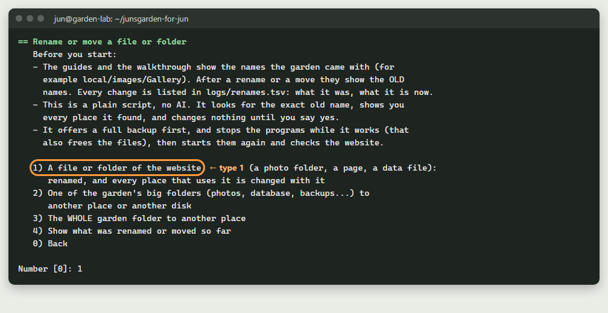
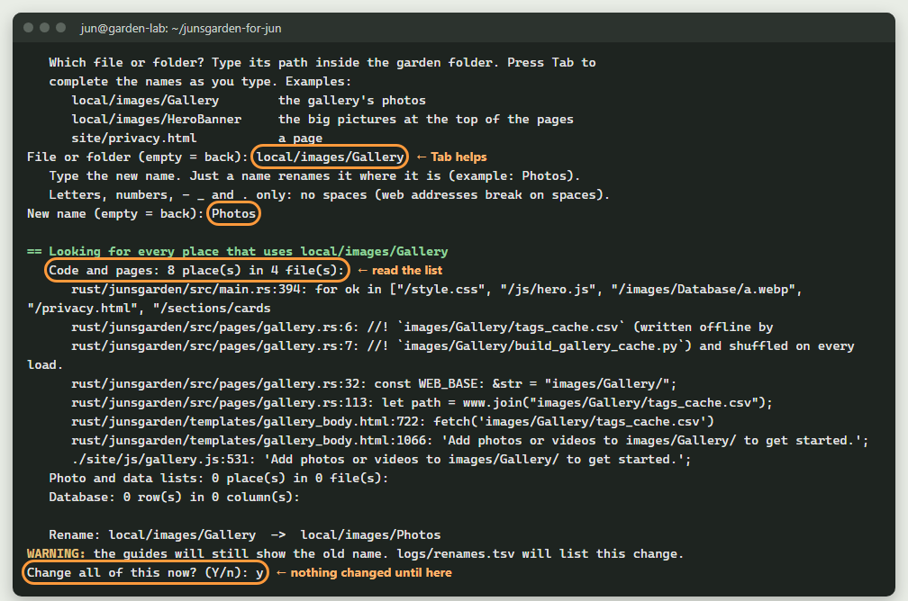
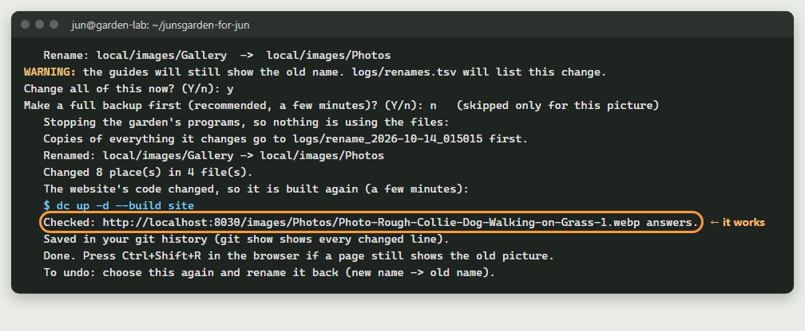
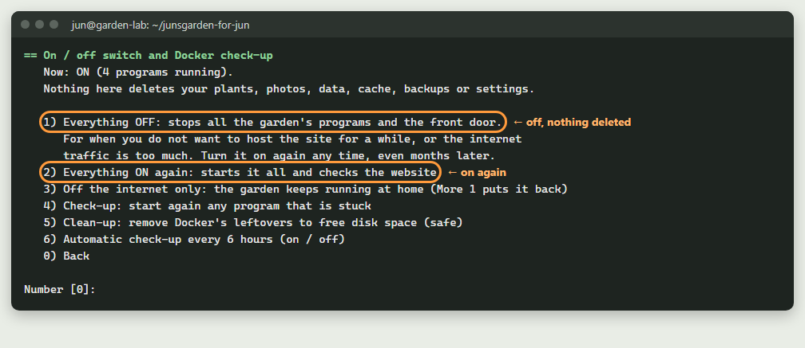
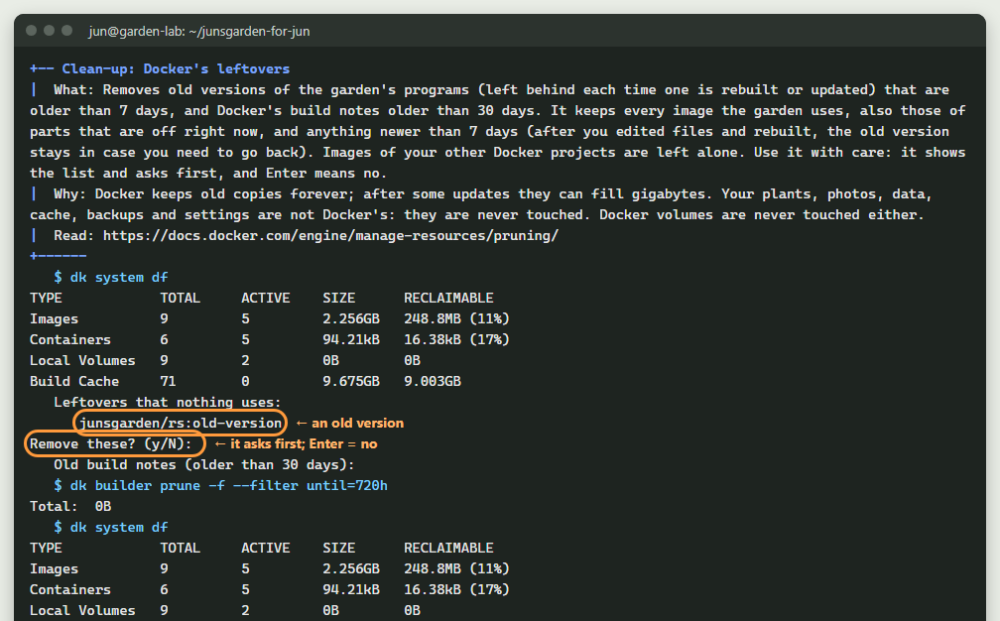
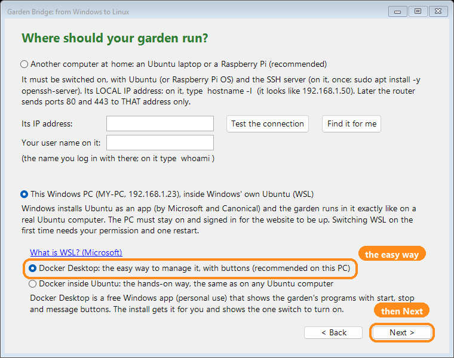

# 26. Rename, move, switch off and tidy up

## Quick version
*No time to read it all? This is the short version. The full guide is below.*

- **Rename or move a file or folder:** menu `M`, then `18` (or menu `8`, then `8`). Every place that uses the name changes with it: the code, the pages, the photo lists and the database.
- It shows you every place first, offers a backup, and changes **nothing** until you type `y`.
- **The guides keep the old names.** After a rename they show the names the garden came with. `logs/renames.tsv` lists what is called what now (menu `M`, `18`, then `4`).
- **The on / off switch:** menu `M`, then `14`. **Off** stops everything and deletes nothing. **On** works even months later and checks the website.
- **Check-up** starts again a program that is stuck. **Clean-up** removes only Docker's leftovers, never your plants, photos, data, cache or backups.
- On Windows the Windows menu has the same: `M`, then `20` (rename) and `15` (switch).
- These are plain scripts, with no AI inside: each does one job, and you can read every line.

---

## Why rename?
The garden came with the names Jason gave it: `local/images/Gallery`, `HeroBanner`,
`privacy.html` and so on. You may want your own. Renaming only the folder would
break the website, because the code and the database still use the old name. This
tool changes the name **everywhere it is used**, in one go, so nothing gets
disconnected.

It is a plain search and replace. It looks for the **exact** old name (capitals
too), and only where it is a whole name: `Gallery` is not `Gallery2`, and `app.js`
is not `app.js.map`. A short page name like `privacy.html` only counts right after
a `/` or a quote, so the same word in a sentence is never changed.

## 1. Rename a folder, step by step
The example renames the gallery's photo folder from `Gallery` to `Photos`.

1. Menu `M`, then `18`. The tool explains itself first.

2. Type `1` (a file or folder of the website) and press Enter.
3. Type the folder's path: `local/images/Gallery`. Press **Tab** while typing: it
   finishes the names for you, so there are no typing mistakes.
4. Type the new name: `Photos`. Letters, numbers, `-` `_` and `.` only: no spaces
   (web addresses break on spaces).
5. **Read the list.** It shows every line it will change, the photo lists, and the
   database rows. Nothing has changed yet.

6. Type `y` to change it all. Then `y` for a full backup first (recommended, a
   few minutes).
7. Wait. It stops the programs (that also frees the files), renames the folder,
   changes every place, builds the website again if its code changed (a few
   minutes), starts everything, and **checks** that a photo answers under the new name.

8. Open the website and press `Ctrl+Shift+R` (the browser then fetches the new pages).

### What it changes
| Where | Example |
|---|---|
| The code and the pages | `rust/`, `site/`, `beds/`, `docker-compose.yml` |
| The photo and data lists | the gallery's `tags_cache.csv` |
| The database | the rows of the garden's and the wiki's tables that name it |
| Your settings | `IMAGE_FOLDERS` in `.env`, so a later install makes the new name |
| Your git history | one entry: `Renamed ... (menu M, 18)` |

Before it changes anything it keeps copies of every file and database row it
changes, in `logs/rename_DATE/`.

### What it does not rename
It says so and changes nothing:
- **The programs themselves:** `rust/`, `beds/`, `docker/`, `garden.sh`. Renaming them would break the garden.
- **Folders the programs make and use by name:** `local/images/plan/web`, `local/images/plan/tags`, `local/images/Database/.thumbs`, and `site/apps` (phones look there for app updates).
- **A name with a space or a sign in it:** it cannot be in a web address as it is.
- **A photo moved into another photo folder,** or a photo whose name is also in another photo folder: the database keeps only the name, so it could not tell them apart.

### To undo
Choose it again and rename it back: new name, then old name. Or copy the files
from `logs/rename_DATE/` back.

### After restoring a backup
A backup made **before** a rename has the old names. After a restore (menu `7`) or
loading the photos download again, the menu notices and offers to do the rename
again. You can also run it yourself: `bash garden.sh redo-renames`.

## 2. Move a big folder to another place or disk
Menu `M`, `18`, then `2` (it is also menu `8`, then `8`, then `2`). For example the
photos to a bigger disk: type the whole path, like `/mnt/bigdisk/garden-photos`.

- The new place must be on a **Linux disk** (ext4). Windows and USB disks (NTFS,
  exFAT) cannot keep Linux owners and permissions, so the database would break.
  It checks this for you. Only the backups folder may go on any disk.
- It stops the garden, moves the folder, saves the new place in `.env`, and starts again.

## 3. Move the whole garden folder
Menu `M`, `18`, then `3`. For example `/mnt/bigdisk/junsgarden`.

It moves everything, counts the files before and after, and fixes what points at the
folder: the nightly backup schedule, the automatic check-up, the desktop icon, and
Docker's programs (they are made again from the new place). It offers to leave a
**signpost** (a link) at the old place: say yes on Windows, because the Windows
menu looks for the garden there. To move it back, choose `3` again and type the old
place: the signpost is replaced by the garden.

When the menu closes, the terminal is still in the old place: type `cd` and the new place.

## 4. The on / off switch
Menu `M`, then `14`.

- **`1` Everything OFF.** For when you do not want to host the site for a while, or
  the internet traffic is too much. It runs `docker compose down` (**without** `-v`)
  and stops the front door. Your plants, photos, data, cache, backups and settings
  stay in their folders. The nightly backup rests too: nothing changes while it is off.
- **`2` Everything ON again,** after a day or after months. It starts everything,
  waits for the website, and says how many plants it found. If it was off a while,
  it offers a backup.
- **`3` Off the internet only:** the garden keeps running at home; menu `M`, `1` puts it back online.

While it is off, **keep confirming your free No-IP name** every 30 days (No-IP
emails you a link), or the name is lost. The padlock certificate renews by itself
when the garden is on again.

From a terminal: `bash garden.sh off` and `bash garden.sh on`.

## 5. Check-up
`4` checks every garden program: one that stopped with an error, is "unhealthy", or
keeps restarting is made again and started. If the website does not answer, it is
restarted. It never deletes a file.

`6` runs it by itself every 6 hours (a cron line; see it with `crontab -l`). It writes
what it fixed in `logs/checkup.log`, and does nothing while the garden is switched off.

## 6. Clean-up
Docker keeps old versions of programs forever; after some updates they can fill
gigabytes. `5` removes:
- old versions of the garden's own programs (left behind by each rebuild or update), older than 7 days,
- Docker's build notes older than 30 days.

Use it with care. It shows the list and asks first, and pressing Enter means **no**. It
**keeps** every image the garden uses, also of parts that are off now, anything newer
than 7 days (after you edit files and rebuild, the old version stays in case you need
to go back), and never touches the images of your other Docker projects.
It never runs `docker volume prune`, `docker system prune --volumes`, or anything
with `-v`. It only runs while the garden is on, so it can see what the garden uses.

## 7. On Windows: two ways to run Docker
When you install on **this Windows PC**, the installer asks which Docker runs the
garden's programs:

| | Docker Desktop (the easy way) | Docker inside Ubuntu (the hands-on way) |
|---|---|---|
| What you see | a Windows app with buttons: the programs, start, stop, their messages | the menu and the terminal |
| Starts | with Windows | when Windows' Ubuntu runs |
| Install | the installer gets it (winget) and shows the one switch | nothing more on Windows |
| Cost | free for personal use and small businesses | free |

With Docker Desktop, the installer waits for one switch: Docker Desktop >
Settings > Resources > WSL integration: switch **on** `JunsGarden`, then
**Apply & restart**. The garden's programs then show in Docker Desktop under
**Containers**, as `junsgarden`.

If you chose Docker inside Ubuntu and also have Docker Desktop for other things,
keep that switch **off** for `JunsGarden`. The checklist (menu `5`) warns you if it is on.

### An old Windows PC (Windows 7 or 8)
The garden does not run there, and it should not: Windows 7 gets no security
updates since January 2020, which makes it unsafe for a website on the internet,
and it has no WSL, no built-in SSH and no current Docker. Two good ways instead:
- Put Ubuntu on that old laptop (Ubuntu runs well on old computers; guide 01). Copy
  your files to a USB stick first.
- Run the garden on another computer, and use any other PC or phone to reach it (guide 20).

## Read more
- `docker compose down`: <https://docs.docker.com/reference/cli/docker/compose/down/>
- Docker's clean-up commands: <https://docs.docker.com/engine/manage-resources/pruning/>
- Docker Desktop on Windows: <https://docs.docker.com/desktop/setup/install/windows-install/>
- Docker Desktop and WSL: <https://docs.docker.com/desktop/features/wsl/>
- Windows 7 support ended: <https://learn.microsoft.com/lifecycle/products/windows-7>
