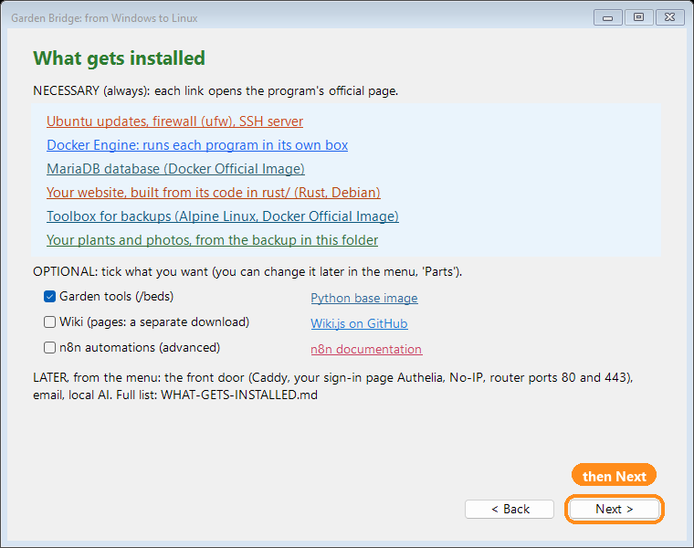

# 00b. 시작하기 전에: 필요한 것, 가입할 것, 걸리는 시간

> 영어 원문: [../00b-before-you-start.md](../00b-before-you-start.md)

놀랄 일은 없어요. 필요한 것은 모두 이 페이지에 있어요. **꼭 필요한 것**과 **선택**으로
나누었고, 각 부분이 보통 얼마나 걸리는지도 적었어요. 한 번에 다 할 필요는 없어요.
어느 단계든 멈췄다가 나중에 이어서 할 수 있고, 메뉴가 어디까지 했는지 기억해요.

## 왜 이렇게 만들었나요(Jason이 쓰는 글)

어려운 공부 없이도 나만의 Linux 웹 서버를 가질 수 있도록 자동으로 하는 길을 골랐어요.
설치가 일을 대신 하고, 하는 동안 단계마다 설명해 줘요. 그래서 쉽게 할 수 있어요.
그리고 Custom(사용자 지정)을 고르면 모든 부분을 직접 고를 수 있어요. 나누어서 하도록
만들었어요: 멈추고, 돌아와서, 이어서 하세요. 나중에 주요 폴더를 옮길 수 있고(메뉴 8),
나만의 웹 이름을 고를 수도 있어요(Website name swap, 웹사이트 이름 바꾸기).

집 네트워크와 컴퓨터를 지키도록 만들었어요. 인터넷에서 닿을 수 있는 것은 정문(Caddy)
하나뿐이고, 그것도 웹 포트 두 개에서만이에요. 나머지는 모두 정원 컴퓨터 안에서만
들어요. 방화벽이 켜져 있고, 처음부터 들어 있는 계정은 아무에게도 없어요. 모든 비밀번호와
키는 그 컴퓨터에서 새로 만들어져요. 집에서 쓸 수 있는 예산 안에서 제가 아는 좋은 방법을
모두 따랐어요. 인터넷에 드러나는 것을 최대한 작게 하려고요.

이제 이것은 당신의 프로젝트예요.

## Easy(쉽게)와 Custom(사용자 지정) 중 무엇?

설치가 한 번 물어봐요. 둘 다 번호가 붙은 똑같은 14단계를 써요.

| | **1) EASY**(쉽게, 추천) | **2) CUSTOM**(사용자 지정) |
|---|---|---|
| 질문 | 내 이름, 이메일, 데이터베이스 비밀번호(Enter = 대신 만들어 줘요), 웹 이름을 그대로 쓸지 새로 고를지. 마지막에: 내 비밀번호와 AI 키 | 똑같아요. 그리고 선택 부분을 하나씩 묻고, 몇 번째 단계부터 시작할지도 물어요 |
| 설치하는 것 | 꼭 필요한 것 모두, 그리고 정원 도구 | 내가 고른 것: 정원 도구(기본 Yes), 위키(기본 No), n8n(기본 No) |
| 사진 | 사진 다운로드 파일이 있으면 알아서 불러와요 | 내가 골라요: 지금, 또는 나중에(메뉴 6, 그다음 11) |
| 위키 | 꺼져 있어요. 언제든 켤 수 있어요(메뉴 9) | 물어봐요(기본 No) |

어느 쪽이든 나중에 부분을 더하거나 뺄 수 있어요(안내서 [19](19-every-menu-option.md)에 모든 선택이 있어요).

## 필요한 것: 꼭 필요해요

| 무엇 | 왜 | 시간 |
|---|---|---|
| 계속 켜 둘 수 있는 **정원 컴퓨터**: Ubuntu 노트북, Raspberry Pi 5, 또는 이 Windows PC(Windows 자체의 Ubuntu 사용. 이 PC에서만 쓰는 용도예요, 아래를 보세요) | 정원이 그 위에서 돌아가요 | 노트북: 처음 Ubuntu를 설치하는 데 2~3시간(안내서 [01](01-ubuntu-laptop.md)). 스타터 키트가 있는 Pi 5: 약 1시간. Windows: 설치 프로그램이 설정해요(재시작 한 번) |
| **디스크 빈 공간**: Ubuntu 노트북은 약 60 GB. Windows는 C:에 약 60 GB | Docker, 웹사이트, 사진, 그리고 매일 밤 백업 7개(모두 합쳐 약 6 GB) | 할 일은 없어요. 시작하기 전에 확인만 하세요 |
| **USB 메모리, 16 GB 이상**(노트북에 Ubuntu를 설치할 때만) | Ubuntu 설치용(안의 내용은 지워져요) | 2~3시간 안에 들어 있어요 |
| Google Drive 폴더의 **다운로드 파일 세 개** | 정원(약 70 MB), 사진(약 800 MB), 위키 페이지(1 MB 미만, 위키를 원할 때만) | 정원: 1~2분. 사진: 빠른 인터넷에서 약 2분, 느린 인터넷에서 15~20분 |
| **설치**(메뉴 1) | 모든 것을 하나로 맞춰요 | 30~90분, 대부분 기다리는 시간이에요. 단계마다 걸리는 시간을 보여 줘요. 가장 긴 단계인 웹사이트 만들기(빌드)는 15~45분 걸려요(아주 오래된 노트북이나 Pi에서는 1시간까지) |
| 정원용 **내 비밀번호** | 내 로그인, 그리고 내 로그인 페이지 | 1분 |

**설치하는 데 가입은 필요 없어요.** 정원은 어디에도 계정이 없이 집에서 작동해요.

### 설치를 시작하기 전에 알아 두면 좋은 것
- **Ubuntu를 막 새로 설치했다면**, Ubuntu가 뒤에서 10~30분 동안 스스로 업데이트해요.
  설치의 3단계(Ubuntu updates and tools, Ubuntu 업데이트와 도구)가 설치할 수 없다고 하면,
  15분 기다렸다가 다시 `1`을 고르세요: 이어서 해요.
- **긴 빌드가 끝난 뒤**(웹사이트 만들기) Ubuntu 비밀번호를 다시 물을 수 있어요. 입력할
  때까지 아무 일도 일어나지 않으니, 가끔 창을 확인하세요.

### Windows PC에서(Windows 자체의 Ubuntu, WSL 안의 정원)

- **무엇에 쓰나요:** 이 PC 자신에서 정원을 쓰는 용도예요. 정원을 인터넷에 올리는 것, 그리고
  집에 있는 휴대폰과 다른 컴퓨터에 보여 주는 것은 Windows 자체의 Ubuntu에서는 안내서에
  적힌 대로 되지 않아요: PC 안에 자기만의 내부 주소가 있어서 공유기와 휴대폰이 닿을 수
  없어요. 그런 일에는 따로 있는 정원 컴퓨터(Ubuntu 노트북 또는 Raspberry Pi)를 쓰세요.
  더 알고 싶다면 Microsoft가 WSL의 네트워크를 여기서 설명해요(읽기만 하세요. 정원은 이것을
  설정하지 않아요): <https://learn.microsoft.com/windows/wsl/networking>
- **재시작 한 번:** 처음에는 Windows가 WSL을 켜도 되는지 허락을 묻고, 재시작이 한 번
  필요해요. 재시작한 뒤 `Start-Here-Windows.cmd`를 다시 더블클릭하고 같은 페이지를
  넘기세요: 멈춘 곳부터 이어서 해요.
- **Ubuntu 사용자 이름과 비밀번호:** Ubuntu 사용자 이름(예: `jun`)과 비밀번호를 정하라고
  해요. 비밀번호는 두 번 입력해요(입력하는 동안 아무것도 보이지 않아요). 적어 두세요.
  바로 뒤에 그 비밀번호를 다시 물어봐요.
- **다운로드:** WSL용 Ubuntu는 수백 MB를 내려받아요.
- **재시작한 뒤 WSL이 시작되지 않으면:** PC의 BIOS에서 가상화(virtualization)를 켜야 할 수
  있어요. Microsoft 도움말: <https://learn.microsoft.com/windows/wsl/troubleshooting>
- **PC가 절전 모드로 들어가면 안 돼요.** 그러면 정원이 멈춰요: Settings(설정), System(시스템),
  Power(전원), Sleep(절전) = **Never**(안 함).
- **C:에 빈 공간 약 60 GB**(위의 표를 보세요).

### 바탕 화면이 OneDrive 안에 있다면

Windows 11 PC에서는 바탕 화면(Desktop), 문서(Documents), 사진(Pictures) 폴더가
**OneDrive** 안에 있는 경우가 많아요. OneDrive는 Microsoft의 온라인 저장소예요: 자기 폴더
안에 있는 모든 것을 인터넷에 올려요(업로드). 파일 탐색기에서 폴더의 경로를 보면 알 수
있어요: 경로에 `OneDrive`가 들어 있어요. 예:
`C:\Users\Jun\OneDrive\Desktop\junsgarden-for-jun`.

이것은 정원에 문제가 돼요. OneDrive 무료 요금제는 **5 GB**까지예요. 정원의 내려받은
파일은 약 900 MB이고, 백업 사본은 금방 5 GB를 넘어요. 그래서 OneDrive가 곧 가득 차고,
쓸데없이 큰 파일을 계속 올리게 돼요.

그래서 `Start-Here-Windows.cmd`를 더블클릭했을 때 정원 폴더가 OneDrive 안에 있으면,
설치 프로그램 페이지보다 먼저 작은 창이 열려요:

- **Move it to `C:\Users\<you>\junsgarden-for-jun` (recommended)**(여기로 옮기기, 추천):
  정원 폴더를 내 사용자 폴더로 옮겨요(`<you>`는 내 Windows 사용자 이름이에요).
  OneDrive는 이곳을 올리지 않아요. 이것을 고르세요.
- **Choose another place...**(다른 곳 고르기): 폴더 창이 열려요. 고른 곳 안에
  `junsgarden-for-jun` 폴더가 만들어져요. OneDrive 안의 곳은 받아들이지 않아요.
- **Keep it in OneDrive**(OneDrive에 그대로 두기): 아무것도 옮기지 않고, 설치 프로그램이
  평소처럼 열려요. 작은 창을 닫아도 같아요.

**Move**(옮기기)가 하는 일, 한 단계씩:
1. 모든 파일을 새 폴더로 복사해요. 그 폴더에 이미 무엇이 들어 있으면, 멈추고 아무것도
   옮기지 않아요.
2. 두 곳의 파일 수를 세어서 하나도 빠짐없이 도착했는지 확인해요. 빠진 것이 있으면
   알려 주고, 예전 폴더는 그대로 둬요.
3. 사진 zip과 위키 zip(`junsgarden-photos-addon.zip`, `junsgarden-wiki-addon.zip`)이
   OneDrive 바탕 화면에 있으면, 그것도 새 폴더로 옮겨요.
4. 이 PC에 정원의 자동 작업(매주 백업 사본, "keep running")을 이미 만들어 두었다면,
   그 작업들이 새 폴더를 가리키게 바꿔요. 그래서 예전 폴더를 지워도 계속 작동해요.
5. 바탕 화면에 **Garden folder**(정원 폴더) 바로 가기를 만들어서, 새 폴더를 쉽게 찾게 해요.
6. "Done"(끝났어요)이라고 알리고, 새 위치에서 설치 프로그램을 다시 열어요. 거기서
   이어서 하세요.

**예전 폴더는 절대 대신 지우지 않아요.** 직접 지울 때까지 OneDrive에 남아 있어요.
설치가 끝난 뒤, OneDrive 안의 예전 `junsgarden-for-jun` 폴더를 오른쪽 클릭하고
**Delete**(삭제)를 고르면 공간이 비워져요. (**Garden folder** 바로 가기는 새 폴더로
이어져요. 새 폴더는 그대로 두세요.)

> **왜 파일 탐색기가 아니라 설치 프로그램으로 옮기나요?**
> 손으로 폴더를 끌어다 놓으면 파일을 하나씩 옮기고, 끝에 확인하지 않아요. 중간에
> 멈추면 파일이 두 곳에 나뉘어 있어도 아무도 알려 주지 않아요. 설치 프로그램은 대신
> 복사해요: 새 위치에서 열기 전에 모든 파일이 도착했는지 확인하고, 예전 폴더는 건드리지
> 않아요. 무엇이 잘못되어도 예전 폴더가 온전히 남아 있으니, 그대로 계속 쓰면 돼요.

Windows 메뉴(`Garden-Menu-Windows.cmd`)도 알려 줘요. 정원 폴더가 OneDrive 안에 있으면,
**INSTALL**(설치, 메뉴 `1`)이 거기에 얼마나 들어 있는지 보여 주고 이 부분을 가리켜요.
설치는 OneDrive 안에서도 돼요. 이 안내는 경고일 뿐이에요:

사진 zip과 위키 zip은 정원 폴더, 바탕 화면(OneDrive 바탕 화면도), 또는 다운로드(Downloads)
폴더에서 찾아요. 설치가 거기서 바로 정원 컴퓨터로 보내요. PC에 사본을 하나 더 만들지
않아요.

## 정원을 인터넷에 올리려면: 그 단계에만 꼭 필요해요

이 일에는 따로 있는 정원 컴퓨터(Ubuntu 노트북 또는 Raspberry Pi)가 필요해요. Windows PC 안의
Ubuntu로는 안 돼요(위의 "Windows PC에서"를 보세요).

| 무엇 | 왜 | 시간 |
|---|---|---|
| 내 웹 이름이 있는 **무료 No-IP 계정**과 그 **DDNS 키**(안내서 [04](04-go-public-no-ip-caddy.md), A 부분) | 웹 이름이 계속 우리 집을 가리키게 해요 | 약 10분, 그리고 No-IP가 보낸 이메일로 확인하기. 무료 이름은 30일마다 확인해요(No-IP가 링크를 이메일로 보내요) |
| **공유기(router)의 관리 페이지**와 그 비밀번호(공유기에 붙은 스티커, 또는 인터넷 회사에서) | 정원 컴퓨터의 주소를 예약하고, 포트 80과 443을 그 컴퓨터로 전달하려고요(안내서 [14](14-reserve-your-ip.md)) | 15~30분 |
| **정문 단계**(메뉴 M, 그다음 1) | Caddy, 내 로그인 페이지, No-IP 업데이트 프로그램 | 15~30분 |

## 꼭 하기를 권해요

| 무엇 | 왜 | 시간 |
|---|---|---|
| **Gmail 앱 비밀번호**(Google 계정에 2단계 인증이 필요해요) | "비밀번호를 잊었어요" 이메일이 나에게 오도록요. 비밀번호는 하나만 기억하면 돼요. 잊어버리면 재설정 이메일이 바로 나에게 와요(웹사이트와 로그인 페이지가 각자 보내요. 메뉴 U, 그다음 5를 하면 둘 다 같은 새 비밀번호로 다시 맞춰요) | 5분(2단계 인증이 아직 꺼져 있으면 10분) |
| **비밀번호 관리자**, 또는 안전한 곳에 두는 공책 | 아래의 키와 비밀번호를 적어 두려고요 | 5분 |

## 선택(원할 때만)

| 무엇 | 얻는 것 | 시간 |
|---|---|---|
| **Gemini 키**(Google AI Studio, 무료) | AI 상자: 식물 이름표 읽기, 식물 정보(안내서 [16](16-ai-studio.md)) | 2분 |
| **OpenRouter 키**(무료) | Gemini가 바쁠 때 쓰는 예비 | 5분 |
| **Perenual 키**(무료) | 식물 관리 화면의 식물 정보 | 5분 |
| **위키**(메뉴 9) | 나만의 정원 백과사전 | 5분, 그리고 페이지가 들어가는 동안 약 30분 |
| **DuckDNS**(무료) | 다른 것을 위한 주소 더 만들기. 예: Home Assistant(안내서 [04](04-go-public-no-ip-caddy.md), 고급) | 5분 |
| **NAS**(네트워크 드라이브) | 모든 백업의 두 번째 사본(안내서 [13](13-backups-and-folders.md)) | 10~20분 |
| 내 Google client ID로 하는 **Google Drive 백업** | 집 밖에 두는 사본(안내서 [13](13-backups-and-folders.md)) | 15분 |
| **SSH 키와 Remote Desktop**(원격 데스크톱) | 다른 방에서 정원 컴퓨터로 일하기(안내서 [20](20-ssh-and-remote-desktop.md)) | 10~20분 |
| 그래픽 카드가 있는 데스크톱의 **로컬 AI** | 인터넷 없이 쓰는 AI(안내서 15, [영어](../15-local-ai.md)) | 30~60분 |

## 이것들을 적어 두세요(비밀번호 관리자에 보관하세요)

| 무엇 | 어디서 찾나요 |
|---|---|
| 정원 컴퓨터의 **사용자 이름**과 **비밀번호** | Ubuntu를 설치할 때 정해요(Windows에서는 설치 프로그램이 Windows 자체의 Ubuntu를 설정할 때). 설명: [START-HERE/00-READ-ME-FIRST.md, "Three names for one computer"(컴퓨터 하나에 이름 세 개) 부분](../00-READ-ME-FIRST.md#three-names-for-one-computer-people-mix-these-up-all-the-time)(영어) |
| 그 컴퓨터의 **컴퓨터 이름**(host name, 호스트 이름) | Ubuntu: **Settings**(설정), **System**(시스템), **About**(정보) ("Device Name", 기기 이름). 메뉴 M, 그다음 2(Network, 네트워크)에도 나와요 |
| 그 컴퓨터의 **로컬 IP 주소**(192.168.1.50처럼 생겼어요) | Ubuntu: **Settings**(설정), **Wi-Fi**(또는 **Network**, 네트워크), 내 연결 옆의 톱니바퀴, "IPv4 Address"(IPv4 주소). 또는 메뉴 M, 그다음 2 |
| **공유기의 주소와 비밀번호** | 공유기에 붙은 스티커 |
| 내 **정원 비밀번호** | 설치 마지막에 정해요 |
| **위키 관리자 비밀번호**(위키를 쓸 때만) | 위키를 설정할 때 정해요 |
| 내 **No-IP DDNS 키**(username과 password) | No-IP, Dynamic DNS, DDNS Keys |
| 내 **Gmail 앱 비밀번호** | myaccount.google.com, Security(보안), App passwords(앱 비밀번호) |
| 내 **AI 키** | 각자의 페이지(안내서 [16](16-ai-studio.md)) |

Ubuntu에는 따로 "root password"(루트 비밀번호)가 없어요. 무언가를 바꾸려고 컴퓨터가
비밀번호를 물으면(`sudo`), 그것은 **내** Ubuntu 비밀번호를 뜻해요.

## 포트: 무엇이, 어디에 열리나요

| 포트 | 무엇 | 누구에게 열리나요 |
|---|---|---|
| 80과 443 | 정문(웹) | 인터넷. 정문 단계를 한 뒤에만, 그리고 공유기에서는 이 두 개만 |
| 22 | SSH(다른 컴퓨터에서 일하기) | 집 네트워크에만 |
| 3389 | Remote Desktop(원격 데스크톱), 켰을 때만(안내서 [20](20-ssh-and-remote-desktop.md)) | 집 네트워크에만. 공유기에서 절대 전달하지 않아요 |
| 나머지 모두(8030 웹사이트, 3000 위키, 9091 로그인 페이지, 데이터베이스, ...) | 정원의 프로그램들 | 이 컴퓨터에만 |

## 현실적인 계획

| 앉는 횟수 | 무엇 | 시간 |
|---|---|---|
| 1 | 노트북에 Ubuntu 설치하기(안내서 [01](01-ubuntu-laptop.md)), 또는 Pi 설정하기 | 1~3시간 |
| 2 | 내려받고, 설치하기(Easy) | 1~2시간, 대부분 기다리는 시간(웹사이트 빌드만 15~45분, 아주 오래된 노트북이나 Pi에서는 1시간까지) |
| 3 | Gmail 앱 비밀번호, AI 키(메뉴 K) | 15분 |
| 4 | No-IP, 공유기, 정문: 정원이 인터넷에 올라가요 | 약 1시간 |
| 나중에 | 선택하는 것 아무거나, 한 번에 하나씩 | 위의 표를 보세요 |

한 번 앉아서 하다가 중간에 멈추면, 메뉴를 다시 시작하고 `1`을 고르세요.
어느 단계가 끝났는지 보여 주고 이어서 해요.
