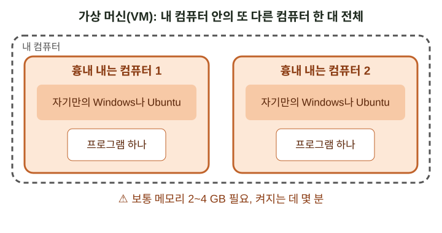
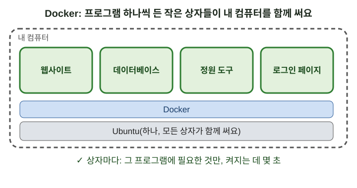

# Docker는 무엇인가요? (참고로만 읽어요)

> 영어 원문: [../02a-what-is-docker.md](../02a-what-is-docker.md)

## 짧은 버전
*다 읽을 시간이 없나요? 짧은 버전이에요. 전체 안내서는 아래에 있어요.*

- 참고로만 읽어요. 이것을 배울 필요는 없어요: 메뉴가 모두 해 줘요.
- 프로그램이 작동하려면 다른 파일들이 필요해요. Docker는 프로그램마다 필요한 파일만 든 작은 상자에 넣어요.
- 모든 상자는 컴퓨터에 이미 있는 Ubuntu 하나를 함께 써요.
- 가상 머신(통째로 된 가짜 컴퓨터)은 보통 메모리가 2~4 GB 필요하고, 켜지는 데 몇 분 걸려요. 상자는 그 프로그램이 쓰는 메모리만 쓰고, 몇 초 만에 켜져요.
- 그래서 정원이 오래된 노트북이나 Raspberry Pi에도 들어가요.
- 상자는 하나하나 닫혀 있어요. 내 정원에서는 정문(Caddy)만 인터넷과 이야기해요.
- 사진과 데이터베이스는 상자 밖, 내 폴더에 보관돼요.

---

이것을 배울 필요는 없어요. 메뉴가 모두 해 줘요.
이 페이지는 Docker가 무엇이고 정원이 왜 쓰는지 쉬운 말로 설명만 해요.

## 프로그램에는 필요한 것이 있어요

프로그램이 작동하려면 다른 파일들이 필요해요.
예를 들어, 정원 웹사이트에는 웹 서버와 데이터베이스가 필요해요.
그것들이 컴퓨터에 맞는 버전으로 있어야 해요.

프로그램에 필요한 것을 주는 흔한 방법이 두 가지 있어요.

## 방법 1: 가상 머신("VM")

가상 머신은 내 컴퓨터 안에 있는 흉내 내는 컴퓨터예요.
자기만의 Windows나 Ubuntu가 통째로 있어요.
프로그램은 그 흉내 내는 컴퓨터 안에서 실행돼요.

이 방법도 돼요. 하지만 흉내 내는 컴퓨터는 커요:

- 하나마다 보통 메모리가 2~4 GB 필요해요.
- 켜지는 데 몇 분 걸려요.
- 진짜 컴퓨터처럼 자기 업데이트가 따로 필요해요.

## 방법 2: Docker(작은 상자)

Docker는 프로그램마다 작은 상자에 넣어요.
상자 안에는 그 프로그램과 필요한 파일만 있어요.
모든 상자는 컴퓨터에 이미 있는 Ubuntu 하나를 함께 써요.

상자는 작아요:

- 그 프로그램이 쓰는 메모리만 써요.
- 몇 초 만에 켜져요.
- 프로그램을 업데이트할 때는 Docker가 상자를 새것으로 바꿔요.

## 오래된 노트북이나 Raspberry Pi에서 이게 중요한 이유

오래된 노트북(예: Windows 7이 들어 있던 노트북)은 메모리가 적어요.
Raspberry Pi도 메모리가 적어요.

- 흉내 내는 컴퓨터 여러 대는 그 메모리에 들어가지 않아요.
- 작은 상자 여러 개는 들어가요.

Raspberry Pi는 프로세서 칩의 종류도 달라요(ARM이라고 해요).
보통 PC용으로 만든 흉내 내는 컴퓨터는 그 칩에서 잘 돌아가지 않아요.
정원이 쓰는 프로그램들은 두 종류의 칩 모두를 위한 버전이 있어요.
Docker가 맞는 버전을 알아서 골라요.
그래서 같은 정원이 노트북에서도 Pi에서도 돌아가도록 만들어졌어요. (보통 PC와 노트북, 그리고 Raspberry Pi 5에서 시험했어요: 안내서 01.)

오래된 Windows 7 노트북에서는 Docker 자체가 돌아가지 않아요.
대신 Ubuntu를 설치할 수 있어요(안내서 01). 그러면 상자로 정원을 실행할 수 있어요.

## 상자의 좋은 점 두 가지 더

1. **상자마다 닫혀 있어요.** 상자는 받은 것만 쓸 수 있어요.
   내 정원에서는 정문(Caddy)만 인터넷과 이야기해요.
   상자들은 이 컴퓨터 안에서만 대답해요.
2. **섞이지 않아요.** 상자를 지우면 그 프로그램이 완전히 지워져요.
   내 사진과 데이터베이스는 상자 밖, 내 폴더에 그대로 있어요.

## 상자는 어디서 오나요

상자마다 그 프로그램을 만든 곳(예: 데이터베이스를 만든 곳)이 만든 공식 "이미지"에서
시작해요. 목록은 `WHAT-GETS-INSTALLED.ko.md`에 있어요.
웹사이트 상자는 이 폴더의 코드로 내 컴퓨터에서 만들어져요.

## 더 읽고 싶다면(선택)

- Docker의 짧은 설명(영어): <https://docs.docker.com/get-started/docker-overview/>
- Raspberry Pi와 Docker(영어): <https://docs.docker.com/engine/install/debian/>
