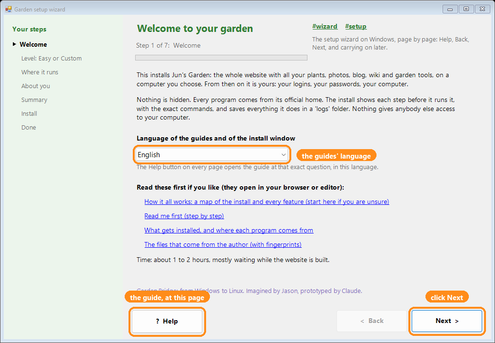

# 18. 코드를 직접 검토하기(친구나 AI와 함께)

> 영어 원문: [../18-review-the-code.md](../18-review-the-code.md)

## 짧은 버전
*다 읽을 시간이 없나요? 짧은 버전이에요. 전체 안내서는 아래에 있어요.*

- 이 패키지의 모든 것은 읽을 수 있는 평범한 글이에요. 이 안내서는 나, 친구, 또는 AI가 확인하는 방법을 보여 줘요.
- 내 코드는 이 공개 페이지에서 `CODE-SOURCE.txt`에 적힌 커밋 하나 그대로 와요: <https://github.com/netnovaops-training/garden-for-all>. 누구나 거기서 읽을 수 있어요.
- 오는 길에 바뀐 것이 없는지 확인하기: 메뉴 `M`, 그다음 `11`.
- 모든 변경 보기: `git log --oneline`, `git show`, `git diff`. 받기 전에 바뀐 것은 `CHANGES.md`가 설명해요.
- 비밀 정보와 보안 실수 검사하기(5분): `sh tools/check-secrets.sh`. `CLEAN`이 나오거나, 찾은 것을 보여 줘요.
- AI에게 부탁하기: `AGENTS.md`와 `GEMINI.md`를 먼저 주세요. `.env`나 `local/` 안의 것은 절대 붙여 넣지 마세요.
- 친구에게 부탁하기: 정원이 아니라 코드를 나누세요. `.env`, `local/`, `backups/`, `logs/`는 빼세요.
- 이상해 보이나요? 짐작하지 마세요: 도움 파일(메뉴 `H`)을 만들어서 믿는 사람에게 물어보세요.

---

이 패키지의 모든 것은 읽을 수 있는 평범한 글이에요. 숨긴 것도, 미리 컴파일해 둔 것도 없어요:
웹사이트는 `rust/`의 코드로 내 컴퓨터에서 만들어지고, 모든 프로그램은 공식 출처에서 와요.
이 안내서는 **나**, 친구, 또는 AI 도우미가 원하는 만큼 확인하는 방법을 보여 줘요.

**코드는 어디서 오나요.** Google Drive에서 받는 `junsgarden-for-jun.zip`에는 GitHub에 없는
것만 들어 있어요: 안내서 모음(handbook), 시작용 백업, 음악 파일, `CODE-SOURCE.txt`,
`FILES-FROM-AUTHOR.txt`, 시작 파일. 코드 전체(`garden.sh`, `windows/`, `rust/`, `START-HERE/`
등)는 첫 시작 때 공개 페이지 <https://github.com/netnovaops-training/garden-for-all>에서, `CODE-SOURCE.txt`에 적힌 커밋 하나
그대로 받아 와요("가장 새것"을 받지 않아요). 모든 파일을 `FILES-FROM-AUTHOR.txt`와 비교하고,
하나라도 맞지 않으면 아무것도 쓰지 않아요. 그러니 여기서 검토하는 코드가 바로 그 커밋의
공개 코드예요.



## 1. 무엇이 어디에 있나(지도)

| 폴더나 파일 | 무엇인가 |
|---|---|
| `garden.sh` | Ubuntu용 프로그램 하나: 메뉴와 모든 설치 단계(설명이 많이 달려 있어요) |
| `windows/` | Windows 설치 마법사와 Windows 메뉴(PowerShell, 설명 포함) |
| `rust/` | 웹사이트의 코드(Rust). `docs/rust-port/CODE-TOUR.md`가 차례로 보여 줘요 |
| `beds/` | 정원 도구의 코드(Python) |
| `docker/` | 각 프로그램의 레시피(Dockerfile), Caddy 설정 틀, 위키 도우미 |
| `docker-compose.yml` | 어떤 프로그램이 어떤 포트에서 실행되는지(모두 이 컴퓨터 안에서만. 정문 단계가 설치하는 Caddy가 인터넷으로 통하는 유일한 문이에요) |
| `android-app/` | 휴대폰 앱의 코드 |
| `site/` | 웹사이트가 보여 주는 사진, 스타일, 스크립트 |
| `CHANGES.md` | 내 사본을 위해 바꾼 모든 것과 그 이유 |
| `FILES-FROM-AUTHOR.txt` | 받은 그대로의 모든 파일의 지문(SHA-256) |
| `CODE-SOURCE.txt` | 코드가 GitHub의 어느 공개 커밋에서 왔는지 |
| `tools/get-code.py`, `tools/get-code.ps1` | 첫 시작(Ubuntu, Windows): 그 커밋의 코드를 받아 모든 파일을 `FILES-FROM-AUTHOR.txt`와 비교해요 |
| `WHAT-GETS-INSTALLED.md` | 설치될 수 있는 모든 프로그램과 그 출처 |

## 2. 오는 길에 바뀐 것이 없는지 확인하기
메뉴 `M`, 그다음 `11`(Windows에서는: More, `11`). 모든 파일을 `FILES-FROM-AUTHOR.txt`의 지문과
비교해서 다른 것을 보여 줘요. (웹사이트 이름 바꾸기를 했다면 그 파일들은 달라요: 예상한 일이에요.) 첫 시작이 파일을
쓰기 전에 이 확인을 이미 한 번 했어요. `M`, `11`은 언제든 다시 해요.

## 3. 모든 변경을 한 줄씩 보기
설치는 내 폴더의 git 기록을 남겨요(안내서 11). 정원 폴더의 터미널에서:

```
git log --oneline          # 저장된 모든 변경, 최신 것부터
git show                   # 가장 최근 변경, 모든 줄
git diff                   # 마지막 저장 뒤에 내가 바꾼 것
```

`CHANGES.md`는 받기 전에 바뀐 것을 하나하나 설명해요: 무엇을 빼거나 고쳤는지, 왜, 그리고
프로그램에 어떤 영향이 있는지.

## 4. 비밀 정보와 보안 실수 검사하기(5분)
잘 알려진 무료 검사기 두 개를 Docker로 실행해서 아무것도 설치할 필요가 없어요:
**gitleaks**(비밀번호, 키, 토큰. 기록 안까지)와 **semgrep**(코드의 보안 버그).

```
sh tools/check-secrets.sh
```

`CLEAN`이 나오거나, 찾은 것을 보여 줘요(비밀 값은 가려져요).
공식 페이지: <https://github.com/gitleaks/gitleaks>와 <https://semgrep.dev/docs/>

내 비밀 정보는 절대 코드 안에 없어요. 비밀번호는 설치할 때 내가 정하고, 내 컴퓨터에 알아볼 수
없게 바꾼 해시로만 저장돼요. 다른 비밀 정보는 내 컴퓨터에서 새로 만들어져 `.env`에 있어요.
git은 이 파일을 절대 저장하지 않고, 이 파일은 아무와도 나누면 안 돼요. 코드를 안다고 해서
누군가 나로 로그인할 수는 없어요.

## 5. 코드가 연락하는 모든 웹 주소
설치 프로그램에 있는 모든 `http`/`https` 주소를 보여 줘서, 무엇이 어디서 오고 어디로 가는지 볼 수 있어요:

```
grep -rhoE 'https?://[A-Za-z0-9./_?=&%:-]+' garden.sh windows docker docker-compose.yml beds | sort -u
```

대부분은 공식 다운로드 페이지와 설명서예요. 정원이 실행 중에 연락하는 곳은 Google(Gemini,
'내' 키로만), OpenRouter('내' 키로만), No-IP와 DuckDNS(내가 설정했을 때만)예요.

## 6. AI에게 검토 부탁하기
내 코드는 공개 페이지 <https://github.com/netnovaops-training/garden-for-all>에서, `CODE-SOURCE.txt`에 적힌 커밋 그대로 와요(zip에는 GitHub에 없는 것만 들어 있어요: 내 정원 데이터, 안내서 모음, 노래 하나).
웹 페이지를 읽을 수 있는 AI라면 거기서 확인할 수 있어요:

- "공개 저장소(https://github.com/netnovaops-training/garden-for-all)를 검토해 주세요. 해로운 것이나 숨겨진 것, 내 데이터를
  다른 곳으로 보내는 것이 있나요? 확인한 파일을 보여 주세요."
- "공개 저장소(https://github.com/netnovaops-training/garden-for-all)에서 주인 말고 다른 사람이 로그인할 수 있나요? 로그인 코드와 설치 프로그램을 확인해 주세요."
- "garden.sh가 무엇을 왜 설치하는지 한 단계씩 쉬운 말로 설명해 주세요."

또는 파일을 하나씩 Gemini(AI Studio, 안내서 16)에 붙여 넣어도 돼요.
Gemini(AI Studio, 안내서 16)는 코드를 읽을 수 있어요. 좋은 질문:

- "이건 garden.sh예요. 내 데이터를 어딘가로 보내거나, 다른 사람이 내 컴퓨터에 들어오게 하는
  부분이 있나요? 그 줄을 보여 주세요."
- "이건 docker-compose.yml이에요. 어떤 프로그램이 다른 컴퓨터에서 들어올 수 있고, 어떤 것이
  이 컴퓨터에서만 되나요?"
- "이건 rust/junsgarden/src/accounts.rs예요. 비밀번호는 어떻게 확인하고 저장하나요?
  기본 비밀번호나 비밀번호 없이 들어오는 방법이 있나요?"

이 폴더의 `AGENTS.md`와 `GEMINI.md`는 AI 도우미를 위해 쓴 안내예요. AI에게 먼저 주세요.
`.env`나 `local/` 안의 어떤 것도 AI에게 붙여 넣지 마세요: 내 비밀번호와 키가 들어 있어요.

## 7. 친구에게 검토 부탁하기
정원이 아니라 **코드**를 나누세요: `.env`, `local/`, `backups/`, `logs/`를 뺀 모든 것.
코드는 공개 페이지에 있어요: 그 링크(그리고 `CODE-SOURCE.txt`의 커밋)를 보내면 돼요. 친구는 코드를 읽고, 4번의 검사기를 실행하거나,
자기만의 빈 사본을 설치해서 해 볼 수 있어요. 그 사본은 친구의 것이에요: 내 식물, 사진,
비밀번호나 키는 하나도 없고, 내 정원에 들어올 수도 없어요.

## 8. 이상해 보이는 것이 있으면
짐작하지 말고 물어보세요. 도움 파일을 만들어서(메뉴 `H`, 비밀번호는 없어요) 믿는 사람에게
보여 주거나, 걱정되는 줄을 Gemini에게 물어보세요.
