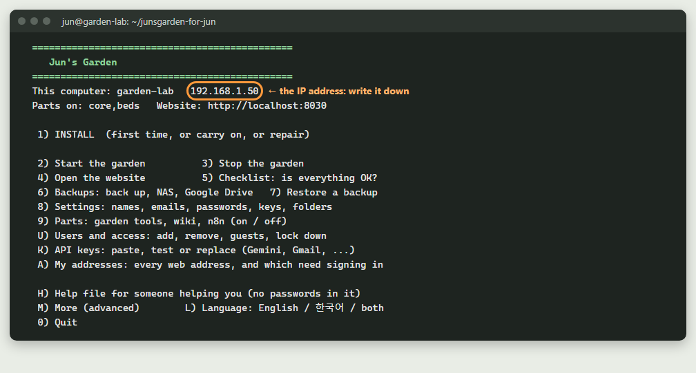
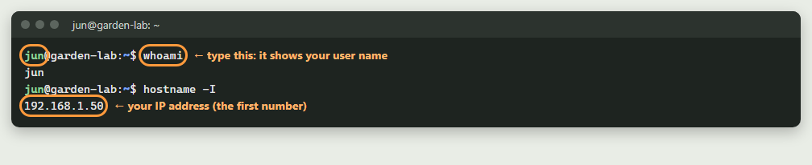
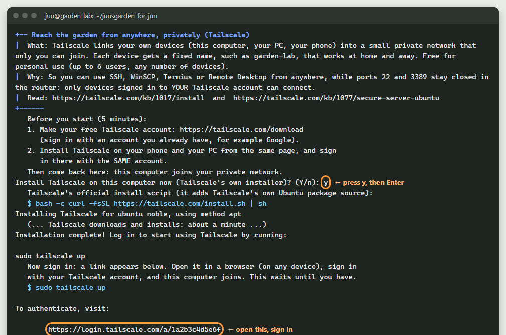

# 20. Windows PC에서 정원 컴퓨터로 일하기(SSH와 Remote Desktop)

> 영어 원문: [../20-ssh-and-remote-desktop.md](../20-ssh-and-remote-desktop.md)

## 짧은 버전
*다 읽을 시간이 없나요? 짧은 버전이에요. 전체 안내서는 아래에 있어요.*

- **SSH**를 쓰면 Windows PC에서 정원 컴퓨터에 명령을 입력할 수 있어요. 비공개로
  암호화된 연결을 거쳐서요. Windows 10과 11에는 이미 들어 있어요.
- **처음인가요?** PowerShell을 열고, `ssh -V`로 확인하고, `ssh jun@192.168.1.50`을
  입력하세요(내 사용자 이름과 IP 주소로요). `exit`를 입력하면 Windows로 돌아와요. 아래에
  한 단계씩 있어요.
- Windows 정원 메뉴가 다른 컴퓨터에 설치할 때 대신 설정해 줘요. **키**(key)도 만들어서,
  매번 비밀번호를 입력하지 않아도 돼요.
- 작은 `config` 파일 하나로 컴퓨터에 짧은 이름을 붙이고(`ssh garden`), 잠깐 자리를 비워도
  연결이 끊기지 않게 할 수 있어요.
- Linux 컴퓨터와 Windows 사이에서 무료 프로그램 **WinSCP**로 **파일을 복사**하세요(끌어다 놓기로요. 아래에 한 단계씩 있어요).
- **Remote Desktop**(원격 데스크톱)은 정원 컴퓨터의 화면을 내 PC에 보여 줘요(예를 들어
  위층에서). Ubuntu의 Settings(설정)에서 켜고, Windows에 들어 있는
  **Remote Desktop Connection**(원격 데스크톱 연결)을 쓰세요.
- **휴대폰에서:** 무료 앱 **Termius**가 SSH로 정원 컴퓨터의 터미널을 열어요(집 Wi-Fi에서요).
- 모든 연결은 네 가지를 물어요: **host name(호스트 이름, IP 주소), port(포트), user name(사용자 이름), password(비밀번호)**. 첫 번째 부분에서 각각 어디서 찾는지 보여 줘요.
- 둘 다 **집 네트워크에서만** 써요. 공유기(router)에서 포트 22나 3389를 절대 전달하지 마세요. 어디서나, 나만 쓰려면: **Tailscale**(선택이지만 꼭 권해요. 정원 메뉴 M, 17).
- Windows 메뉴, More, 18을 하면 바탕화면에 바로가기 두 개가 생겨요: **Garden terminal**(정원 터미널)
  과 **Garden screen**(정원 화면).

---

## 시작하기 전에: 모든 연결이 묻는 네 가지

이 안내서의 모든 프로그램(PowerShell, WinSCP, Termius, Remote Desktop)은 같은 네 가지를
물어요. 한 번 찾아서 적어 두세요.

| 묻는 것 | 무엇인가요 | 어디서 찾나요 |
|---|---|---|
| **Host name**(호스트 이름) 또는 **IP address**(IP 주소)(같은 칸이에요) | 어느 컴퓨터에 연결할지예요. 집에서는 정원 컴퓨터의 IP 주소를 쓰세요. 예: `192.168.1.50` | 정원 메뉴의 맨 윗줄(아래 그림), 또는 정원 컴퓨터의 터미널에서 `hostname -I`를 입력하세요(첫 번째 숫자예요) |
| **Port**(포트) | 이런 연결을 위한 "문 번호"예요. SSH, WinSCP, Termius는 **22**를 써요. Remote Desktop은 **3389**를 써요 | 이미 채워져 있어요. 그대로 두세요 |
| **User name**(사용자 이름) | 정원 컴퓨터(Ubuntu)에서 쓰는 내 사용자 이름이에요. 예: `jun` | 터미널 프롬프트의 앞부분(`jun@garden-lab`), 또는 `whoami`를 입력하세요 |
| **Password**(비밀번호) | 내 **Ubuntu** 비밀번호예요. Ubuntu를 설치할 때 정한 것이고, `sudo`가 묻는 것이에요 | 내 비밀번호 관리자에 있어요. Gmail 비밀번호도 아니고, 웹사이트 비밀번호도 아니에요 |





**정원에는 서로 다른 비밀번호가 세 개 있어요.** 하는 일이 달라요. 그래서 세 개
모두 비밀번호 관리자에 넣어 두세요:

| 비밀번호 | 쓰는 곳 |
|---|---|
| **Ubuntu** 비밀번호 | 정원 컴퓨터 자체에 로그인할 때: 그 화면, SSH, WinSCP, Termius, `sudo` |
| **Website**(웹사이트) 비밀번호 | 정원 웹사이트와 그 로그인 페이지에 로그인할 때(메뉴 `U`, 그다음 `5`에서 정해요) |
| **Gmail app password**(Gmail 앱 비밀번호) | 정원이 이메일을 보낼 때만 써요(안내서 [03](03-run-your-garden.md), Part C). 내 Gmail 비밀번호가 아니에요 |

**IP 주소 대신 내 웹 이름을 입력해도 되나요?** 여기서는 안 돼요. 내 웹 이름(예:
`junsgarden.zapto.org`)은 인터넷에서 우리 집 공유기로 이어져요. 그리고 공유기는
웹사이트만 들여보내요(포트 80과 443). 포트 22와 3389는 거기서 일부러 닫혀 있어요.
그래서 인터넷의 누구도 내 컴퓨터에 로그인을 시도조차 할 수 없어요. 집에서는 IP 주소를
쓰세요(또는 컴퓨터 이름에 `.local`을 붙여서요. 예: `garden-lab.local`). 집 밖에서
컴퓨터에 닿으려면, 이 안내서 끝부분 가까이의 **집 밖에서**를 보세요.

## SSH는 무엇인가요
SSH("secure shell", 보안 셸)는 한 컴퓨터가 다른 컴퓨터에서 일하는 방법이에요. 명령을
입력해서, 마치 그 앞에 앉아 있는 것처럼요. 두 컴퓨터 사이를 오가는 것은 모두
**암호화**돼요. 누가 내 네트워크를 엿봐도 뒤섞인 데이터만 보여요. 내 명령, 파일, 비밀번호는
보이지 않아요. 전 세계에서 서버를 관리하는 표준 방법이에요. 공식 페이지: <https://www.openssh.com/>

Windows 10과 11에는 SSH가 이미 들어 있어요(Microsoft의 OpenSSH):
<https://learn.microsoft.com/windows-server/administration/openssh/openssh_overview>

## PowerShell 기초, 그다음 Linux 컴퓨터에 SSH로 들어가기
**PowerShell**은 Windows 자체의 터미널이에요. 명령을 입력하고, Enter를 누르고, 답을
읽어요. 이 단계들을 따라가면 PowerShell에서 Linux 컴퓨터로 갔다가 다시 돌아와요.

**1단계. PowerShell 열기.** Start(시작)에서 `powershell`을 입력하고 **Windows
PowerShell**을 여세요. (또는 **Terminal**(터미널)을 여세요. Windows 11에 들어 있고,
PowerShell을 열어 줘요.) 이런 줄이 보여요:

```
PS C:\Users\Jun>
```

이것이 **prompt**(프롬프트)예요. `PS`는 PowerShell이라는 뜻이에요. `C:\Users\Jun`은 지금
있는 폴더예요(Windows의 내 홈 폴더). `>` 뒤에 입력해요.

**2단계. 몇 가지 기초.** 해 보세요. 아무것도 바꾸지 않아요.

| 입력하거나 누르기 | 하는 일 |
|---|---|
| `pwd` | 지금 어디 있는지 보여 줘요 |
| `ls` 또는 `dir` | 이 폴더에 무엇이 있는지 보여 줘요 |
| `cd Desktop` | Desktop(바탕 화면) 폴더로 들어가요 |
| `cd ..` | 한 폴더 위로 올라가요 |
| `cls` | 화면을 깨끗하게 지워요 |
| **위쪽 화살표** | 마지막 명령을 다시 불러와요 |
| **Tab** | 이름을 대신 끝까지 써 줘요 |
| **Ctrl+C** | 돌아가는 것을 멈춰요 |

이 짧은 명령들에 대한 Microsoft의 페이지(영어):
<https://learn.microsoft.com/powershell/scripting/learn/shell/using-aliases>

**3단계. SSH가 있는지 확인하기.**

```
ssh -V
```

OpenSSH의 버전을 보여 줘요. 예: `OpenSSH_for_Windows_9.5p2, LibreSSL 3.8.2`.
Windows 10과 11에는 이미 들어 있어요(Microsoft의 페이지는 위에 있어요).

**4단계. 연결하기.** `ssh`, 내 사용자 이름, `@`, IP 주소를 입력하세요(이 안내서 맨 위의
"네 가지"를 보세요):

```
ssh jun@192.168.1.50
```

집에서는 `ssh jun@garden-lab.local`도 될 수 있어요. Tailscale을 쓰면(이 안내서 끝부분):
`ssh jun@garden-lab`.

- 처음에는 "Are you sure you want to continue connecting"(계속 연결할까요?)이라고 물어요.
  `yes`를 입력하고 Enter를 누르세요. 컴퓨터를 기억해서, 나중에 아무도 그 컴퓨터인 척할 수
  없어요.
- 그다음 Ubuntu 비밀번호를 입력하세요. **입력하는 동안 아무것도 보이지 않아요.** Enter를
  누르세요.

**5단계. 이제 Linux 컴퓨터 안에 있어요.** 프롬프트가 바뀌어요:

```
jun@garden-lab:~$
```

이제 입력하는 것은 모두 Windows가 아니라 **그 컴퓨터**에서 실행돼요. 명령은 안내서
[22](../22-bash-walkthrough.md)(영어)에 있어요. 정원 메뉴를 열려면:

```
cd ~/junsgarden-for-jun
bash garden.sh
```

**6단계. 나가기.** `exit`를 입력하세요. 프롬프트가 다시 `PS C:\Users\Jun>`이 돼요. 내
Windows PC로 돌아온 거예요.

**잘 안 되면:**

| 보이는 것 | 할 일 |
|---|---|
| `Connection timed out`(연결 시간 초과) | 컴퓨터가 꺼져 있거나, IP 주소가 틀렸거나, 집 Wi-Fi에 있지 않아요. 하나씩 확인하세요. |
| `Connection refused`(연결 거부) | 컴퓨터는 켜져 있지만 SSH 서버가 돌아가지 않아요. 그 컴퓨터에서 `sudo systemctl status ssh`를 입력하세요. |
| `Permission denied`(권한 거부) | 사용자 이름이나 비밀번호가 틀렸어요. 작은 글자와 큰 글자가 달라요: `jun`은 `Jun`이 아니에요. |
| `WARNING: REMOTE HOST IDENTIFICATION HAS CHANGED!`(원격 호스트 정보가 바뀌었어요) | 컴퓨터가 지난번과 달라 보여요. 다시 설치했다면 `ssh-keygen -R 192.168.1.50`을 입력하고 다시 연결하세요. 그런 적이 없다면 멈추고 믿을 수 있는 사람에게 물어보세요. |

## 키: 매번 비밀번호를 치지 않기
**키**(key)는 내 PC에서 만드는 파일 한 쌍이에요. 내 PC를 절대 떠나지 않는 **private**(개인)
절반과, 정원 컴퓨터에 주는 **public**(공개) 절반이에요. 연결할 때 두 절반이 비밀번호를
보내지 않고도 내가 누구인지 증명해요.

- **ed25519**는 요즘 쓰는 종류의 키예요. 짧고 튼튼하고, OpenSSH가 권하는 것이에요.
  정원 메뉴는 이것을 써요.
- **RSA**는 예전 종류예요. 오래된 프로그램이 꼭 이것을 원하면 아직 쓸 수 있어요(4096비트를
  쓰세요). 그렇지 않으면 ed25519를 고르세요.

**Windows 정원 메뉴가 이것을 대신 해 줘요.** 다른 컴퓨터에 설치할 때(메뉴 1, "another computer"(다른 컴퓨터))
키가 없으면 키를 만들고(`C:\Users\YOU\.ssh\id_ed25519`), 공개 절반을 정원 컴퓨터에 넣어요.

**손으로 하려면, 세 단계로**(PowerShell에서):

**1. 키 만들기**(PC마다 한 번). 질문마다 Enter를 누르세요(또는 passphrase(암호 문구)를
정하세요: 키 자체의 비밀번호라서 더 안전해요).

```
ssh-keygen -t ed25519
```

**2. 공개 절반을 정원 컴퓨터에 주기**(한 번). 마지막으로 한 번 Ubuntu 비밀번호를 물어요.

```
type $env:USERPROFILE\.ssh\id_ed25519.pub | ssh jun@192.168.1.50 "mkdir -p ~/.ssh && cat >> ~/.ssh/authorized_keys && chmod 600 ~/.ssh/authorized_keys"
```

**3. 연결하기.** 이제 `ssh jun@192.168.1.50`만 하면 바로 들어가요.

**같은 키가 Pi와 다른 Linux 컴퓨터에도 통해요.** 컴퓨터마다 2단계를 한 번씩 하세요. 그
컴퓨터의 사용자 이름과 주소로요.

키가 있는 컴퓨터를 보거나 지우려면: 정원 메뉴 `U`, 그다음 `7`(정원이 돌아가는 컴퓨터에서).

**휴대폰에서(Termius):**

1. **키 만들기.** **Keychain**(키체인)을 열고, **+**를 누르고, **Generate Key**(키 만들기)를
   누르세요(Android에서는 **New SSH Key**, 그다음 **Generate new SSH Key**). **Ed25519**를
   고르고 저장하세요.
2. **정원 컴퓨터에 보내기.** 키를 누르고(Android에서는 그다음 **Export to…**), 정원 컴퓨터를
   고르고, **Export**(내보내기)를 누르세요.
3. **쓰기.** 호스트가 아직 그 키를 쓰지 않으면, 호스트를 고쳐서 거기서 키를 고르세요.

Export 버튼이 없나요? Termius에서 키의 공개 글자를 복사하세요. 그다음 정원 컴퓨터에서
`nano ~/.ssh/authorized_keys`를 입력하고, 새 줄에 붙여 넣고(키 하나에 한 줄), **Ctrl+O**,
**Enter**, **Ctrl+X**를 누르세요.

Termius의 페이지(영어): <https://docs.termius.com/keychain/ssh-keys-and-certificates>

개인(private) 절반은 내 휴대폰이나 PC를 절대 떠나지 않아요. 휴대폰이나 PC를 잃어버리면 그
키를 지우세요: 정원 메뉴 `U`, 그다음 `7`.

## 연결 유지하기(그리고 짧은 이름)
PC의 작은 파일 하나, `C:\Users\YOU\.ssh\config`가 정원 컴퓨터에 짧은 이름을 붙이고,
잠깐 자리를 비워도 연결이 끊기지 않게 해 줘요.

**1. 파일을 만들고 열기**(PowerShell에서):

```
New-Item -ItemType File $HOME\.ssh\config
notepad $HOME\.ssh\config
```

첫 줄은 확장자 없는 빈 파일을 만들어요. 파일이 이미 있다고 하면 괜찮아요. (폴더가 없다고
하면 먼저 키를 만드세요: 위의 1단계가 `.ssh` 폴더를 만들어요.) 둘째 줄은 Notepad(메모장)에서
그 파일을 열어요.

**2. 이것을 입력하세요**(내 IP 주소와 사용자 이름으로요). 그다음 **Ctrl+S**로 저장하고
Notepad를 닫으세요:

```
Host garden
    HostName 192.168.1.50
    User jun
    ServerAliveInterval 60
```

**3. 짧은 이름으로 연결하기:**

```
ssh garden
```

`ServerAliveInterval 60`은 60초마다 작은 "아직 여기 있어요" 신호를 보내요. 그래서
키보드에서 떨어져 있어도 연결이 닫히지 않아요.

Pi나 다른 Linux 컴퓨터는 첫 덩어리 아래에 두 번째 덩어리를 더하세요. 그 컴퓨터의 이름과
주소로요(예: `Host pi`와 `HostName 192.168.1.60`).

공식 설명서(영어): <https://man.openbsd.org/ssh_config>

**Termius에서:** Termius 버전에 보이면, 호스트의 Keep-Alive(연결 유지) 설정을 쓰세요.
Termius의 문서(영어): <https://docs.termius.com/>.

## 파일을 안전하게 복사하기
같은 암호화된 연결로 파일도 옮겨요.

- **파일 하나, PowerShell에서:**
  `scp C:\Users\YOU\Pictures\rose.jpg jun@192.168.1.50:~/`
- **폴더 전체:** `-r`을 붙이세요:
  `scp -r C:\Users\YOU\Pictures\garden jun@192.168.1.50:~/`
- **정원 컴퓨터에서 가져오기:**
  `scp jun@192.168.1.50:~/junsgarden-for-jun/backups/NAME.tar C:\Users\YOU\Desktop\`
- **창과 끌어다 놓기로:** WinSCP예요. 바로 다음 부분을 보세요.

정원 메뉴의 "Copy the newest backup to THIS PC"(가장 최근 백업을 이 PC로 복사, More, 10)가 바로 이 방법을 써요.

## Linux와 Windows 사이에서 파일 복사하기: WinSCP, 한 단계씩

**WinSCP**는 무료이고 잘 알려진 Windows 프로그램이에요. 왼쪽에는 내 Windows PC를,
오른쪽에는 정원 컴퓨터를 보여 줘요. 파일을 한쪽에서 다른 쪽으로 끌어다 놓으면 돼요.
같은 암호화된 SSH 연결을 써요. 그래서 새로 여는 것은 없어요.

**1단계. 설치하기(한 번만).**
공식 내려받기 페이지를 여세요: <https://winscp.net/eng/download.php>. 초록색
**Download WinSCP**(WinSCP 내려받기) 버튼을 누르고, 파일을 열고, 설치 프로그램에서
**Next**(다음)를 계속 누르세요(권하는 선택 그대로 괜찮아요).

**2단계. 열기.**
Start(시작) 메뉴에서 `WinSCP`를 입력하고 여세요. **Login**(로그인) 창이 나타나요.

**3단계. Login 창 채우기**(이 안내서 처음에 나온 네 가지예요):

| 칸 | 고르거나 입력할 것 |
|---|---|
| **File protocol**(파일 프로토콜) | `SFTP`(암호화된 것이에요. 보통 이미 골라져 있어요) |
| **Host name** | 정원 컴퓨터의 IP 주소. 예: `192.168.1.50` |
| **Port number**(포트 번호) | `22`(이미 채워져 있어요) |
| **User name** | 내 Ubuntu 사용자 이름. 예: `jun` |
| **Password** | 내 Ubuntu 비밀번호 |

**4단계. 저장하기. 그러면 다음에는 한 번만 누르면 돼요.**
**Save**(저장)를 누르고, 이름을 `Garden computer`로 하고, **OK**를 누르세요. (PC를 나 혼자
쓰는 게 아니라면 "Save password"(비밀번호 저장)는 체크하지 말고 두세요.)

**5단계. Login을 누르세요.**
처음 한 번만, WinSCP가 정원 컴퓨터의 **key fingerprint**(키 지문)를 보여 주고 믿을지
물어요. 집 네트워크에서 내 컴퓨터에 연결하는 거라면 **Yes**(예)를 누르세요. (이렇게 해서
매번 같은 컴퓨터인지 확인해요.)

**6단계. 파일 복사하기.**
- **왼쪽:** 내 Windows PC. **오른쪽:** 정원 컴퓨터(내 홈 폴더 `/home/jun`에서
  열려요).
- 파일이나 폴더를 한쪽에서 다른 쪽으로 **끌어다 놓으세요**. 그러면 복사돼요.
- 내 정원은 오른쪽의 `junsgarden-for-jun`에 있어요. 백업은
  `junsgarden-for-jun/backups`에 있어요.

**7단계. 다 했으면 닫으세요**(X, 또는 **Session**(세션), **Disconnect**(연결 끊기)).

이 창에 대한 WinSCP의 안내서(그림이 있어요):
<https://winscp.net/eng/docs/guide_connect>.

**좋은 습관:** `junsgarden-for-jun`에서 파일을 꺼낼 때는 옮기지 말고 복사하세요(정원에
필요한 파일이에요). 그리고 거기 있는 `.env`는 절대 손으로 고치지 마세요(메뉴 `8`이 안전하게 해 줘요).

## Remote Desktop: 정원 컴퓨터의 화면을 보고 쓰기
다른 방에서 정원 노트북의 바탕화면을 창과 마우스까지 그대로 쓰려면:

**정원 컴퓨터(Ubuntu 24.04)에서, 한 번만:**
1. **Settings**(설정), **System**(시스템), **Remote Desktop**(원격 데스크톱).
2. **Remote Login**(원격 로그인, 노트북에 아무도 로그인하지 않았을 때 작동해요: 먼저 노트북에서
   로그아웃하거나, Desktop Sharing을 쓰세요) 또는 **Desktop Sharing**(데스크톱 공유, 로그인한
   사람의 화면을 공유해요)을 고르세요. 켜세요.
3. "Login Details"(로그인 정보) 아래에 보이는 **user name**(사용자 이름)과 **password**(비밀번호)를
   정하세요(Remote Desktop에만 쓰는 것이에요. 적어 두세요).
4. 집 네트워크만 들어오게 하세요(터미널에 한 줄. 메뉴의 방화벽 단계가 이미 나머지는
   모두 막아요):
   ```
   sudo ufw allow from 192.168.1.0/24 to any port 3389 proto tcp comment 'remote desktop, home only'
   ```
   (내 네트워크의 앞 숫자 세 개를 쓰세요: 정원 컴퓨터 IP 주소의 앞부분, 그다음 `.0/24`.)

**Windows PC에서:** Start(시작)에서 **Remote Desktop Connection**(원격 데스크톱 연결)을 입력하고,
Computer(컴퓨터) = 정원 컴퓨터의 IP 주소, **Connect**(연결), 그다음 3단계의 로그인 정보를 넣으세요.

안내 페이지(Ubuntu의 데스크톱은 GNOME이에요): <https://help.gnome.org/gnome-help/sharing-desktop.html>.
Raspberry Pi에서는 대신 **Raspberry Pi Connect**를 쓰세요:
<https://www.raspberrypi.com/software/connect/>.

끄려면: Settings(설정), System(시스템), Remote Desktop(원격 데스크톱), 끄기. 그리고
`sudo ufw delete allow from 192.168.1.0/24 to any port 3389 proto tcp`.

## 휴대폰 속 Linux 터미널(SSH)
휴대폰으로 정원 컴퓨터의 터미널을 열 수 있어요. 안내서 [22](../22-bash-walkthrough.md)(영어)에
나오는 바로 그 터미널이에요. 집 Wi-Fi가 닿으면 집 안 어디서나 돼요. 거기서 정원 메뉴를
돌리고, 이것저것 확인하고, 아니면 그냥 소파에서 Linux를 가지고 놀 수 있어요.

**1. 터미널 앱을 설치하세요.** **Termius**는 이 용도로 무료이고, 잘 알려져 있고,
iPhone과 Android에서 똑같아요(무료 요금제로 충분해요. 다른 제안은 무시해도 돼요):
- iPhone과 iPad: <https://apps.apple.com/app/termius-ssh-shell-console-terminal/id549039908>
- Android: <https://play.google.com/store/apps/details?id=com.server.auditor.ssh.client>
- 만든 곳의 사이트: <https://termius.com>

**2. 정원 컴퓨터를 추가하세요**(Termius는 컴퓨터를 "host"(호스트)라고 불러요). **+**를 누르고
**New Host**(새 호스트)를 추가하세요:

| 칸 | 입력할 것 |
|---|---|
| Address(주소. 또는 Hostname) | 정원 컴퓨터의 IP 주소. 예: `192.168.1.50`(정원 메뉴 맨 위에 보여요) |
| Port | `22`(보통 이미 채워져 있어요) |
| Username | 내 Ubuntu 사용자 이름. 예: `jun` |
| Password | 내 Ubuntu 비밀번호(`sudo`가 묻는 것이에요) |

저장하고, 그 항목을 눌러서 연결하세요.

**3. 처음 한 번만,** 앱이 컴퓨터의 **fingerprint**(지문)를 보여 주고 믿을지 물어요. 집
Wi-Fi에서 내 정원 컴퓨터에 연결하는 거라면: 예. (지문은 SSH가 매번 같은 컴퓨터인지
확인하는 방법이에요.)

**4. 들어왔어요.** 컴퓨터 앞에서 보는 것과 같은 프롬프트가 보여요:

```
jun@garden-lab:~$
```

이제 컴퓨터 앞에서 입력하던 것을 그대로 입력하세요. 정원 메뉴를 열려면:

```
cd ~/junsgarden-for-jun
bash garden.sh
```

**작은 화면에서 입력하기:** 앱이 휴대폰 키보드 위에 추가 키 한 줄을 넣어 줘요(**Ctrl**,
**Tab**, **Esc**, 화살표). **Tab**은 긴 이름을 대신 끝까지 써 줘요. **Ctrl** 다음 **C**는
돌아가는 것을 멈춰요. 다 했으면 `exit`로 연결을 닫으세요.

일부러 집 Wi-Fi에서만 돼요: 포트 22는 절대 인터넷에 열지 않아요. (이 패키지의
테스트에서 휴대폰으로 해 보지는 않았어요. 연결이 안 되면: 휴대폰이 같은 Wi-Fi에 있나요?
주소가 맞나요? 메뉴 `5`의 점검 목록에 "22 SSH: listening"(대기 중)이 보여요.)

**바탕 화면 전체를 보고 싶나요?** Microsoft의 무료 **Windows App**
(iPhone: <https://apps.apple.com/us/app/windows-app-mobile/id714464092>, Android:
<https://play.google.com/store/apps/details?id=com.microsoft.rdc.androidx>)은 Remote Desktop을
켜 두면(위의 단계) Remote Desktop으로 Ubuntu 바탕 화면을 열어요. **+**, 그다음 **PC**를
누르고, IP 주소를 입력하고, 그다음 Remote Desktop 로그인 정보를 넣으세요.
Microsoft의 페이지: <https://learn.microsoft.com/windows-app/get-started-connect-devices-desktops-apps>.

## 바탕화면의 바로가기 두 개
Windows 정원 메뉴의 **More, 18**이 만들어요:
- **Garden terminal**(정원 터미널): 정원 컴퓨터로 SSH를 열어요(또는 Windows 자체의 Ubuntu).
- **Garden screen**(정원 화면): 정원 컴퓨터로 Remote Desktop Connection을 열어요(따로 있는
  정원 컴퓨터일 때, Remote Desktop을 켠 뒤에).

## 집 밖에서(선택이지만 꼭 권해요): Tailscale

위의 모든 것은 일부러 집 Wi-Fi에서만 돼요. **Tailscale**을 쓰면 어디서나(직장에서,
휴가 중에, 휴대폰의 모바일 데이터로) 정원 컴퓨터에 닿을 수 있어요. 그리고 나만요.

**왜 해 볼 만한가요:**
- **내 기기만 들어와요.** Tailscale은 내 기기들(정원 컴퓨터, 내 PC, 내 휴대폰)을 작은
  비공개 네트워크로 이어 줘요. 다른 사람은 아무도 들어올 수 없고, 그 컴퓨터가 거기 있다는
  것조차 볼 수 없어요.
- **공유기에 문을 하나도 열지 않아요.** 포트 22와 3389는 닫힌 그대로예요. Tailscale은
  port forwarding(포트 전달)이 전혀 필요 없어요.
- **어디서나 통하는 이름 하나.** 정원 컴퓨터는 집에서도 밖에서도 같은 이름 하나(예:
  `garden-lab`)를 계속 써요. Termius, WinSCP, Remote Desktop에서 IP 주소 대신 그 이름을 쓰면 돼요.
- **개인용은 무료예요**(사용자 6명까지, 기기 수는 상관없어요):
  <https://tailscale.com/pricing>.
- **처음부터 끝까지 암호화돼요.** 그리고 내 기기들을 언제든 보고 지울 수 있어요:
  <https://login.tailscale.com/admin/machines>.

**얼마나 쉬운가요: 세 단계, 10분쯤, 입력할 것은 "y" 하나뿐이에요.**

**1단계. 내 계정과 내 기기들**(브라우저와 휴대폰에서).
<https://tailscale.com/download>를 열고, 이미 있는 계정(예: Google)으로 로그인해서
가입하세요. 그리고 내 **휴대폰**(App Store나 Google Play)과 내 **PC**에 Tailscale 앱을
설치하세요. 각각 같은 계정으로 로그인하세요.

**2단계. 정원 컴퓨터가 들어와요**(정원 메뉴가 해 줘요).
정원 메뉴: `M`, 그다음 `17`(Windows 메뉴에서는 `M`, 그다음 `19`). `y`를 누르세요.
Tailscale 자체의 설치 프로그램으로 Tailscale을 설치하고, 모든 명령을 보여 주고, 그다음
**sign-in link**(로그인 링크)를 보여 줘요. 그 링크를 브라우저에서 열고(어느 기기에서든
돼요) 같은 계정으로 로그인하면, 정원 컴퓨터가 들어와요. 그다음 메뉴가 SSH와 Remote
Desktop이 Tailscale로만 들어오게 하고, 쓸 이름을 알려 줘요.



**3단계. 쓰기.** Termius, WinSCP, Remote Desktop에서 IP 주소 대신 정원 컴퓨터의
이름(예: `garden-lab`)을 **Host name**에 입력하세요. 나머지는 모두 그대로예요. Tailscale
앱을 켜 두면 집에서도, 밖에서도 돼요.

**끄려면:** 같은 메뉴 항목을 다시 고르세요(`M`, `17`). 연결을 끊고 방화벽 줄을 닫아요.

Tailscale 자체의 페이지: <https://tailscale.com/kb/1017/install>(설치하기),
<https://tailscale.com/kb/1081/magicdns>(기기 이름),
<https://tailscale.com/kb/1077/secure-server-ubuntu>(방화벽과 함께 쓰기).

그 대신 공유기에서 포트 22나 3389를 전달하는 일은 **절대** 하지 마세요. Tailscale은 같은
일을 해 주면서도, 인터넷 전체가 내 컴퓨터의 문을 두드리게 두지 않아요.

## 안전하게 지키기
- **공유기에서 포트 22(SSH)나 3389(Remote Desktop)를 절대 전달하지 마세요.** 인터넷으로
  가는 것은 웹사이트를 위한 80과 443뿐이에요.
- 키가 비밀번호보다 나아요. PC의 `.ssh` 폴더를 비공개로 두고, `.pub`이 없는 파일은
  절대 아무에게도 주지 마세요.
- PC를 잃어버리거나 남에게 주면, 그 PC의 키를 지우세요: 메뉴 `U`, 그다음 `7`.
