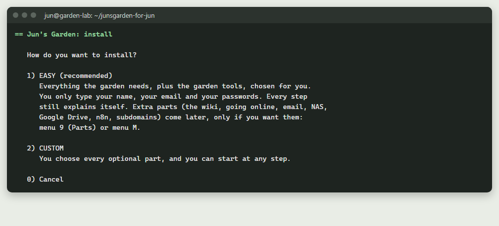
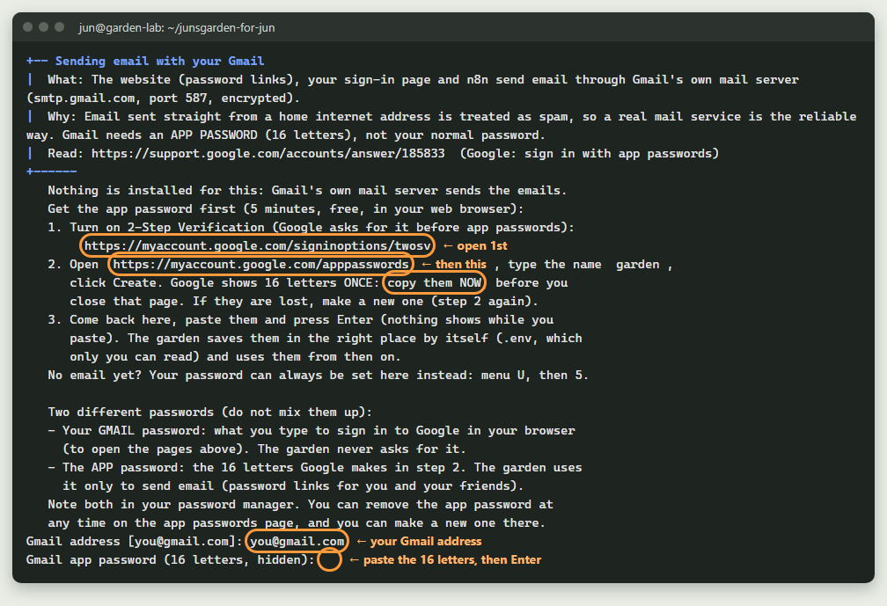

# 23. 전체 설정: 지금 정원이 돌아가는 방식 그대로, 전부

> 영어 원문: [../23-full-setup.md](../23-full-setup.md)

## 짧은 버전
*다 읽을 시간이 없나요? 짧은 버전이에요. 전체 안내서는 아래에 있어요.*

- EASY 설치는 집에서 쓰는 정원을 줘요. 이 안내서는 다른 길이에요: 지금 정원이 돌아가는 방식 그대로, 모든 것을 순서대로 해요. 부분마다 다른 날에 해도 돼요.
- 먼저 나에게 맞는 단계를 고르세요: 쉬움(맥주), 추천(와인), 전체(샴페인). 부분마다 단계가 적혀 있어요.
- 1 부분: 메뉴 `1`로 설치해요. 전체 단계: `2`(CUSTOM, 직접 고르기)를 고르고, 정원 도구 yes, 위키 yes(위키 내려받기 파일과 함께), 사진은 지금. 쉬움과 추천 단계: `1`(EASY)을 고르세요.
- 2~5 부분은 설치가 끝날 때 물어봐요(EASY는 2~4를 물어요): 내 비밀번호, AI 키, 비밀번호 링크용 이메일, 공유기에서 주소 예약하기.
- 6~8 부분, 세 곳에 백업: NAS와 다른 네트워크 장소(메뉴 `6`, 그다음 `4`와 `13`), Google Drive(메뉴 `6`, 그다음 `5`), Windows PC에 매주 사본(Windows 메뉴 `M`, 그다음 `13`).
- 9 부분: 내 무료 No-IP 계정과 웹 이름(안내서 04, A 부분), CGNAT 확인, 그리고 연습.
- 10 부분: HTTPS와 로그인 페이지로 인터넷에 올리기: 메뉴 `M`, `1`, 선택 `3`, 그다음 공유기에서 포트 80과 443.
- 11 부분: DuckDNS로 하위 도메인(메뉴 `M`, 그다음 `13`. Windows에서는 More, `14`). 예를 들면 내 위키.
- 12 부분: 친구와 게스트(메뉴 `U`).
- 13 부분: 휴대폰과 원격 도구: Termius, WinSCP, 원하면 Tailscale(안내서 20).
- 14 부분: 휴대폰의 Android 앱.
- 15 부분: 마지막 확인: 점검표(메뉴 `5`)가 0 fail로 끝나고, 메뉴 `A`가 모든 주소를 보여 줘요.

---

## 두 가지 길: EASY, 또는 이 길

**EASY**(설치 선택 `1`)는 정원 도구와 함께 정원을 집에 있는 컴퓨터 한 대에 올려요.
묻는 것은 이름, 이메일, 비밀번호뿐이에요. 나머지는 원할 때까지 기다려요.

**이 안내서는 다른 길이에요.** 새로 설치하는 것부터 지금 정원이 돌아가는 방식 그대로의
완전한 정원까지 데려가요: 웹사이트, 정원 도구, 위키, 사진. 내 비밀번호. "비밀번호 찾기"
링크용 이메일. 공유기의 고정 주소. AI 키. 세 곳에 백업. HTTPS와 로그인 페이지가 있는
내 웹 이름. 하위 도메인. 친구. 휴대폰과 원격 도구. 그리고 Android 앱.

**부분마다 다른 날에 해도 돼요.** 순서대로 하세요: 부분마다 앞의 부분이 필요해요(10 부분의
정문은 9 부분의 웹 이름이 필요하고, 11 부분의 하위 도메인은 정문이 필요해요). 어느 부분
뒤에서든 멈춰도 돼요: 메뉴가 어디까지 했는지 기억하고, 아무것도 잃어버리지 않아요.
[안내서 00b](00b-before-you-start.md)에 같은 것들이 걸리는 시간과 함께 있어요.
[안내서 10](10-the-plan.md)은 확인 지점이 있는 더 느긋한 계획이에요. 아래 부분마다 자세한
내용이 있는 안내서로 가는 링크가 있어요.

## 나에게 맞는 단계 고르기

이 표는 고르는 것을 돕기 위해서만 있어요. 작게 시작하고, 언제든 한 부분씩 더할 수 있어요.
부분마다 자기 안내서가 있어요. 숫자는 가는 길에 답답한 순간이 올 가능성이에요(한 번 더 해야
하는 단계, 또는 안내서와 조금 다르게 보이는 화면). 나를 시험하는 점수가 아니에요. 그런 순간이
오면 정상이에요: 멈추고, 쉬세요. 메뉴는 하던 곳부터 이어서 해요.

| 단계 | 들어 있는 것 | 아래의 부분 | 모두 합한 시간 | 답답한 순간이 올 가능성 |
|---|---|---|---|---|
| **쉬움(맥주)** (Easy, beer) | EASY 설치만: 정원 도구가 있는 집의 정원, 내 식물과 사진, 내 비밀번호 | 1(EASY로)과 2 | 약 1~2시간, 대부분 기다리는 시간 | 3 / 10 |
| **추천(와인)** (Recommended, wine) | 쉬움, 그다음 순서대로: 비밀번호 링크용 이메일, 고정 주소(예약하기), 무료 AI 키, 두 번째 장소에 백업(NAS 그리고/또는 Google Drive, 그리고 Windows 매주 사본), 집에서 쓰는 휴대폰과 PC(Termius, WinSCP), 점검표 | 1~8, 13(Tailscale 빼고), 15 | 약 2~4시간, 여러 날에 걸쳐 | 5 / 10 |
| **전체(샴페인)** (Full, champagne) | 모든 것: 추천에 더해 위키, 내 웹 이름으로 인터넷에 올리기(No-IP, 공유기, HTTPS, 로그인 페이지), 하위 도메인, 친구와 게스트, Android 앱, 집 밖에서 쓰는 Tailscale | 전부, 1~15 | 약 3~5시간, 여러 날에 걸쳐 | 8 / 10 |

**목표로 삼기 좋은 것은 추천(와인)이에요.** 백업이 두 곳 이상에 있고, 비밀번호 이메일을
보내고, AI를 쓰고, 집에서 휴대폰과 PC로 쉽게 돌볼 수 있는 정원이에요. 집을 인터넷에 열지
않고도요. 전체(샴페인)는 나중에, 마음이 내킬 때 한 부분씩 해도 돼요.

*시간을 더한 방법:* 쉬움은 안내서 00b에 있는 EASY로 내려받고 설치하는 시간이에요("현실적인
계획", 두 번째 시간). 그 위의 단계는 아래 부분들의 **시간** 줄을 더했어요(안내서
00b와 설치 화면에서 가져왔어요). 넣지 않은 것: 노트북에 Ubuntu 올리기(2~3시간, 안내서 01),
안내서에 시간이 없는 부분(Windows 매주 사본, 친구, Tailscale, 마지막 확인), 그리고 앱을 직접
빌드하기(약 3시간, 안내서 17).

## 1 부분 전에

- **따로 있는 정원 컴퓨터**, 켜 둘 수 있는 것: Ubuntu 노트북(안내서
  [01](01-ubuntu-laptop.md): 처음에는 2~3시간) 또는 Raspberry Pi. Windows 안의 Ubuntu(WSL)에
  있는 정원은 그 PC에서만 쓰는 용도예요: 인터넷에 올라갈 수 없어요([안내서 00b](00b-before-you-start.md)).
- Google Drive 폴더의 **내려받기 파일 세 개**: `junsgarden-for-jun.zip`(이것은 압축을 푸세요),
  `junsgarden-photos-addon.zip`과 `junsgarden-wiki-addon.zip`(이 둘은 압축된 그대로 두세요).
  전체 설정에는 세 개 모두 필요해요. 어디에 둘지: 한 폴더 위의
  [00-READ-ME-FIRST-KO.html](../../00-READ-ME-FIRST-KO.html), 1단계.
- **비밀번호 관리자.** 이 길에서는 비밀번호와 키를 많이 만들어요. 하나하나 먼저 거기에 넣으세요.
  안내서 00b의 "이것들을 적어 두세요" 부분에 목록이 있어요.

## 1 부분. 정원 설치하기(맥주)

**얻는 것:** 내 식물과 사진이 모두 있는 웹사이트와 정원 도구(`/beds`)가 집에서 돌아가요.
전체 단계에서는 모든 페이지가 들어 있는 위키도요. 자동 백업 일정과 바탕화면
아이콘도 함께 생겨요.

**쉬움이나 추천 단계인가요?** "How do you want to install?"(어떻게 설치할까요?)에서
`1`(EASY)을 고르세요. EASY는 구성 요소, 사진, 위키에 대한 질문을 건너뛰고, 마지막에 비밀번호,
AI 키, 이메일을 물어요(2~4 부분). 아래 표는 `2`(CUSTOM)로 하는 **전체** 단계용이에요.
(EASY로 시작했는데 나중에 위키를 원하나요? 위키 내려받기 파일을 둔 다음, 메뉴 `9`, 그다음 `2`,
그다음 `A`.)

**시간:** 30~90분, 대부분 기다리는 시간이에요. 가장 긴 단계인 웹사이트 빌드는 15~45분
걸려요(아주 오래된 노트북이나 Pi에서는 1시간까지)(안내서 00b). 위키는 페이지가 들어가는 동안
약 30분이 더 걸려요(설치 화면이 그렇게 알려 줘요). 단계마다 시작하기 전에 보통 걸리는 시간을
보여 줘요.

**시작하기 전에:** `junsgarden-wiki-addon.zip`을(압축된 그대로) 홈 폴더, Downloads(다운로드),
바탕화면 또는 정원 폴더에 두세요. 없으면 위키가 비어 있는 채로 시작하고, 설치가 그렇다고
알려 줘요. (나중에 zip을 제자리에 두고 `bash garden.sh wiki`를 실행하면 페이지가 들어가요.)

**정원 컴퓨터에서 시작하기:** `junsgarden-for-jun` 폴더를 열고, `Start-Here-Ubuntu.sh`를
오른쪽 클릭해서 **Run as a Program**(프로그램으로 실행)을 고르세요(또는 거기서 터미널에
`bash garden.sh`를 입력하세요). `1`(INSTALL, 설치)을 입력하고 Enter를 누르세요.

**질문과, 전체 설정을 위한 대답**(나오는 순서대로):

| 창이 묻는 것 | 입력할 것 |
|---|---|
| Where should your garden run?(정원을 어디에서 실행할까요?) `Type 1, 2 or 0` | `1`(THIS computer, 이 컴퓨터) |
| How do you want to install?(어떻게 설치할까요?) `Type 1, 2 or 0` | 전체 단계는 `2`(CUSTOM). (쉬움과 추천은 `1`, EASY) |
| Your web name(내 웹 이름): `Type 1 or 2` | `1`: 지금 이름을 그대로 써요. 9 부분에서 내 No-IP 계정에 넣어요. (새 이름: `2`, 또는 나중에 메뉴 `M`, 그다음 `16`. 안내서 04) |
| `Start at which step? Type a number, or press Enter for step 1 (0 = cancel)` | `Enter` |
| Ubuntu 비밀번호(`sudo`용) | 내 Ubuntu 비밀번호. 입력하는 동안 아무것도 보이지 않아요 |
| `Is this the right place for it? (Y/n)` | `Enter`(yes) |
| `Your first name for the login (letters only) [Jun]` | `Enter`(또는 내 이름) |
| `Your email address (password links go here)` | 내 Gmail 주소 |
| `Database password (Enter = make a strong one for me)` | `Enter`. 강한 비밀번호를 대신 만들어 줘요. 내가 입력할 일은 없어요 |
| `Install the garden tools? (Y/n)` | `y` |
| `Install the wiki? (y/N)` | `y` |
| `Install n8n now? (y/N)` | 마음대로 고르세요. `n`이어도 괜찮아요: 메뉴 `9`로 언제든 더할 수 있어요 |
| `Load the photos now (a few minutes)? Or later: menu 6, then 11 (Y/n)` | `y` |
| `Wiki admin password (nothing shows as you type)`, 그다음 `Type it again` | 위키용 새 비밀번호, 10자 이상. 정원 비밀번호와 달라도 돼요 |

대문자가 `Enter`의 뜻을 알려 줘요: `(Y/n)`은 yes, `(y/N)`은 no예요.

**Windows PC에서 한다면**(안내 설치 프로그램, `Start-Here-Windows.cmd`): 2쪽에서 **Another
computer at home**(집에 있는 다른 컴퓨터)을 고르고, 그 컴퓨터의 IP 주소(또는 **Find it for me**(찾아 줘요) 클릭)와 거기서 쓰는 내 사용자
이름을 입력하세요. 3쪽은 이름, 이메일, 웹 이름을 물어요(그대로 두세요). 4쪽에서 **Garden
tools**(정원 도구)와 **Wiki**(위키)에 체크하세요(n8n은 마음대로). 그다음 **Start the
install**(설치 시작): 검은 창에서 `2`(CUSTOM)를 고르세요. 이름, 이메일, 웹 이름, 구성 요소는
이미 대답했으니, 검은 창은 위 질문의 나머지를 물어요. 사진과 위키 zip이 정원 폴더, 바탕화면,
Downloads에 있으면 저절로 함께 가요.

나중에 구성 요소에 대해 마음이 바뀌었나요? 메뉴 `9`(Parts, 구성 요소)로 하나씩 켜고 끌 수 있어요:

**마지막에 창을 열어 두세요.** CUSTOM은 "Three short follow-ups (each can also be done
later)"(짧은 후속 작업 세 가지, 나중에 해도 돼요)로 끝나요. 아래의 2~5 부분이 바로 그것이고,
순서도 같아요.

**잘 됐는지 아는 방법:** 창에 **ALL DONE**(모두 끝)과 함께 `Your garden: http://localhost:8030`과
`Your wiki: http://localhost:3000`이 보이고, 메뉴 `4`가 사진과 함께 내 식물을 보여 줘요.

**자세한 내용:** [00-READ-ME-FIRST-KO.html](../../00-READ-ME-FIRST-KO.html),
[00b](00b-before-you-start.md)("Easy(쉽게)와 Custom(사용자 지정) 중 무엇?"), [19](19-every-menu-option.md)(메뉴 1).

## 2 부분. 내 비밀번호(맥주)

**얻는 것:** 웹사이트 로그인(정원을 편집하려면 필요해요)과 로그인 페이지에 함께 쓰는 비밀번호 하나.

**시간:** 1분(안내서 00b).

**어디서:** 첫 번째 후속 작업, `1. Set your password now (needed to edit your garden)? (Y/n)`:
`y`를 입력하세요. (EASY는 "Last thing: your password"(마지막: 내 비밀번호) 아래에서 바로 물어요.)
나중에 하거나 바꾸려면: 메뉴 `U`, 그다음 `5`.

**질문:** `Login name [Jun]`: `Enter`를 누르세요. 그다음
`New password for Jun (10+ characters, nothing shows as you type)`와 `Type it again`.
비밀번호 관리자에 넣으세요.

**잘 됐는지 아는 방법:** 정원 컴퓨터에서 `http://localhost:8030/login.php`에 로그인할 수
있어요(Windows에서는: Windows 메뉴 `4`, 그다음 주소 끝에 `/login.php`를 붙이세요).

**자세한 내용:** [03](03-run-your-garden.md), B 부분.

## 3 부분. 내 AI 키(와인)

**얻는 것:** 웹사이트와 정원 도구의 AI 상자(이름표 읽기, 식물 알아보기, 진단)가 내 무료
Gemini 키로 작동해요. Gemini가 바쁠 때는 OpenRouter가 대신해요.

**시간:** Gemini 키 2분, OpenRouter 키 5분, Perenual 키 5분(안내서 00b).

**어디서:** 비밀번호 바로 뒤에 설치가 `Add your Google Gemini key (AI Studio) now? (Y/n)`라고
물어요: `y`를 입력하세요. 방법을 보여 줘요(<https://aistudio.google.com/apikey>를 열고,
**Create API key**(API 키 만들기), 복사). `Paste the key now (or just press Enter to skip)`에
붙여 넣고(보이지 않아요) `Enter`를 누르세요. 키를 시험해 줘요. 그다음
`Add your OpenRouter key (a backup when Gemini is busy) now? (y/N)`: 전체 설정이라면 `y`를
입력하세요. 방법은 화면에 나와요(<https://openrouter.ai/keys>).

나중에 하거나 바꾸려면: 메뉴 `K`(API keys, API 키). `1` Gemini, `2` OpenRouter, `3` Perenual
(식물 관리 화면의 식물 정보), `5` 위키 키(11 부분). 키마다 `1` 새 키 붙여 넣기, `2` 키 시험하기,
`3` 키 받는 방법이 있어요.

**잘 됐는지 아는 방법:** 붙여 넣은 뒤 `Works: the service accepted the key.`(작동해요: 서비스가
키를 받아들였어요)라고 해요. (코드 429는 키는 맞지만 오늘의 무료 한도를 다 썼다는 뜻이에요.)

**자세한 내용:** [16](16-ai-studio.md), 4번 부분. [19](19-every-menu-option.md), API keys (K).

## 4 부분. "비밀번호 찾기" 링크용 이메일(와인)

**얻는 것:** 나와, 12 부분에서 더하는 친구들을 위한 "비밀번호 찾기" 이메일. 내 Gmail로 보내요.

**시간:** 5분(2-Step Verification(2단계 인증)이 아직 꺼져 있으면 10분)(안내서 00b).

**어디서:** 두 번째 후속 작업, `2. Set up email (Gmail) now, for 'forgot password' links? (y/N)`:
`y`를 입력하세요. (`Enter`는 no예요. 그러면 한 번 더 물어요:
`Are you sure? ... Skip email for now? (Y/n)`. `n`을 입력하면 이메일 설정으로 돌아가요.)
(EASY도 같은 질문을 해요. 앞의 `2.`만 없어요.) 나중에: 메뉴 `M`, 그다음 `3`, 또는 메뉴 `8`,
그다음 `3`.

1. 2단계 인증을 켜세요: <https://myaccount.google.com/signinoptions/twosv>.
2. <https://myaccount.google.com/apppasswords>를 열고, 이름에 `garden`을 입력하고
   **Create**(만들기)를 누르세요. Google이 16글자를 한 번만 보여 줘요: 지금 복사하세요.
3. `Gmail address [you@gmail.com]`: 맞으면 `Enter`.
4. `Gmail app password (16 letters, hidden)`: 붙여 넣고 `Enter`.
5. `Send a test email to ... now? (Y/n)`: `y`.

**잘 됐는지 아는 방법:** 테스트 이메일이 와요(처음에는 스팸함도 확인하세요).

**자세한 내용:** [03](03-run-your-garden.md), C 부분.

## 5 부분. 공유기에서 주소 예약하기(와인)

**얻는 것:** 정원 컴퓨터가 집 네트워크에서 늘 같은 주소를 가져요. 그래서 SSH, 6~8 부분의
사본, 그리고 나중에 공유기의 열린 포트 두 개가 언제나 정원 컴퓨터를 찾아요.

**시간:** 안내서 00b는 공유기 작업 전체에 15~30분을 줘요: 이 예약과, 10 부분의 포트 두 개를 합해서요.

**어디서:** 세 번째 후속 작업, `3. Reserve this laptop's address in your router now? (y/N)`:
`y`를 입력하세요. EASY는 이것을 묻지 않아요: 메뉴 `M`, 그다음 `2`(Network, 네트워크)를 쓰세요.
나중에 할 때도 같은 방법이에요.

1. 정원 컴퓨터의 **IP 주소**, **MAC 주소**, **공유기 주소**를 방법과 함께 보여 줘요.
2. 공유기 페이지(또는 공유기 휴대폰 앱)에서 **DHCP reservation**(DHCP 예약)(또는 Address
   reservation, Static IP, Fixed IP)을 찾아서, 그 MAC과 그 IP를 더하세요. 저장하세요.
3. 창으로 돌아와서: `Have you reserved 192.168.1.50 for this laptop in the router? (y/N)`
   (내 주소로 보여요): 저장했으면 `y`.
4. 정원 컴퓨터를 한 번 다시 시작하고 메뉴 `M`, `2`를 다시 고르세요: IP가 같아야 해요.

**잘 됐는지 아는 방법:** 점검표(메뉴 `5`)가 `Address ... matches the one reserved in the router`
(주소가 공유기에 예약한 것과 같아요)라고 해요.

**자세한 내용:** [14](14-reserve-your-ip.md), 2단계.

## 6 부분. 백업 1: NAS, 그리고 다른 네트워크 장소(와인)

**얻는 것:** 매일 밤 백업의 사본이 집에 있는 NAS에 가요(최신 14개를 보관해요). 원하면 네트워크
장소 두 곳에 더 보낼 수 있어요(두 번째 NAS, 또는 Windows PC가 공유하는 폴더). yes라고 하면
정원 폴더 전체의 사본도 매주 NAS에 가요.

**시간:** NAS는 10~20분(안내서 00b). 장소를 하나 더할 때마다 같은 질문을 다시 해요.

**먼저 NAS에서:** 백업용 공유 폴더(예: `backups`), 그리고 거기에 쓸 수 있는 NAS 사용자와
비밀번호. NAS의 주소도 공유기에서 예약하세요(5 부분과 같은 방법).

**메뉴 `6`, 그다음 `4`**(Connect your NAS, NAS 연결하기):

| 창이 묻는 것 | 입력할 것 |
|---|---|
| `Search your home network for the NAS? (Y/n)` | `Enter`. 찾은 것을 목록으로 보여 줘요 |
| `Number of your NAS (or type its address) [1]` | 목록에서 그 번호 |
| `NAS user name`, 그다음 NAS 비밀번호(보이지 않아요) | 그 폴더에 쓸 수 있는 NAS 사용자 |
| `Number of the folder for backups (or type its name) [1]` | 백업 폴더의 번호 |
| `Folder inside it for the garden [junsgarden]` | `Enter` |
| `Copy the newest backup there now? (Y/n)` | `Enter`(yes) |
| `Also keep a copy of the WHOLE garden folder on the NAS (weekly)? (Y/n)` | `y`. 설정 파일 `.env`도 들어가니, NAS는 비공개로 두세요 |

**장소 더하기: 메뉴 `6`, 그다음 `13`**(Add another network place, 다른 네트워크 장소 더하기).
질문은 같아요. 처음 더하는 곳이 장소 2, 그다음이 장소 3이에요. 이 예에서 장소 2는
`GardenCopies`라는 폴더를 공유하는 Windows PC예요:

**잘 됐는지 아는 방법:** `Connected:`(연결됐어요)와 `NAS copy: ...`(NAS 사본)라고 하고, 메뉴
`6`의 맨 위에 NAS 사본이 보이고, `logs/offsite.log`에 `NAS OK`가 있는 줄이 있어요(장소 2는 `NAS2 OK`).

**자세한 내용:** [13](13-backups-and-folders.md), "NAS 연결하기"와 "네트워크 장소를 여러 곳에".

## 7 부분. 백업 2: Google Drive(와인)

**얻는 것:** 일주일에 한 번, 최신 백업이 집 밖의 Google Drive 폴더 `JunsGarden-backups`에
가요(최신 4개를 보관해요, 약 3.2 GB).

**시간:** 15분(안내서 00b). 내 Google "client ID"(클라이언트 ID)를 만드는 것도 그 안에
들어 있어요: 약 10분, 한 번만(메뉴가 그렇게 말해요).

**메뉴 `6`, 그다음 `5`**(Connect Google Drive, Google Drive 연결하기):

1. 창이 내 Google client ID를 만드는 7단계를 보여 줘요. <https://console.developers.google.com/>에서:
   프로젝트, **Google Drive API**, 동의 화면(consent screen), 범위
   `https://www.googleapis.com/auth/drive.file`, 사용자로 나 자신, **Desktop app**(데스크톱 앱)
   종류의 **OAuth client**, 그다음 **PUBLISH APP**(앱 게시)(이것을 안 하면 Google이 매주 다시
   로그인하라고 해요).
2. `Your client ID (ends in .apps.googleusercontent.com; ...)`: 붙여 넣으세요.
3. `Your client secret`: 붙여 넣으세요(보이지 않아요).
4. 브라우저에 Google 로그인 페이지가 열려요: 내 계정을 고르고 **Allow**(허용)를 누르세요.
   (SSH로 일하고 있어서 브라우저가 없나요? rclone이 할 일을 알려 줘요: 브라우저가 있는
   컴퓨터에서 `rclone authorize "drive"`를 실행하고, 나온 것을 다시 붙여 넣으세요.)
5. `Copy the newest backup to Google Drive now? (about 800 MB) (Y/n)`: `Enter`(yes).

**잘 됐는지 아는 방법:** Google Drive에 `JunsGarden-backups` 폴더가 있고 그 안에 백업이 있어요.
`logs/offsite.log`에 `CLOUD OK`가 있는 줄이 있어요.

**자세한 내용:** [13](13-backups-and-folders.md), "Google Drive 연결하기".

## 8 부분. 백업 3: Windows PC에 매주 사본(와인)

**얻는 것:** 매주 일요일 11시에 Windows PC가 정원 컴퓨터의 최신 백업을 내가 고른 폴더로
복사해요(최신 8개를 보관해요). 일요일을 놓쳤으면 PC가 켜지자마자 해요.

**시간:** 안내서에 이것의 시간은 없어요. 질문 세 개예요.

**Windows 메뉴**(`Garden-Menu-Windows.cmd`), **`M`, 그다음 `13`**. (Windows 메뉴예요.
Ubuntu 메뉴에서 `M`, `13`은 Subdomains(하위 도메인)이에요.)

1. 사본을 둘 곳: `1` 창에서 폴더 고르기(이 PC, USB 드라이브, Google Drive for desktop, 또는
   **Network**(네트워크) 아래의 NAS), `2` 직접 입력하기(예: `C:\Backups\weekly`, 또는
   `\\192.168.1.20\backups`), `3` 그대로 두기.
2. `Add the weekly copy now? (Y/n)`: `y`.
3. `Make the first copy right now? (Y/n)`: `y`.

NAS라면 먼저 한 가지: 파일 탐색기에서 NAS를 한 번 열고, 로그인하고, **Remember my
credentials**(자격 증명 기억)에 체크하세요.

**잘 됐는지 아는 방법:** 내가 고른 곳 안의 `junsgarden-backups` 폴더에
`junsgarden-backup_...tar` 파일이 생기고, PC의 정원 폴더에 있는 `logs\backup-copy.log`가
`OK`라고 해요.

**자세한 내용:** [13](13-backups-and-folders.md), "Windows PC에 사본 두기"와 "3-2-1: NAS와 Google Drive".

## 9 부분. No-IP의 내 웹 이름, 그리고 확인 두 가지(샴페인)

**얻는 것:** 내 웹 이름(`junsgarden.zapto.org`, 또는 내가 고른 이름)이 들어 있는 내 무료
No-IP 계정과, 10 부분의 정문에 필요한 그 이름의 **DDNS 키**.

**시간:** 약 10분, 그리고 No-IP가 보내는 이메일로 확인하기(안내서 00b).

1. <https://www.noip.com>에서 내 이메일로 무료 계정을 만들고, No-IP가 보낸 이메일로 확인하세요.
2. **Dynamic DNS, No-IP Hostnames, Create Hostname.** Name(이름) `junsgarden`, domain(도메인)
   `zapto.org`(또는 내 이름). `junsgarden.zapto.org`는 내가 가져올 수 있도록 놓아 준 이름이에요:
   [안내서 04b](04b-take-over-junsgarden-zapto.md).
3. **Dynamic DNS, DDNS Keys, Add DDNS Key.** 키의 **username**(사용자 이름)과
   **password**(비밀번호)를 비밀번호 관리자에 넣으세요.

그다음 인터넷에 올리기 전에 확인 두 가지:

- **CGNAT**(안내서 04, B 부분): 공유기 페이지에서 **WAN**(또는 Internet) 주소를 찾으세요.
  정원 컴퓨터에서 `curl -s https://api.ipify.org; echo`를 실행하세요. 주소가 같으면 괜찮아요.
  다르고 `10.`, `100.64.`~`100.127.`, `192.168.`로 시작하면: 인터넷 회사에
  "public IP address"(공인 IP 주소)를 요청하세요.
- **연습하기**(추천, 안내서 04, C 부분): 정원 컴퓨터 자신의 화면에서 메뉴 `M`, `1`, 선택 `2`,
  이름은 `garden.test`. 거기 Firefox에서 `https://garden.test`를 열고, `/beds`와 로그인을 해 보세요.

**잘 됐는지 아는 방법:** No-IP Hostnames에 내 웹 이름이 있고, DDNS 키가 비밀번호 관리자에 있고,
CGNAT 확인에서 같은 주소가 두 번 보여요.

**30일마다** No-IP가 링크를 이메일로 보내요: **Confirm**(확인)을 누르세요. 안 누르면 무료
이름이 작동을 멈춰요.

**자세한 내용:** [04](04-go-public-no-ip-caddy.md), A, B, C 부분.

## 10 부분. 인터넷에 올리기: HTTPS와 로그인 페이지(샴페인)

**얻는 것:** 모든 사람을 위한 `https://junsgarden.zapto.org`, 자물쇠 포함. 정원 도구 앞의
`/auth`에 있는 내 로그인 페이지(Authelia). 이름이 계속 집을 가리키게 하는 No-IP 업데이트
프로그램. 열리는 포트는 80과 443뿐이에요.

**시간:** 정문 단계 15~30분, 공유기 15~30분(안내서 00b). 안내서 04 전체로는 약 1시간.

**메뉴 `M`, 그다음 `1`**(The front door, 정문). Windows 메뉴도 같은 번호예요: More, `1`.

| 창이 묻는 것 | 입력할 것 |
|---|---|
| `Type 1, 2, 3 or 0` | `3`(THE REAL WEB NAME, 진짜 웹 이름) |
| `Web name [junsgarden.zapto.org]` | `Enter`(또는 내 이름) |
| `Is junsgarden.zapto.org in your own No-IP account? (Y/n)` | `Enter`(yes. 9 부분에서 했어요) |
| `Wiki web name (empty = private only)` | `Enter`(비워 두기). 위키는 11 부분에서 자기 주소를 받아요. 여기에 입력하고 11 부분에서 또 더하면 두 번 생겨요 |
| Ubuntu 비밀번호(`sudo`용) | 내 Ubuntu 비밀번호 |
| `DDNS Key username:`, 그다음 `DDNS Key password (hidden):` | 9 부분의 DDNS 키 |
| `New password for Jun (10+ characters, ...)`, 그다음 `Type it again` | 2 부분의 내 정원 비밀번호. 웹사이트와 로그인 페이지에 비밀번호 하나예요 |

5 부분을 아직 안 끝냈으면 주소를 예약했는지도 물어요.

**그다음 공유기**(나만 할 수 있어요): **TCP 80**과 **TCP 443**을 정원 컴퓨터의 예약된 주소로
전달하세요. 그 밖에는 아무것도 하지 마세요: 22, 8030, 3306이나 다른 포트는 절대 안 돼요.

**테스트:** **Wi-Fi를 끈** 휴대폰으로 `https://junsgarden.zapto.org`를 여세요. 처음 방문은
Caddy가 인증서를 받는 동안 30초쯤 걸릴 수 있어요.

**잘 됐는지 아는 방법:** 휴대폰에 자물쇠와 함께 내 정원이 보여요.
`https://junsgarden.zapto.org/beds`는 로그인 페이지로 보내고, 로그인하면 열려요. 점검표(메뉴
`5`)의 6번 부분이 `No-IP updater is running`(No-IP 업데이트 프로그램이 돌고 있어요)과
`junsgarden.zapto.org points at this home`(이 집을 가리켜요)이라고 해요.

**자세한 내용:** [04](04-go-public-no-ip-caddy.md), D 부분. [14](14-reserve-your-ip.md), 3단계.
[07 내 로그인 페이지](07-sso-gate.md).

## 11 부분. DuckDNS로 하위 도메인(샴페인)

**얻는 것:** 무료 DuckDNS 이름(예: `junsgarden.duckdns.org`). 그 하위 도메인이 집을 가리켜요:
위키는 `wiki.junsgarden.duckdns.org`, n8n을 켰다면 `n8n.junsgarden.duckdns.org`. 하나하나
자기 자물쇠가 있고, 공유기 포트는 같은 두 개만 써요. 내 정원은 `junsgarden.zapto.org`에 그대로 있어요.

**시간:** DuckDNS는 5분(안내서 00b).

**메뉴 `M`, 그다음 `13`**(Subdomains, 하위 도메인). Windows 메뉴에서는: More, `14`.

1. `1`을 고르세요(Set up DuckDNS, DuckDNS 설정). <https://www.duckdns.org>에 로그인하고,
   "domains" 아래에 이름을 입력하고 **add domain**(도메인 추가)을 누른 다음, 페이지 맨 위의
   **token**(토큰)을 복사하세요.
   `Your DuckDNS name (only the first part, e.g. junsgarden)`: 이름을 입력하세요.
   `Paste your DuckDNS token`(보이지 않아요): 붙여 넣으세요.
   `DuckDNS says OK: junsgarden.duckdns.org points home now.`라고 해요.
2. `2`를 고르세요(Add a subdomain, 하위 도메인 더하기).
   `Subdomain name (letters, numbers, -) [wiki]`: `Enter`.
   `Port of the program on this computer [3000]`: `Enter`.
   `Put wiki behind your sign-in page (recommended unless it has its own login)? (y/N)`:
   `Enter`(no: 위키는 자기 로그인이 있어요). 설정을 쓰고, Caddy를 다시 불러오고, 내 주소를 보여 줘요.
3. n8n을 켰나요? `2`를 다시 고르세요: 이름 `n8n`, 포트 `5678`, 그리고 로그인 페이지 뒤에 두려면
   `Enter`(yes).
4. `0`으로 돌아가요.

위키는 자기 설정이 끝나야(관리자가 있어야) 인터넷에 올라가요. 안 끝났으면 메뉴가 위키를 빼고
그렇다고 말해요: `bash garden.sh wiki`를 실행하고, 2단계를 다시 하세요.

**정원 도구를 위한 위키 키**(정원 도구의 위키 대기열이 초안을 내 위키에 올려요): 메뉴 `K`,
그다음 `5`, 그다음 `1`. 내 위키를 열고(새 주소, 또는 정원 컴퓨터에서 `http://localhost:3000`)
관리자로 로그인하세요. **Administration > API Access**(관리 > API 접근): **Enable API**(API
켜기)를 켜고 **Apply**(적용), 그다음 **New API Key**(새 API 키): 이름 `garden-tools`, 기한 1년,
**Full Access**(전체 접근). 키를 복사하고(한 번만 보여요) 붙여 넣으세요.

**잘 됐는지 아는 방법:** `https://wiki.junsgarden.duckdns.org`(내 DuckDNS 이름으로)가 자물쇠와
함께 내 위키를 열고(처음 방문은 1분쯤 기다리세요), 메뉴 `A`에 그 주소가 있고, 위키 키 시험이
`Works`라고 해요.

**자세한 내용:** [04](04-go-public-no-ip-caddy.md), "고급(선택): DuckDNS로 하위 도메인 만들기".
[19](19-every-menu-option.md), Subdomains.

## 12 부분. 친구와 게스트(샴페인)

**얻는 것:** 내가 고른 사람이 로그인할 수 있어요. **편집**할 수 있는 사람은 웹사이트 로그인,
로그인 페이지, 정원 도구를 받아요. **게스트**는 로그인 페이지 계정만 받고, 비공개인 것은
아무것도 보지 못해요.

**시간:** 안내서에 시간은 없어요. 한 사람마다 이름, 이메일, 첫 비밀번호예요.

**메뉴 `U`**(Users and access, 사용자와 접근):

- `2` Add a person who may EDIT(편집할 수 있는 사람 더하기): `Their first name (letters only)`,
  `Their email address`, 그다음 그 사람의 첫 비밀번호를 두 번. 비밀번호는 직접 만나서 알려
  주세요. 이메일을 설정했으면(4 부분) 그 사람이 로그인 페이지의 "Forgot password?"(비밀번호
  찾기)로 자기 비밀번호를 정할 수 있어요.
- `3` Add a GUEST(게스트 더하기): `Guest's first name (letters only)`,
  `Guest's email (optional)`, 그다음 비밀번호. (게스트는 로그인 페이지에 있으니, 10 부분이 먼저
  필요해요.)
- `1`은 누가 로그인할 수 있는지 보여 줘요. `4`는 한 사람을 지워요(그 사람의 모든 로그인).
  `8` LOCK DOWN(잠그기)은 나만 남겨요.

하위 도메인이 있으면 로그인 페이지에 휴대폰 코드(2단계 인증)를 켜는 것이 좋아요: 안내서 07,
"Make it stronger"(더 강하게 만들기).

**잘 됐는지 아는 방법:** 메뉴 `U`, `1`에 그 사람들이 보이고, 그 사람들이 로그인할 수 있어요.

**자세한 내용:** [07](07-sso-gate.md). [19](19-every-menu-option.md), Users and access (U).

## 13 부분. 휴대폰과 원격 도구(와인)

**얻는 것:** 휴대폰에서 여는 정원 컴퓨터의 터미널(Termius), Windows와 정원 컴퓨터 사이에서
끌어다 놓는 파일 복사(WinSCP), PC 바탕화면의 바로가기 두 개, 그리고 원하면 집 밖에서 안전하게
들어오는 방법(Tailscale).

**시간:** SSH 키와 Remote Desktop(원격 데스크톱)에 10~20분(안내서 00b).

이것들은 모두 같은 네 가지를 물어요: 정원 컴퓨터의 **IP 주소**(5 부분에서 예약한 주소),
**포트** `22`, 내 Ubuntu **사용자 이름**, 내 Ubuntu **비밀번호**.

- 휴대폰의 **Termius**(iPhone이나 Android, 무료): **+**를 눌러 네 가지로 호스트를 더하고,
  저장하고, 누르고, 처음에 나오는 지문(fingerprint)에 yes라고 하세요. 그다음
  `cd ~/junsgarden-for-jun`과 `bash garden.sh`로 메뉴가 열려요. 집 Wi-Fi에서 작동해요.
- Windows의 **WinSCP**(<https://winscp.net/eng/download.php>): File protocol(파일 프로토콜)
  `SFTP`, 그다음 네 가지. `Garden computer`라는 이름으로 **Save**(저장), **Login**(로그인),
  처음에는 키에 **Yes**. 왼쪽이 내 PC, 오른쪽이 정원 컴퓨터예요.
- **바로가기:** Windows 메뉴, More, `18`: **Garden terminal**(정원 터미널, SSH)과 **Garden
  screen**(정원 화면, Remote Desktop. 먼저 Ubuntu의 Settings에서 켜세요, 안내서 20).
- **Tailscale**(샴페인. 선택이지만 꼭 권해요: 어디서나 내 기기만 정원 컴퓨터에 닿을 수 있고,
  포트는 하나도 열지 않아요). <https://tailscale.com/download>에서 계정을 만들고 휴대폰과 PC에
  앱을 설치하세요. 그다음 정원 메뉴 `M`, `17`(Windows 메뉴 `M`, `19`), `y`를 누르고, 보여 주는
  링크를 열어서 로그인하세요. IP 주소 대신 정원 컴퓨터의 이름을 쓰세요. 그림과 함께 한 단계씩:
  안내서 20, "집 밖에서".

공유기에서 포트 22나 3389는 **절대** 전달하지 마세요. 그 일은 Tailscale이 안전하게 해요.

**잘 됐는지 아는 방법:** 집 Wi-Fi에서 Termius가 프롬프트(`jun@garden-lab:~$`)를 보여 주고,
WinSCP 오른쪽에 `junsgarden-for-jun`이 보이고, (Tailscale이 있으면) 휴대폰 데이터에서도
Termius가 이름으로 연결돼요.

**자세한 내용:** [20](20-ssh-and-remote-desktop.md): 휴대폰의 터미널, WinSCP, 바로가기 두 개, Tailscale.

## 14 부분. Android 앱(샴페인)

**얻는 것:** Android 휴대폰의 Jun's Garden 앱: 내 식물, 그리고 로그인하면 카메라 도구.

**시간:** 앱은 약 45 MB짜리 내려받기 하나예요(`garden.sh`가 적어 둔 크기예요). Android Studio로
앱을 직접 빌드하는 것은 약 3시간이고 여러 번에 나눠서 해요(안내서 17). 그것은 앱을 바꿀 때만 필요해요.

1. 휴대폰에서 내 정원(`https://junsgarden.zapto.org`)을 열고 맨 위의 **Android App**을
   누르거나, `https://junsgarden.zapto.org/apps/junsgarden.apk`를 여세요(메뉴 `A`에 "the phone
   app download"(휴대폰 앱 내려받기)로 나와요).
2. Android는 Play 스토어에서 오지 않은 앱을 설치하기 전에 물어봐요. 이 파일 하나는 허용하세요.
3. 앱을 여세요. 웹사이트 이름과 비밀번호로 로그인하거나 **Continue as guest**(게스트로 계속)를
   누르세요.

나중에 앱은 내 웹사이트(`site/apps/version.json`)에서 업데이트를 스스로 찾아요. 앱을 바꾸려면:
안내서 17과 `android-app/README.md`(영어). 지금 앱에 서명한 키는 이 패키지에 없어요. 그래서
내가 빌드하는 앱에는 README의 "Signing and updates"(서명과 업데이트)의 선택 (b)(내 새 키)가 맞아요.

**잘 됐는지 아는 방법:** 앱이 열리고 내 식물을 보여 줘요. 로그인하면 카메라 도구가 열려요.

**자세한 내용:** [17](17-android-app-and-ai-coding.md), A 부분.
[android-app/README.md](../../android-app/README.md)(영어).

## 15 부분. 마지막 확인(와인)

**얻는 것:** 모든 것이 함께 잘 돌아간다는 확인, 그리고 모든 주소의 목록.

**시간:** 안내서에 시간은 없어요. 메뉴 선택 두 개와 휴대폰 테스트예요.

1. **메뉴 `5`**(점검표). 프로그램, 포트, 폴더, 백업, 네트워크, 웹 이름을 확인해요. PASS는
   좋음, WARN은 곧 고치기, FAIL은 먼저 고치기예요. 줄마다 아래에 고치는 방법이 있어요.

   

2. **메뉴 `A`**(My addresses, 내 주소): 내 정원의 모든 주소, 그리고 어느 주소에 로그인이
   필요한지. `MY-ADDRESSES.txt`에도 저장돼요.
3. **메뉴 `6`, 그다음 `1`**(Back up now, 지금 백업): 사본이 NAS로 가는 것을 보세요. 메뉴 `6`,
   그다음 `6`을 하면 Google Drive에도 바로 하나 보내요.
4. **전체 단계: 휴대폰 데이터로:** 내 정원, `/beds`(로그인), 그리고 내 위키 주소.

**잘 됐는지 아는 방법:** 점검표가 `RESULT: ... 0 fail`로 끝나고, 메뉴 `A`의 모든 주소가 열려요.

**자세한 내용:** [19](19-every-menu-option.md), 메뉴 5. [09 문제 해결](09-troubleshooting.md).

## 모든 것이 끝나면

전체 단계라면 이제 지금 정원이 돌아가는 방식 그대로예요. (추천 단계라면 내 단계에 들어 있는
것만 체크하세요. 나머지는 나중에 해도 돼요.)

- [ ] 웹사이트, 정원 도구, 위키. 내 식물, 사진, 페이지가 모두 있어요
- [ ] 내 비밀번호, 그리고 "비밀번호 찾기" 링크용 이메일
- [ ] 내 AI 키
- [ ] 세 곳에 백업: 정원 컴퓨터, NAS(와 다른 네트워크 장소), Google Drive, 그리고 Windows PC의 매주 사본
- [ ] 자물쇠와 로그인 페이지가 있는 `https://junsgarden.zapto.org`
- [ ] DuckDNS 하위 도메인에 있는 내 위키(와 n8n)
- [ ] 로그인할 수 있는 친구와 게스트
- [ ] 어디서나 돌볼 수 있는 Termius, WinSCP(와 Tailscale)
- [ ] 휴대폰의 앱
- [ ] 점검표(메뉴 `5`)가 0 fail로 끝나요

**내 주소:** 언제든 메뉴 `A`(`MY-ADDRESSES.txt`에도 있어요).

**건강하게 지키기: 일주일에 15분**([안내서 10](10-the-plan.md)에서):

- [ ] `bash lab/09-health-check.sh`를 실행하고 FAIL이 있으면 고치세요.
- [ ] `sudo apt update && sudo apt upgrade -y`, 그다음 물어보면 `sudo reboot`.
- [ ] `backups/`를 USB 스틱에 복사하세요.
- [ ] Uptime Kuma(프로젝트 1)를 만들었다면 보세요. 모두 초록색인가요?

**그리고 가끔:**

- 30일마다: No-IP 이메일에서 **Confirm**(확인)을 누르세요.
- 한 달에 한 번: 사본을 확인하세요(안내서 13, "한 달에 한 번 사본 확인하기"):
  `tail logs/offsite.log`, NAS 폴더마다, 그리고 Drive 폴더.

**다음:** [19 메뉴의 모든 선택, 하나씩 알아보기](19-every-menu-option.md).
