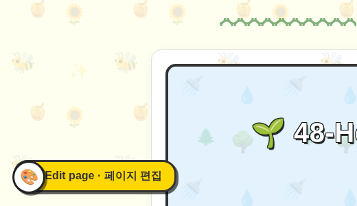
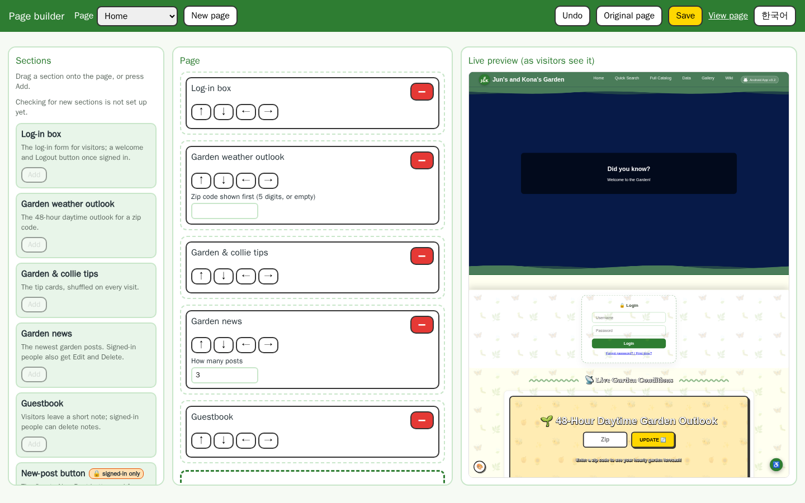
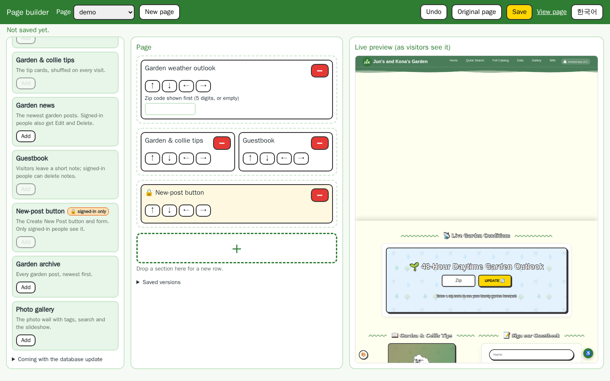
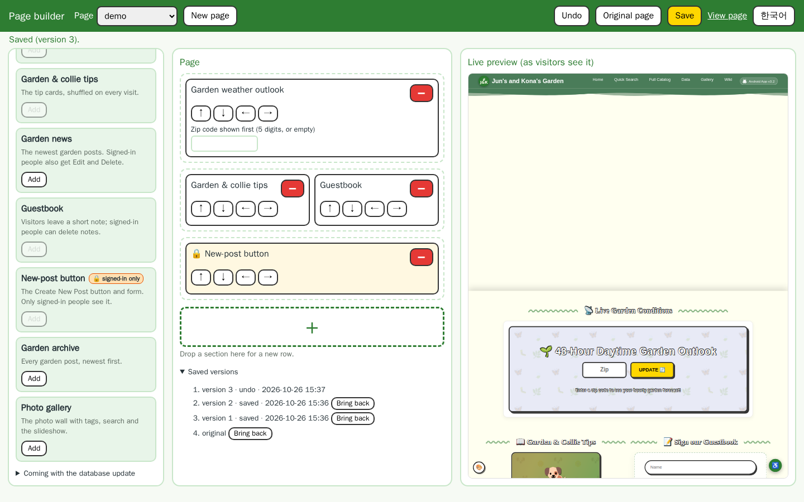
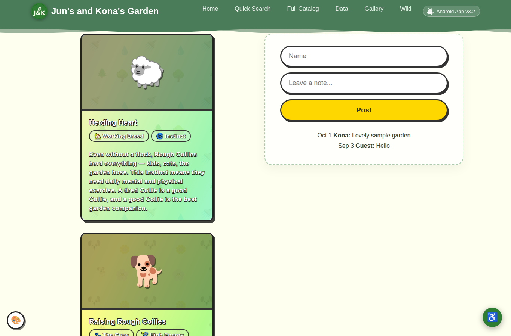
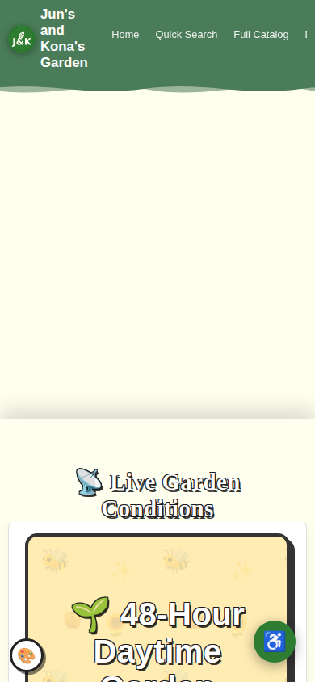
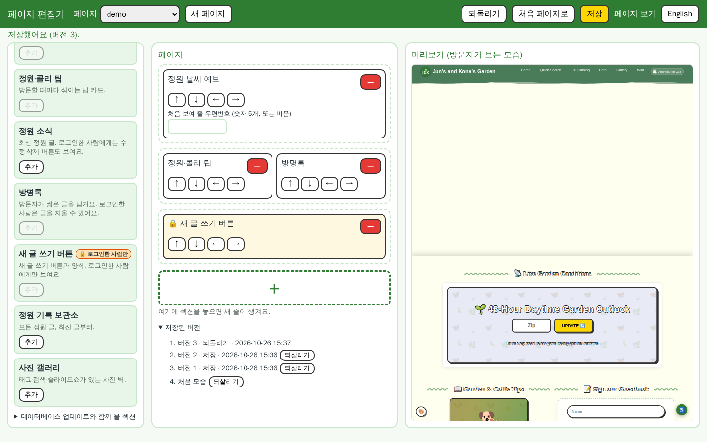

# Page builder: a short guide

[한국어](GUIDE.ko.md)

The page builder lets the garden owner arrange pages out of **sections** (blocks such as the
weather, the tip cards, the news or the guestbook). Nothing changes until you edit: every page
starts exactly as it is today.

**Who can edit.** Only the garden owner can edit: the first name on the garden's user list,
or the name in `JUNSGARDEN_PAGE_OWNER`. You have to be signed in on a computer. Phones and the
app show the pages but cannot edit them.

## 1. Open the editor

Sign in, then go to any page you can edit (Home, Garden archive, Gallery). Press **✏️ Edit
page** in the bottom-left corner. Only you see that button.

## 2. The editor

- **Left: Sections.** Every block you can place. Signed-in-only sections, such as the
  New-post button, are marked 🔒. A section that is already on the page has its **Add**
  button greyed out.
- **Middle: Page.** One box per section, in rows. The arrows **↑ ↓ ← →** move a section,
  and the red **−** takes it off. Some sections have settings, for example how many posts
  Garden news shows.
- **Right: Live preview.** This is the page as a visitor sees it. It updates by itself after
  every change. 🔒 sections show as an orange note there, because visitors never see them.

## 3. Add, move, put side by side

- **Add** (or the big **+**) puts a section in a new row at the bottom.
- **Drag** a section from the left onto a row to put it **next to** what is there, up to 4 in
  a row. You can also drag a box from one row into another.
- **↑ ↓** move a section up or down. A section that shares a row steps out into its own row.
- **← →** swap it with its neighbour in the row.

On a phone, sections that sit side by side are shown one under the other.

## 4. Save, undo, go back

- **Save** keeps the page. Every save is a new **version**, and the old layout is backed up
  first.
- **Undo** goes back to the version before. If you have unsaved changes, Undo drops those
  instead (it asks first).
- **Original page** puts the page back the way it came. That can be undone too.
- **Saved versions** (under the page) lists recent versions, with **Bring back** next to each.

## 5. New pages

Press **New page**, type a short name (`a-z`, `0-9` and `-`, for example `spring`), add
sections and **Save**. The page lives at `page.php?name=spring`. **View page** opens it.

 

## 6. English and Korean

The **한국어 / English** button switches the editor's language. The browser remembers your
choice.

## 7. New sections

When a garden update brings new sections, they show a yellow **new** badge in the list until
you add one or press **OK**. Sections that a later update will bring show greyed out, with
"comes with the next garden update". Nothing is ever placed on a page for you. Sections
for the catalogue, search and the data charts come with the database update.
